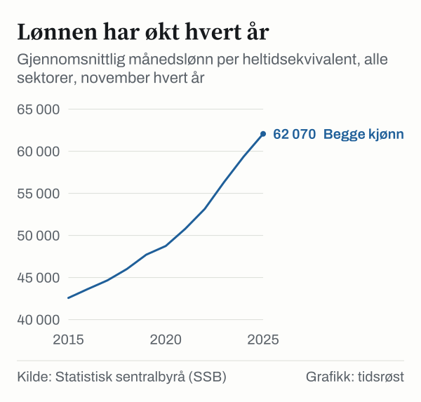
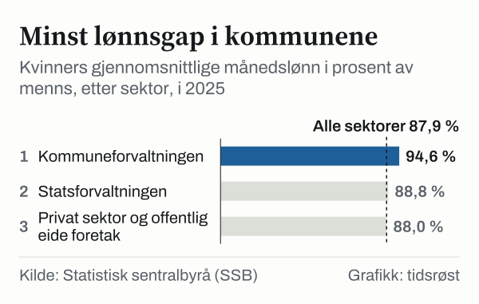

Gjennomsnittlig månedslønn for alle sektorer var 62 070 kroner per heltidsekvivalent i november 2025, opp 4,5 prosent fra 59 370 kroner året før. Det viser lønnsstatistikken fra Statistisk sentralbyrå (SSB), publisert 5. februar 2026. Heltidsekvivalent betyr at deltidslønn er regnet om til det den ville vært i full stilling.

*Gjennomsnittlig månedslønn per heltidsekvivalent, alle sektorer, november 2015–2025. Kilde: SSB, tabell 11418.*

Fra 2015 til 2025 økte gjennomsnittslønnen med 45,8 prosent, fra 42 580 til 62 070 kroner. Ifølge SSB har lønnsveksten avtatt siden toppen i 2023. SSB anslår den foreløpige reallønnsveksten i 2025 til 1,9 prosent: årslønnen økte 5,0 prosent, og konsumprisindeksen 3,1 prosent.

## Kvinner og menn

Menn hadde i 2025 en gjennomsnittlig månedslønn på 65 610 kroner, opp 4,7 prosent. Kvinner hadde 57 690 kroner, opp 4,4 prosent. Kvinners lønn utgjorde dermed 87,9 prosent av menns, mot 88,2 prosent i 2024. I 2015 var andelen 85,3 prosent.

*Kvinners gjennomsnittlige månedslønn i prosent av menns, alle sektorer, 2015–2025. Kilde: SSB, tabell 11418.*

Ifølge SSB økte lønnen mest for jobbene med høyest lønn i 2025. Det bidro til økt lønnsulikhet og et større lønnsgap mellom kvinner og menn.

## Sektorene

Statsforvaltningen hadde høyest gjennomsnittslønn med 66 530 kroner, og kommuneforvaltningen lavest med 55 080 kroner. Forskjellen mellom kvinner og menn var minst i kommuneforvaltningen.

*Kvinners gjennomsnittlige månedslønn i prosent av menns, etter sektor, 2025. Den stiplede linjen viser alle sektorer. Kilde: SSB, tabell 11418.*

| Sektor, 2025 | Kvinner | Menn | Begge kjønn | Kvinners andel av menns lønn |
|---|---:|---:|---:|---:|
| Privat sektor og offentlig eide foretak | 58 020 | 65 950 | 63 310 | 88,0 % |
| Kommuneforvaltningen | 54 260 | 57 360 | 55 080 | 94,6 % |
| Statsforvaltningen | 63 340 | 71 340 | 66 530 | 88,8 % |

*Gjennomsnittlig månedslønn i kroner per heltidsekvivalent. Andelen er beregnet fra SSBs tall. Kilde: SSB, tabell 11418.*

## Gjennomsnitt og median

Gjennomsnittet trekkes opp av de høyeste lønningene. Medianlønnen, som deler jobbene i to like store grupper, var 55 800 kroner i 2025. Medianen var 54 020 kroner for kvinner og 57 830 kroner for menn. Kvinners medianlønn utgjorde 93,4 prosent av menns, så gapet er mindre målt med median enn med gjennomsnitt.

SSB publiserer neste lønnsstatistikk 4. februar 2027.

## Kilder

- [SSB: Lønn – statistikk (publisert 5. februar 2026)](https://www.ssb.no/arbeid-og-lonn/lonn-og-arbeidskraftkostnader/statistikk/lonn)
- [SSB: Høyest lønnsvekst i toppen](https://www.ssb.no/arbeid-og-lonn/lonn-og-arbeidskraftkostnader/statistikk/lonn/artikler/hoyest-lonnsvekst-i-toppen)
- [SSB: Tabell 11418 – Yrkesfordelt månedslønn](https://www.ssb.no/statbank/table/11418)
