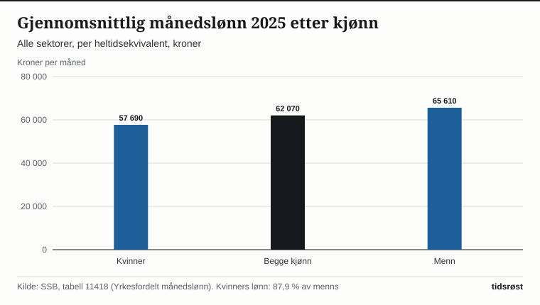

Gjennomsnittlig månedslønn for alle sektorer var 62 070 kroner per heltidsekvivalent i 2025, opp 4,5 prosent fra 59 370 kroner året før. Det viser Statistisk sentralbyrås (SSB) lønnsstatistikk, som ble publisert 5. februar 2026. Referansemåneden er november, og tallene er regnet om til heltidsekvivalenter, slik at deltidslønn er omregnet til hva den ville vært for en full stilling.

## Lønnsutviklingen siden 2015

Fra 2015 til 2025 har gjennomsnittlig månedslønn økt fra 42 580 kroner til 62 070 kroner. Det er en økning på 45,8 prosent over ti år. Den siste femårsperioden, fra 2020 til 2025, viser en økning fra 48 750 kroner til 62 070 kroner.

*Gjennomsnittlig månedslønn, alle sektorer, per heltidsekvivalent, kroner. Kilde: SSB, tabell 11418.*

## Kvinner og menn

Menn hadde i 2025 en gjennomsnittlig månedslønn på 65 610 kroner, opp 4,7 prosent fra 62 680 kroner i 2024. Kvinner hadde 57 690 kroner, opp 4,4 prosent fra 55 280 kroner. Dermed utgjorde kvinners lønn 87,9 prosent av menns lønn i 2025.

*Gjennomsnittlig månedslønn i 2025 etter kjønn, alle sektorer, kroner. Kilde: SSB, tabell 11418.*

Ifølge SSB hadde yrkene med høyest lønn den sterkeste lønnsveksten, og dette bidro til økt lønnsulikhet og et større lønnsgap mellom kvinner og menn.

## Forskjeller mellom sektorer

Lønnsnivået varierer mellom sektorene. Statsforvaltningen hadde høyest gjennomsnittslønn med 66 530 kroner, mens kommuneforvaltningen lå lavest med 55 080 kroner. Forskjellen mellom kvinner og menn var minst i kommuneforvaltningen.

| Sektor, 2025 | Kvinner | Menn | Begge kjønn | Kvinners andel av menns lønn |
|---|---:|---:|---:|---:|
| Privat sektor og offentlige eide foretak | 58 020 | 65 950 | 63 310 | 88,0 % |
| Kommuneforvaltningen | 54 260 | 57 360 | 55 080 | 94,6 % |
| Statsforvaltningen | 63 340 | 71 340 | 66 530 | 88,8 % |

*Gjennomsnittlig månedslønn i kroner per heltidsekvivalent. Andelen er beregnet fra SSBs tall. Kilde: SSB, tabell 11418.*

## Gjennomsnitt og median

Gjennomsnittet trekkes opp av de aller høyeste lønningene. Medianlønnen, som deler lønnstakerne i to like store grupper, var 55 800 kroner for alle sektorer i 2025. Medianen var 54 020 kroner for kvinner og 57 830 kroner for menn, og kvinners medianlønn utgjorde dermed 93,4 % av menns. Målt med gjennomsnitt er gapet altså større enn målt med median.

SSB publiserer neste oppdatering av lønnsstatistikken 4. februar 2027.

## Kilder

- [SSB: Lønn – statistikk og artikler (publisert 5. februar 2026)](https://www.ssb.no/arbeid-og-lonn/lonn-og-arbeidskraftkostnader/statistikk/lonn)
- [SSB: Høyest lønnsvekst i toppen](https://www.ssb.no/arbeid-og-lonn/lonn-og-arbeidskraftkostnader/statistikk/lonn/artikler/hoyest-lonnsvekst-i-toppen)
- [SSB: Tabell 11418 – Yrkesfordelt månedslønn](https://www.ssb.no/statbank/table/11418)
