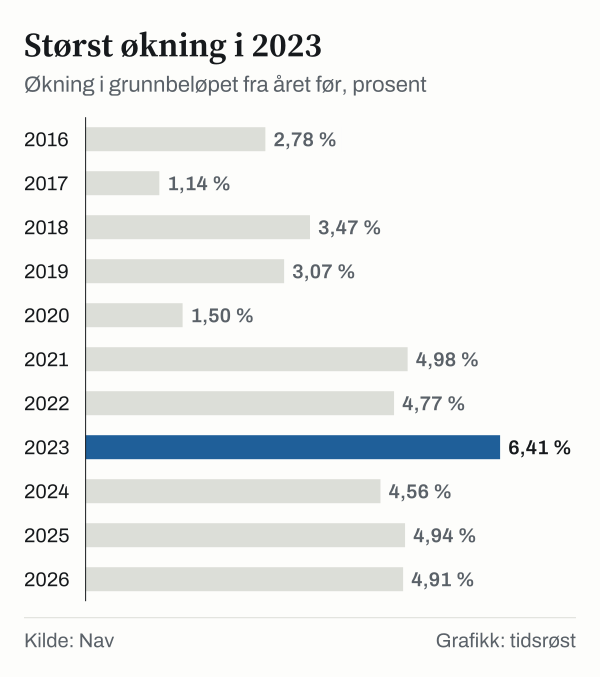
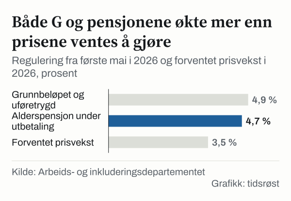

Grunnbeløpet i folketrygden, ofte kalt G, økte 1. mai 2026 med 4,91 prosent, fra 130 160 til 136 549 kroner. Økningen er på 6 389 kroner. Nav bruker grunnbeløpet til å beregne mange av sine utbetalinger, blant annet uføretrygd, arbeidsavklaringspenger og dagpenger.

## Slik fungerer reguleringen

Grunnbeløpet oppdateres 1. mai hvert år etter trygdeoppgjøret. Arbeids- og inkluderingsdepartementet la fram årets trygdeoppgjør 20. mai 2026. Ifølge Nav ble grunnbeløpet formelt vedtatt 22. mai.

Reglene for reguleringen står i lov og forskrift:

- **Grunnbeløpet, uføretrygd og alderspensjon under opptjening** følger lønnsveksten. Det korrigeres for avvik mellom forventet og faktisk lønnsvekst to år tilbake i tid.
- **Alderspensjon under utbetaling, minste pensjonsnivå og garantipensjon** reguleres med et gjennomsnitt av lønns- og prisveksten.

Gjennomsnittlig G for 2026 er 134 419 kroner. Det er lavere enn selve grunnbeløpet fordi det gamle beløpet gjaldt de første fire månedene av året.

## Grunnbeløpet over tid

*Folketrygdens grunnbeløp (G) fra 1. mai hvert år, 2005–2026. Kilde: Nav.*

Siden 2016 har grunnbeløpet økt med 47,5 prosent, fra 92 576 til 136 549 kroner. Den største årlige økningen siden 2005 kom i 2023, med 6,41 prosent.

*Økning i grunnbeløpet fra året før, 2016–2026. Kilde: Nav.*

## Hva de ulike ytelsene får

Alderspensjon under utbetaling økte med 4,69 prosent fra 1. mai. AFP i offentlig sektor reguleres på samme måte. Alderspensjon under opptjening, uføretrygd og andre ytelser som følger G, økte med 4,91 prosent. Departementet regnet med en prisvekst på 3,5 prosent i 2026, og skriver at både pensjonister og trygdede dermed får økt kjøpekraft. Trygdeoppgjøret gjelder om lag 1,5 millioner alderspensjonister og trygdede.

*Regulering fra 1. mai 2026 og forventet prisvekst i 2026. Kilde: Arbeids- og inkluderingsdepartementet.*

## Minste pensjonsnivå og uføretrygd

Pensjonister med lav eller ingen opptjening får minst et fastsatt beløp. Alle satser for minste pensjonsnivå og garantipensjon økte med 4,69 prosent.

| Minste pensjonsnivå, årlig | Kroner |
|---|---:|
| Lav sats (ektefellen har pensjon) | 209 531 |
| Ordinær sats | 242 509 |
| Høy sats (ektefellen har inntekt under 2 G) | 255 191 |
| Særskilt sats, enslig pensjonist | 293 062 |
| Særskilt sats, ektepar | 397 215 |

*Kilde: Arbeids- og inkluderingsdepartementet, trygdeoppgjøret 2026.*

En enslig minstepensjonist født i 1953 med full trygdetid får ifølge departementet årlig pensjon økt fra 279 933 til 293 062 kroner, altså 13 129 kroner mer. Garantipensjonen er 234 765 kroner med ordinær sats og 253 787 kroner med høy sats.

For uføretrygd er minste årlige ytelse 318 023 kroner (2,329 G) med ordinær sats og 345 332 kroner (2,529 G) med høy sats for enslige. For unge uføre er satsene 369 911 og 404 048 kroner.

## Utbetalingen

Ifølge Nav ble økningen for mai utbetalt sammen med den månedlige utbetalingen 19. juni for blant annet alderspensjon og uføretrygd. For arbeidsavklaringspenger kom den som egen utbetaling i starten av juni, eller sammen med etterbetalingen for meldekortet.

## Kilder

- [Nav: Grunnbeløpet i folketrygden](https://www.nav.no/grunnbelopet)
- [Nav: Regulering av grunnbeløpet og pengestøtter fra 1. mai 2026](https://www.nav.no/regulering-2026)
- [Arbeids- og inkluderingsdepartementet: Trygdeoppgjøret er klart (20. mai 2026)](https://www.regjeringen.no/no/aktuelt/trygdeoppgjoret-er-klart-okt-kjopekraft-for-pensjonister-og-trygdede/id3160284/)
