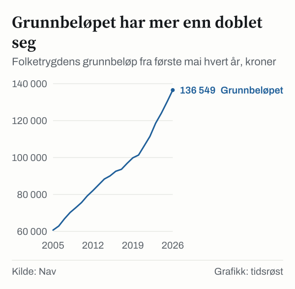

Grunnbeløpet i folketrygden, ofte kalt G, ble 1. mai 2026 økt med 4,91 prosent, fra 130 160 til 136 549 kroner. Økningen er på 6 389 kroner. Grunnbeløpet er et tall som brukes til å beregne mange av Navs utbetalinger.

## Slik fastsettes grunnbeløpet

Grunnbeløpet oppdateres 1. mai hvert år og bestemmes av Stortinget etter trygdeoppgjøret. Arbeids- og inkluderingsdepartementet kunngjorde årets trygdeoppgjør 20. mai 2026, og Nav oppgir at grunnbeløpet formelt ble vedtatt 22. mai 2026. Gjennomsnittlig G for 2026 er 134 419 kroner, fordi beløpet er lavere i årets første måneder før reguleringen.

*Folketrygdens grunnbeløp (G) fra 1. mai hvert år, kroner. Kilde: Nav.*

Siden 2016 har grunnbeløpet økt fra 92 576 til 136 549 kroner, altså med 47,5 prosent. Den prosentvise økningen var 6,41 prosent i 2023, 4,56 prosent i 2024 og 4,94 prosent i 2025.

## Ulik regulering for ulike ytelser

Ikke alle ytelser reguleres likt. Regjeringen oppgir at alderspensjoner under utbetaling økte med 4,69 prosent fra 1. mai 2026. Alderspensjon under opptjening, uføretrygd og andre ytelser som reguleres gjennom G økte med 4,91 prosent. Avtalefestet pensjon (AFP) i offentlig sektor reguleres på samme måte som alderspensjon under utbetaling.

Regjeringen oppgir en forventet prisvekst på 3,5 prosent. Trygdeoppgjøret gjelder om lag 1,5 millioner alderspensjonister og trygdede, ifølge regjeringen.

| Ytelse | Regulering 1. mai 2026 |
|---|---:|
| Grunnbeløpet (G) | 4,91 % |
| Alderspensjon under opptjening | 4,91 % |
| Uføretrygd | 4,91 % |
| Alderspensjon under utbetaling | 4,69 % |

*Kilde: Nav og regjeringen.no.*

## Minste pensjonsnivå og uføretrygd

Pensjonister med lav eller ingen opptjent tilleggspensjon får en minste årlige ytelse. Satsene ble også justert 1. mai 2026.

| Minste pensjonsnivå, årlig | Kroner |
|---|---:|
| Lav sats (ektefellen har pensjon) | 209 531 |
| Ordinær sats | 242 509 |
| Høy sats (ektefellen har inntekt under 2 G) | 255 191 |
| Særskilt sats, enslig pensjonist | 293 062 |
| Særskilt sats, ektepar | 397 215 |

*Kilde: regjeringen.no, trygdeoppgjøret 2026.*

En enslig minstepensjonist født i 1953 med full trygdetid får ifølge regjeringen årlig pensjon økt fra 279 933 til 293 062 kroner, altså 13 129 kroner. For uføretrygd er minste årlige ytelse med ordinær sats 318 023 kroner (2,329 G), og for unge uføre 369 911 kroner (2,709 G).

## Når kommer økningen?

Ifølge Nav kommer økningen for alderspensjon og uføretrygd fra 1. mai med den månedlige utbetalingen 19. juni. Arbeidsavklaringspenger får en egen utbetaling tidlig i juni.

## Kilder

- [Nav: Grunnbeløpet i folketrygden](https://www.nav.no/grunnbelopet)
- [Nav: Regulering 2026](https://www.nav.no/regulering-2026)
- [Regjeringen.no: Trygdeoppgjøret er klart – økt kjøpekraft for pensjonister og trygdede (20. mai 2026)](https://www.regjeringen.no/no/aktuelt/trygdeoppgjoret-er-klart-okt-kjopekraft-for-pensjonister-og-trygdede/id3160284/)
