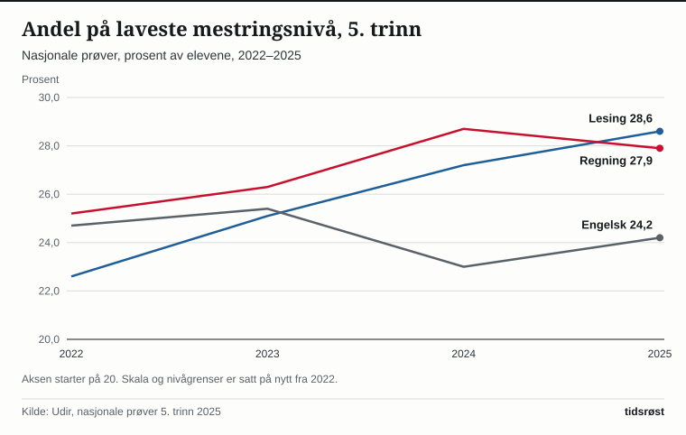

Avgangselevene i skoleåret 2025–26 fikk i snitt 42,4 grunnskolepoeng, 0,2 poeng mer enn kullet året før, viser Utdanningsdirektoratet (Udir) i en analyse sist oppdatert 25. august 2026. Resultatene fra nasjonale prøver i denne artikkelen gjelder høsten 2025. På 5. trinn presterte da 28,6 prosent av elevene på laveste mestringsnivå i lesing, mot 22,6 prosent i 2022, ifølge Udir (sist oppdatert 13. november 2025).

## Grunnskolepoeng: små endringer siste år

Grunnskolepoeng regnes ut fra alle standpunkt- og eksamenskarakterer på vitnemålet, og brukes som grunnlag for opptak til videregående skole. Jentene fikk i snitt 44,3 poeng og guttene 40,5, en forskjell på 3,8 poeng, som i fjor. Siste ti år har guttenes snitt økt med 1,3 poeng og jentenes med 0,6. Årets kull har ett poeng mer enn kullet som gikk ut i 2017. Elevene i Oslo har høyest snitt med 44,5 poeng, elevene i Vestfold lavest med 41,1.

*Gjennomsnittlige grunnskolepoeng, alle elever, jenter og gutter. Kilde: Udir, analysen «Karakterer på 10. trinn 2025–2026».*

Tallene for 2019–20 til 2021–22 bygger bare på standpunktkarakterer, fordi alle eksamener i grunnskolen ble avlyst under koronapandemien. De er derfor ikke sammenlignbare med årene før og etter, opplyser Udir.

## 5. trinn: flere på laveste nivå i lesing

Nasjonale prøver gis i lesing, regning og engelsk. Resultatene vises på en skala der landsgjennomsnittet i 2022 er satt til 50 skalapoeng, og elevene fordeles på tre mestringsnivåer på 5. trinn. Høsten 2025 tok rundt 57 000 elever prøvene. Deltakelsen var 92 prosent i lesing og 93 prosent i regning og engelsk.

| Skalapoeng, 5. trinn | 2022 | 2023 | 2024 | 2025 | Endring 2022–2025 |
|---|---:|---:|---:|---:|---:|
| Lesing | 50,0 | 49,5 | 49,1 | 48,7 | −1,3 |
| Regning | 50,0 | 49,7 | 49,4 | 49,5 | −0,5 |
| Engelsk | 50,0 | 50,2 | 50,7 | 50,3 | +0,3 |

*Kilde: Udir, nasjonale prøver 5. trinn 2025. Endring er regnet ut fra tallene i tabellen.*

I lesing har andelen på laveste nivå økt med 6,0 prosentpoeng siden 2022, til 28,6 prosent, noe Udir anslår tilsvarer 3 400 flere elever. Andelen på høyeste nivå gikk samtidig ned fra 28,7 til 24,8 prosent. I regning var andelen på laveste nivå 27,9 prosent i 2025, ned fra 28,7 året før. I engelsk var den 24,2 prosent.

*Andel elever på laveste mestringsnivå, 5. trinn. Kilde: Udir, nasjonale prøver 5. trinn 2025.*

Det er store fylkesforskjeller. Andelen på laveste nivå i lesing varierer fra 20,7 prosent i Oslo til 34,8 prosent i Møre og Romsdal.

## 8. og 9. trinn: engelsk går fram, lesing og regning tilbake

På 8. trinn er det fem mestringsnivåer. Høsten 2025 tok 61 000 elever prøvene, og 94 prosent deltok. Skalapoengene var 48,7 i lesing, 48,7 i regning og 51,1 i engelsk.

| Andel på de to laveste nivåene, 8. trinn | 2022 | 2025 | Endring (prosentpoeng) |
|---|---:|---:|---:|
| Lesing | 29,6 | 34,6 | +5,0 |
| Regning | 28,8 | 34,1 | +5,3 |
| Engelsk | 29,0 | 24,9 | −4,1 |

*Kilde: Udir, nasjonale prøver 8. og 9. trinn 2025. Andelene er summen av nivå 1 og 2, regnet ut fra Udirs tall.*

Andelen på laveste nivå i lesing varierer fra 7,1 prosent i Oslo til 16,8 prosent i Finnmark. På 9. trinn, som tar de samme prøvene i lesing og regning, var snittet 52,6 skalapoeng i lesing og 52,7 i regning, om lag 4 poeng over 8. trinn. Andelen på høyeste nivå i lesing var 18,1 prosent på 9. trinn og 7,8 prosent på 8. trinn. Prøvene er laget etter kompetansemålene for 7. trinn, og måler ikke hele bredden av ferdighetene på 9. trinn, påpeker Udir.

## Kjønnsforskjeller

| Skalapoeng 2025 | 5. trinn jenter | 5. trinn gutter | 8. trinn jenter | 8. trinn gutter |
|---|---:|---:|---:|---:|
| Lesing | 49,6 | 47,9 | 49,9 | 47,6 |
| Regning | 47,9 | 51,0 | 47,0 | 50,4 |
| Engelsk | 49,8 | 50,8 | 51,0 | 51,2 |

*Kilde: Udir, nasjonale prøver 5. trinn og 8. og 9. trinn 2025.*

På 5. trinn var 33,0 prosent av jentene og 22,9 prosent av guttene på laveste nivå i regning. I lesing var det omvendt: 25,1 prosent av jentene og 32,1 prosent av guttene. På 8. trinn var 40,5 prosent av jentene på de to laveste nivåene i regning, mot 28,0 prosent av guttene. I lesing var tallene 29,5 prosent for jentene og 39,7 prosent for guttene.

I grunnskolepoeng ligger jentene foran, men i skriftlig eksamen i matematikk i 2025–26 fikk guttene for første gang siden innføringen av Kunnskapsløftet (LK06) høyere snittkarakter enn jentene, 3,5 mot 3,4.

## Hva tallene måler

Fra 2022 startet Udir målingen av utvikling over tid på nytt, med ny skala og nye grenser mellom mestringsnivåene. Resultater fra 2015 til 2021 er avpublisert, og sammenligningene i denne artikkelen går derfor bare tilbake til 2022. Grunnskolepoeng bygger derimot på standpunkt- og eksamenskarakterer.

## Kilder

- [Udir: Karakterer på 10. trinn 2025–2026 (sist endret 25. august 2026)](https://www.udir.no/tall-og-forskning/statistikk/statistikk-grunnskole/analyser/2026/karakterer-pa-10.-trinn-20252026/)
- [Udir: Resultater fra nasjonale prøver for 5. trinn 2025 (sist endret 13. november 2025)](https://www.udir.no/tall-og-forskning/statistikk/statistikk-grunnskole/analyser/2025/resultater-fra-nasjonale-prover-for-5-trinn-2025/)
- [Udir: Resultater fra nasjonale prøver for ungdomstrinnet 2025 (sist endret 13. november 2025)](https://www.udir.no/tall-og-forskning/statistikk/statistikk-grunnskole/analyser/2025/resultater-fra-nasjonale-prover-for-ungdomstrinnet-2025/)
- [Udir: Statistikk om grunnskolepoeng](https://www.udir.no/tall-og-forskning/statistikk/statistikk-grunnskole/grunnskolepoeng/)
