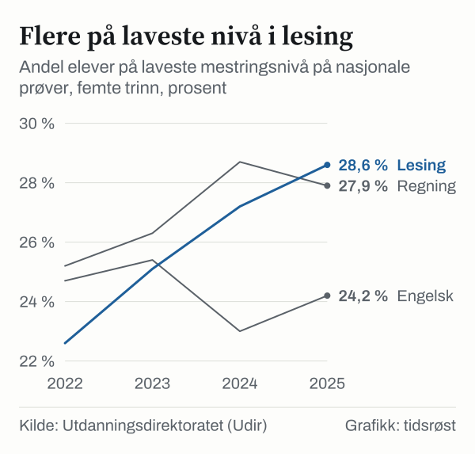
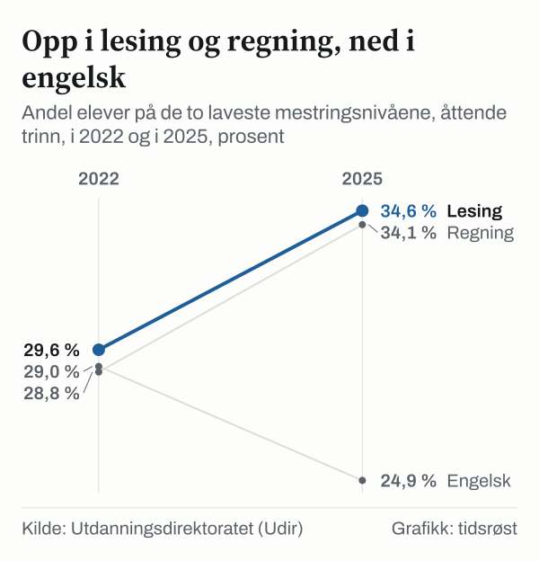

Avgangselevene i skoleåret 2025–26 fikk i snitt 42,4 grunnskolepoeng, 0,2 poeng mer enn kullet året før, viser Utdanningsdirektoratet (Udir) i en analyse oppdatert 25. august 2026. På nasjonale prøver høsten 2025 presterte 28,6 prosent av elevene på 5. trinn på laveste mestringsnivå i lesing, mot 22,6 prosent i 2022.

## Grunnskolepoeng

Grunnskolepoeng er snittet av alle standpunkt- og eksamenskarakterer på vitnemålet, ganget med ti, og brukes ved opptak til videregående skole. Jentene fikk i snitt 44,3 poeng og guttene 40,5, en forskjell på 3,8 poeng, som året før. De siste ti årene har guttenes snitt økt med 1,3 poeng og jentenes med 0,6.

*Gjennomsnittlige grunnskolepoeng etter avgangsår (2017 = skoleåret 2016–17). Kilde: Udir, «Karakterer på 10. trinn 2025–2026».*

I skoleårene 2019–20 til 2021–22 ble eksamenene avlyst på grunn av koronapandemien. Grunnskolepoengene for de årene bygger bare på standpunktkarakterer og er ikke sammenlignbare med årene før og etter, opplyser Udir.

Elevene i Oslo hadde høyest snitt, 44,5 poeng, og elevene i Vestfold lavest, 41,1. På skriftlig eksamen i matematikk fikk guttene for første gang siden Kunnskapsløftet (LK06) høyere snittkarakter enn jentene, 3,5 mot 3,4.

## Nasjonale prøver på 5. trinn

Nasjonale prøver gis i lesing, regning og engelsk. Skalaen er satt slik at landsgjennomsnittet i 2022 er 50 skalapoeng. På 5. trinn er det tre mestringsnivåer. Høsten 2025 tok rundt 57 000 elever prøvene. 92 prosent deltok i lesing og 93 prosent i regning og engelsk.

| Skalapoeng, 5. trinn | 2022 | 2023 | 2024 | 2025 |
|---|---:|---:|---:|---:|
| Lesing | 50,0 | 49,5 | 49,1 | 48,7 |
| Regning | 50,0 | 49,7 | 49,4 | 49,5 |
| Engelsk | 50,0 | 50,2 | 50,7 | 50,3 |

*Kilde: Udir, nasjonale prøver 5. trinn 2025.*

Andelen på laveste nivå i lesing økte med 6,0 prosentpoeng fra 2022, til 28,6 prosent. Ifølge Udir tilsvarer det 3 400 flere elever. Andelen på høyeste nivå gikk ned fra 28,7 til 24,8 prosent. I regning var andelen på laveste nivå 27,9 prosent, ned fra 28,7 året før, og i engelsk 24,2 prosent.

*Andel elever på laveste mestringsnivå, 5. trinn, 2022–2025. Kilde: Udir, nasjonale prøver 5. trinn 2025.*

Guttene presterer i snitt 3,1 skalapoeng høyere enn jentene i regning og 1 poeng høyere i engelsk. Jentene presterer 1,7 poeng høyere i lesing. På laveste nivå i regning var 33 prosent av jentene og 23 prosent av guttene. I lesing var det omvendt: 25,1 prosent av jentene og 32,1 prosent av guttene.

## 8. og 9. trinn

På ungdomstrinnet er det fem mestringsnivåer, og 94 prosent av elevene på 8. trinn deltok. Andelen på de to laveste nivåene har økt i lesing og regning siden 2022 og gått ned i engelsk.

*Andel elever på mestringsnivå 1 og 2, 8. trinn, 2022 og 2025. Kilde: Udir, nasjonale prøver for ungdomstrinnet 2025.*

| Andel på de to laveste nivåene, 8. trinn | 2022 | 2025 |
|---|---:|---:|
| Lesing | 29,6 % | 34,6 % |
| Regning | 28,8 % | 34,1 % |
| Engelsk | 29,0 % | 24,9 % |

*Kilde: Udir. Summen av mestringsnivå 1 og 2.*

På 8. trinn var 40,5 prosent av jentene og 28,0 prosent av guttene på de to laveste nivåene i regning. I lesing var tallene 29,5 prosent for jentene og 39,7 prosent for guttene.

9. trinn tar de samme prøvene i lesing og regning. Snittet var 52,6 skalapoeng i lesing og 52,7 i regning. I lesing var 18,1 prosent av elevene på 9. trinn på høyeste nivå, mot 7,8 prosent på 8. trinn. Udir påpeker at prøvene er laget etter kompetansemålene for 7. trinn, og at de ikke måler hele bredden av ferdighetene på 9. trinn.

## Kilder

- [Udir: Karakterer på 10. trinn 2025–2026 (sist endret 25. august 2026)](https://www.udir.no/tall-og-forskning/statistikk/statistikk-grunnskole/analyser/2026/karakterer-pa-10.-trinn-20252026/)
- [Udir: Resultater fra nasjonale prøver for 5. trinn 2025](https://www.udir.no/tall-og-forskning/statistikk/statistikk-grunnskole/analyser/2025/resultater-fra-nasjonale-prover-for-5-trinn-2025/)
- [Udir: Resultater fra nasjonale prøver for ungdomstrinnet 2025](https://www.udir.no/tall-og-forskning/statistikk/statistikk-grunnskole/analyser/2025/resultater-fra-nasjonale-prover-for-ungdomstrinnet-2025/)
- [Udir: Statistikk om grunnskolepoeng](https://www.udir.no/tall-og-forskning/statistikk/statistikk-grunnskole/grunnskolepoeng/)
