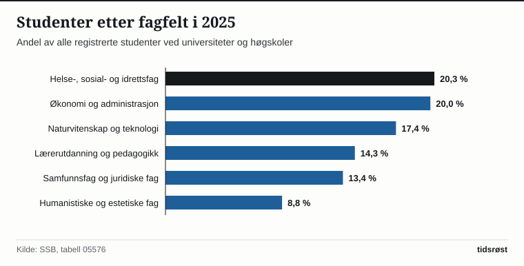

Høsten 2025 var 311 148 studenter registrert ved universiteter og høgskoler i Norge, viser utdanningsstatistikken fra Statistisk sentralbyrå (SSB). Det er 9 269 flere enn høsten 2024, da tallet var 301 879, og den største økningen fra ett år til det neste siden 2021.

## Hvor økningen kom

Alle de seks største lærestedene hadde flere studenter høsten 2025 enn året før. Handelshøyskolen BI hadde den største økningen, med 1 130 flere studenter, fulgt av Universitetet i Sørøst-Norge (USN) med 1 086 og OsloMet – storbyuniversitetet med 937.

Norges teknisk-naturvitenskapelige universitet (NTNU) er fortsatt landets største lærested, med 42 873 registrerte studenter, 265 flere enn året før. Deretter følger Universitetet i Oslo (UiO), OsloMet og BI.

*Registrerte studenter høsten 2025 og endring fra høsten 2024. NTNU: Norges teknisk-naturvitenskapelige universitet, UiO: Universitetet i Oslo, BI: Handelshøyskolen BI, UiB: Universitetet i Bergen, USN: Universitetet i Sørøst-Norge. Kilde: SSB, tabell 09168.*

## Hva studentene studerer

Helse-, sosial- og idrettsfag er det største fagfeltet, med 20,3 prosent av studentene i 2025. Økonomiske og administrative fag følger tett etter med 20,0 prosent, og naturvitenskapelige fag, håndverksfag og tekniske fag har 17,4 prosent.

*Andel av alle registrerte studenter etter fagfelt, 2025. Øvrige fagfelt er primærnæringsfag, samferdsels- og sikkerhetsfag og andre servicefag, allmenne fag og uoppgitt fagfelt. Kilde: SSB, tabell 05576.*

## Studenttallet over tid

Høsten 2013 var 253 317 studenter registrert. Fram til 2025 økte tallet med 22,8 prosent. Økningen var særlig stor i 2020 og 2021: Fra høsten 2020 til høsten 2021 kom det 12 051 flere studenter. Høsten 2022 gikk tallet ned for første gang i perioden, før det steg igjen de tre neste årene.

*Registrerte studenter ved universiteter og høgskoler i Norge hver høst, 2013–2025. Kilde: SSB, tabell 10821.*

Utdanningsnivået i befolkningen har økt i samme retning. I 2025 hadde 38,3 prosent av alle bosatte i Norge over 16 år fullført universitets- eller høgskoleutdanning, 25,3 prosent kort og 13,0 prosent lang. I 2010 var andelen 28,4 prosent.

## Søkingen i 2026

Tallene for høsten 2026 er ikke klare ennå. Ifølge Kunnskapsdepartementet søkte 150 856 personer om studieplass via Samordna opptak i 2026, nesten 9 000 flere enn året før, og det var lyst ut 65 573 studieplasser fordelt på 1 395 studier. Ved hovedopptaket i juli hadde 117 099 søkere fått tilbud om studieplass, 4 prosent flere enn i fjor.

## Hva tallene ikke viser

Statistikken teller studenter som er registrert ved et norsk universitet eller en norsk høgskole. I tillegg kommer om lag 12 400 norske studenter som tar utdanning på universitets- og høgskolenivå i utlandet. Studenter i høyere yrkesfaglig utdanning (fagskole) er heller ikke med: SSB registrerte 33 400 fagskolestudenter i 2025, mot 31 900 i 2024.

Et tilbud om studieplass er ikke det samme som en registrert student. Søkertallene fra Samordna opptak viser derfor ikke hvor mange som faktisk begynner å studere.

## Kilder

- [SSB: Studenter i universitets- og høgskoleutdanning](https://www.ssb.no/utdanning/statistikker/utuvh)
- [SSB Statistikkbanken: Tabell 10821 – Studenter i høyere utdanning i Norge, etter kjønn og skoleslag](https://www.ssb.no/statbank/table/10821)
- [SSB Statistikkbanken: Tabell 09168 – Studenter i høyere utdanning i Norge, etter lærested](https://www.ssb.no/statbank/table/09168)
- [SSB Statistikkbanken: Tabell 05576 – Studenter i høyere utdanning i Norge, etter fagfelt](https://www.ssb.no/statbank/table/05576)
- [SSB Statistikkbanken: Tabell 09429 – Befolkningens utdanningsnivå](https://www.ssb.no/statbank/table/09429)
- [Regjeringen: Søkingen til høyere utdanning 2026](https://www.regjeringen.no/no/aktuelt/kraftig-okning-i-sokingen-til-hoyere-utdanning/id3157089/)
- [Regjeringen: Tilbud om studieplass i hovedopptaket 2026](https://www.regjeringen.no/no/aktuelt/historisk-mange-far-tilbud-om-hoyere-utdanning/id3169262/)
