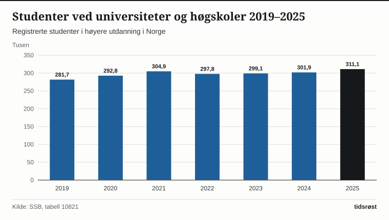

Over 307 000 personer studerer ved norske universiteter og høgskoler, viser utdanningsstatistikken fra Statistisk sentralbyrå (SSB) og Direktoratet for høyere utdanning og kompetanse (HK-dir). I tillegg kommer rundt 13 000 norske gradsstudenter ved læresteder i utlandet og over 31 000 studenter på høyere yrkesfaglig utdanning (fagskoler).

Det høye studenttallet har løftet utdanningsnivået i befolkningen jevnt gjennom flere tiår: I dag har 38,2 prosent av alle bosatte i Norge over 16 år fullført en høyere utdanning, opp fra 28,4 prosent i 2010.

## Gratisprinsippet og fleksible utdanningstilbud

Et bærende trekk ved det norske utdanningssystemet er at studier ved statlige universiteter og høgskoler er gratis for norske borgere, EØS-borgere og personer med oppholdstillatelse i Norge som gir rett til utdanningsstøtte. Rundt 86 prosent av alle studenter i Norge går ved offentlige læresteder.

De siste årene har Kunnskapsdepartementet og lærestedene også trappet opp tilbudet av fleksible og desentraliserte utdanninger, slik at yrkesaktive og innbyggere i distriktene kan ta blant annet sykepleier-, lærer- og ingeniørutdanning nær der de bor.

*Registrerte studenter ved norske universiteter og høgskoler (tusen), 2019–2025. Kilde: SSB, tabell 09174.*

## De største universitetene og fagfeltene

Norges teknisk-naturvitenskapelige universitet (NTNU) er landets klart største lærested med over 43 000 registrerte studenter i Trondheim, Gjøvik og Ålesund, fulgt av Universitetet i Oslo (UiO), OsloMet – storbyuniversitetet, Universitetet i Bergen (UiB) og Universitetet i Sørøst-Norge (USN).

| Lærested | Registrerte studenter (ca.) | Hovedcampuser |
|---|---:|---|
| NTNU | 43 400 | Trondheim, Gjøvik, Ålesund |
| Universitetet i Oslo (UiO) | 26 800 | Oslo |
| OsloMet – storbyuniversitetet | 22 300 | Oslo, Kjeller |
| Universitetet i Bergen (UiB) | 19 600 | Bergen |
| Universitetet i Sørøst-Norge (USN) | 17 800 | Drammen, Vestfold, Kongsberg, Bø, Porsgrunn |
| UiT Norges arktiske universitet | 16 900 | Tromsø, Alta, Narvik, Harstad |

*Kilde: HK-dir, Database for statistikk om høyere utdanning (DBH).*

Målt etter fagfelt samler økonomiske og administrative fag 21,8 prosent av studentene, mens helse-, sosial- og idrettsfag utgjør 19,6 prosent og naturvitenskapelige, håndverksmessige og tekniske fag står for 17,4 prosent.

*Andel studenter etter fagfelt ved norske universiteter og høgskoler, 2025. Kilde: SSB og HK-dir (DBH).*

## Sterk søkning til helsefag og teknologi i 2026

Tallene fra Samordna opptak for studieåret 2026/2027 viser at over 142 000 søkere konkurrerte om studieplassene ved universiteter og høgskoler. Etter at opptakskravene ble gjort mer fleksible for en rekke profesjonsutdanninger, økte søkningen til blant annet sykepleierutdanningen markant, slik at helsetjenesten og kommunene sikres flere ferdigutdannede fagfolk i årene fremover.

Samtidig vokser fagskolene raskt: Over 31 000 studenter tar nå høyere yrkesfaglig utdanning innen tekniske fag, helse og maritim sektor – en praktisk utdanningsvei som regjeringen har styrket med nye studieplasser i de siste statsbudsjettene.

## Kilder

- [SSB: Studenter i høyere utdanning](https://www.ssb.no/utdanning/hoyere-utdanning/statistikk/studenter-i-hoyere-utdanning)
- [SSB Statistikkbanken: Tabell 09174 – Studenter i høyere utdanning i Norge og i utlandet](https://www.ssb.no/statbank/table/09174)
- [SSB: Befolkningens utdanningsnivå](https://www.ssb.no/utdanning/utdanningsniva/statistikk/befolkningens-utdanningsniva)
- [HK-dir: Database for statistikk om høyere utdanning (DBH)](https://dbh.hkdir.no/)
- [Samordna opptak: Søker- og opptaksstatistikk](https://www.samordnaopptak.no/info/om/sokertall/)
