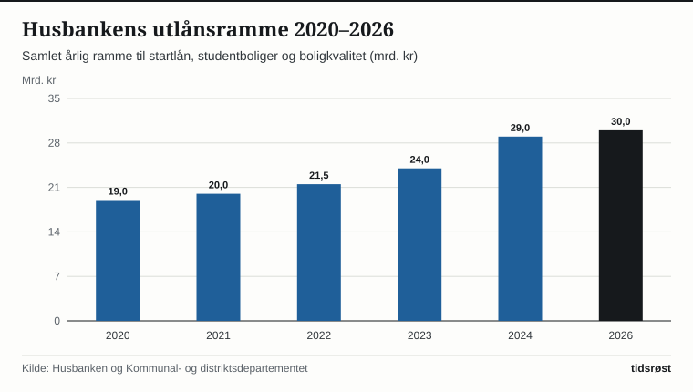
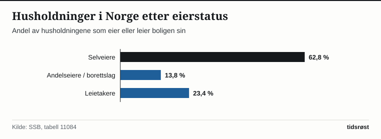

Eierlinjen har vært et bærende prinsipp i norsk boligpolitikk siden etterkrigstiden. Ifølge boforholdsstatistikken fra Statistisk sentralbyrå (SSB) eier 76,6 prosent av norske husholdninger sin egen bolig, og regnes antall personer i stedet for husholdninger, bor over 81 prosent av befolkningen i en bolig familien selv eier.

For å sikre at flest mulig kan komme inn på boligmarkedet og bo trygt i alle deler av landet, har regjeringen og Stortinget løftet Husbankens utlånsramme fra 19 milliarder kroner i 2020 til rundt 30 milliarder kroner i 2026.

## Startlån hjelper barnefamilier inn i egen bolig

Husbankens største enkeltvirkemiddel er startlånet, som formidles i samarbeid med landets 357 kommuner. Ordningen er rettet mot barnefamilier, eldre, personer med nedsatt funksjonsevne og andre som har fast inntekt til å betjene et boliglån over tid, men som ikke får ordinært lån i privatbank fordi de mangler oppspart egenkapital.

*Husbankens årlige utlånsramme i milliarder kroner, 2020–2026. Kilde: Husbanken og Kommunal- og distriktsdepartementet.*

Hvert år får over 7 500 husstander innvilget startlån til boligkjøp eller nødvendig utbedring av boligen, og mer enn halvparten av lånene går til barnefamilier, slik at barna sikres en stabil oppvekst i nærmiljøet sitt.

## Eierformer og Husbankens viktigste ordninger

Tabellen viser hvordan Husbankens utlån og tilskudd støtter opp under boligforsyningen i hele landet:

| Virkemiddel i Husbanken | Målgruppe | Hovedformål |
|---|---|---|
| Startlån (via kommunene) | Barnefamilier og langsiktig vanskeligstilte | Kjøp av egen bolig uten krav om ordinær egenkapital |
| Lån og tilskudd til studentboliger | Studentsamskipnader og stiftelser | Bygging av tusenvis av rimelige studentboliger |
| Lån til boligkvalitet og utleieboliger | Kommuner og utbyggere i distriktene | Eldreboliger, trygdeboliger og miljøvennlige bygg |
| Bostøtte | Husstander med lave inntekter og høye boutgifter | Månedlig økonomisk støtte til strøm, husleie eller boliglån |

*Kilde: Husbanken og Kommunal- og distriktsdepartementet.*

I tillegg mottar over 120 000 husstander i Norge statlig bostøtte i løpet av året, en rettighetsbasert ordning som utbetales månedlig av Husbanken og kommunene for å holde bo- og strømutgiftene håndterbare.

*Fordeling av husholdninger i Norge etter eierstatus. Kilde: SSB, tabell 11084.*

## Satsing på studentboliger og boligbygging i distriktene

Gjennom tilskudd og gunstige lån fra Husbanken finansierer staten hvert år bygging av mellom 1 500 og 2 000 nye studentboliger hos studentsamskipnadene, slik at dekningsgraden for studentboliger på landsbasis har økt jevnt.

Samtidig har regjeringen utvidet bruken av Husbankens lån til boligkvalitet i distriktskommuner, noe som gjør det enklere å finansiere nye helårsboliger og eldrevennlige leiligheter i mindre lokalsamfunn der tomte- og byggekostnadene ellers kan overstige markedsverdien ved ferdigstillelse.

## Kilder

- [SSB: Boforhold, registerbasert statistikk over eierstatus og boligtyper](https://www.ssb.no/bygg-bolig-og-eiendom/bolig-og-boforhold/statistikk/boforhold-registerbasert)
- [SSB Statistikkbanken: Tabell 11084 – Husholdninger etter eierstatus](https://www.ssb.no/statbank/table/11084)
- [Husbanken: Årsrapporter, statistikk og nøkkeltall for lån og tilskudd](https://www.husbanken.no/om-husbanken/statistikk/)
- [Kommunal- og distriktsdepartementet: Meld. St. 13 (2023–2024) Bustadmeldinga – Ein heilskapleg og aktiv bustadpolitikk for heile landet](https://www.regjeringen.no/no/dokumenter/meld.-st.-13-20232024/id3030675/)
