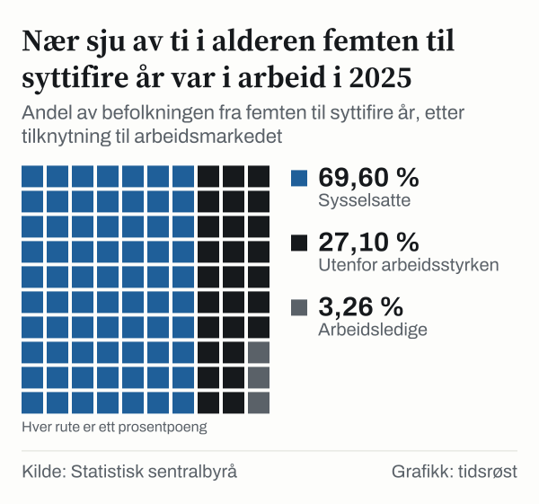
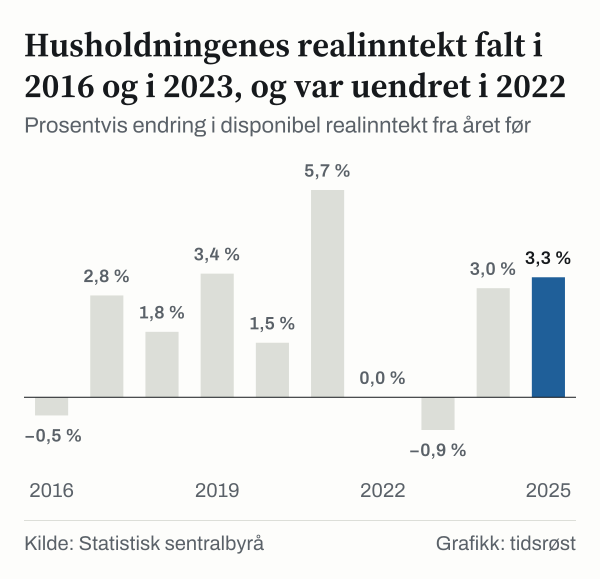
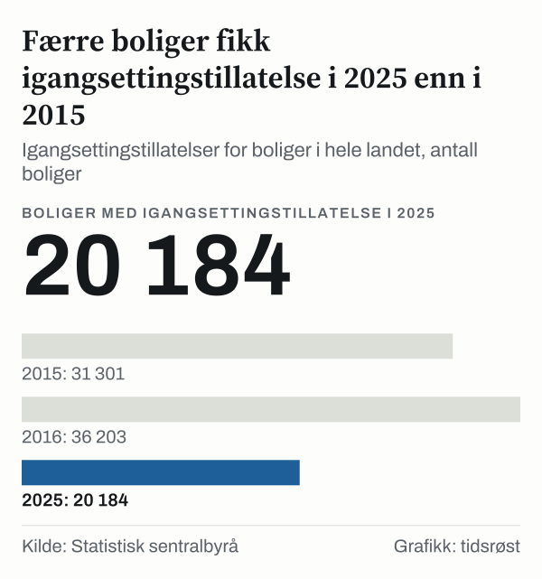

I 2015 var ledigheten 4,5 prosent. I 2025 var den også 4,5 prosent. Men antallet boliger som fikk igangsettingstillatelse falt fra 31 301 i 2015 til 20 184 i 2025, en nedgang på 35,5 prosent.

De to tallene er et utgangspunkt for å se hvordan husholdningenes økonomi ser ut i to ulike år. Noe står nesten stille, og noe har flyttet seg mye. Vi har tatt de samme målene for de to årene og satt dem side om side: arbeid, inntekt, sparing, gjeld og boligbygging. Resultatet er et portrett av to år som ligner på noen måter og avviker på andre.

Tallene er sektortall og sier lite om den enkelte husholdning. Ledigheten og spareraten er omtrent på samme nivå i de to årene. Styringsrenten var høyere den 31. desember 2025 enn den 31. desember 2015, realinntektsveksten var lavere i 2025 enn i 2015, og færre boliger fikk igangsettingstillatelse. Tallene sier ikke hvorfor, og de sier ikke hva som er best eller verst. De viser hvor tiåret har flyttet de ulike målene, og hvor det ikke har gjort det.

## Samme mål, to år

Hvorfor i 2015 og i 2025? Dette er ti år, og begge er hele kalenderår som SSB har publisert tall for. Vi har valgt fem områder fordi de gir et bredt bilde av en husholdnings hverdag: hvem som er i arbeid, hvor mye inntekten vokser, hvor mye som spares, hvor mye som er lånt og hvor mange boliger som bygges. For hvert område har vi ett eller to mål, og vi har brukt akkurat samme mål i begge år.

Spareraten er den delen av disponibel inntekt som ikke brukes til forbruk. Realinntekt er inntekt etter skatt, regnet om til faste priser slik at prisveksten er trukket fra. Gjeldsraten setter gjelden i forhold til inntekten, og igangsettingstillatelser teller boliger som har fått lov til å bli bygget. Hvert av målene har sin egen kilde og sin egen definisjon, og vi forklarer dem der de brukes. Felles for alle er at de kommer fra offentlig statistikk og kan hentes på nytt av hvem som helst.

Hvilke år vi sammenligner, er også et utgangspunkt. I 2015 var veksten i husholdningenes realinntekt på 6,1 prosent, den høyeste i hele tiåret, og dette påvirker sammenligningen. Vi kommer tilbake til hva det betyr.

## Arbeid: flere i jobb, men med et brudd i serien

Det første målet er arbeid. I aldersgruppen femten til syttifire år bodde det 3,9 millioner personer i Norge i 2015. I 2025 var tallet 4,2 millioner, en økning på 274 000 eller 7,0 prosent. Antallet sysselsatte økte fra 2,6 millioner til 2,9 millioner, 264 000 flere eller 10,0 prosent. Sysselsettingsandelen var 67,7 prosent i 2015 og 69,6 prosent i 2025, 1,9 prosentpoeng høyere.

Disse tallene må leses sammen med et brudd i serien. I 2021 ble AKU lagt om. SSB oppgir at antallet personer i aldersgruppen ble redusert med 26 700 i omleggingen, at antallet utenfor arbeidsstyrken ble redusert med 54 000, og at det ble et brudd på 21 900 personer i antallet sysselsatte. Tallene for de to årene er derfor ikke fullt ut sammenlignbare, og vi vet ikke hvor mye av endringene som skyldes omleggingen.

*Personer fra femten til syttifire år, årsgjennomsnitt. Kilde: Statistisk sentralbyrå.*

Antallet personer utenfor arbeidsstyrken var 1 000 lavere i 2025 enn i 2015, og andelen utenfor arbeidsstyrken var 29,0 prosent i 2015 og 27,1 prosent i 2025, altså 1,9 prosentpoeng lavere. Forskjellen på 1 000 personer er langt mindre enn bruddet på 54 000 i 2021, så fra disse tallene alene kan vi ikke si hvordan antallet utenfor arbeidsstyrken har utviklet seg. Arbeidsstyrken økte med 275 000 personer.

Arbeidsstyrken består av sysselsatte og arbeidsledige. SSBs arbeidskraftundersøkelse regner en person som arbeidsledig når vedkommende ikke har vært i arbeid, har søkt jobb aktivt de siste fire ukene og kan begynne innen to uker. Den som verken har jobb eller søker, hører til utenfor arbeidsstyrken.

Både antallet sysselsatte og sysselsettingsandelen er altså høyere i 2025 enn i 2015, men på grunn av bruddet i 2021 er størrelsen på endringen usikker. På den andre siden var det også flere arbeidsledige: 125 000 i 2015 og 136 000 i 2025, 11 000 flere. Raten er likevel den samme, 4,5 prosent i begge år, fordi arbeidsstyrken har vokst. I 2025 var 3,3 prosent av befolkningen i denne aldersgruppen arbeidsledige.

*Andel av befolkningen fra femten til syttifire år, etter tilknytning til arbeidsmarkedet. Kilde: Statistisk sentralbyrå.*

## Inntekt og sparing: lavere vekst, nesten samme sparerate

Det andre målet er husholdningenes disponible realinntekt, altså inntekt etter skatt, justert for prisvekst. Tallene gjelder husholdningssektoren samlet. Realinntekten vokste med 6,1 prosent i 2015. I 2025 var veksten 3,3 prosent. Tallet var altså 2,8 prosentpoeng lavere i 2025.

*Prosentvis endring i disponibel realinntekt fra året før. Kilde: Statistisk sentralbyrå.*

Mellom de to årene var forløpet ujevnt. Realinntekten endret seg med −0,5 prosent i 2016 og med −0,9 prosent i 2023, og med 0,0 prosent i 2022. Den vokste med 5,7 prosent i 2021, men bare med 1,5 prosent i 2020. I 2024 steg den med 3,0 prosent. I 2025 steg den med 3,3 prosent.

Spareraten viser et annet mønster. Den var 5,5 prosent i 2015 og 5,3 prosent i 2025, bare 0,2 prosentpoeng lavere. I 2020 var den 7,4 prosent, høyere enn i begge sammenligningsårene. Spareraten var altså omtrent like høy i 2025 som i 2015.

*Prosent, andre kvartal for gjeldsveksten og årsgjennomsnitt for de andre. Kilde: Statistisk sentralbyrå.*

## Gjeld og rente: to mål, hver for seg

Gjeld er det tredje målet. SSB definerer gjeldsraten som gjeld i prosent av disponibel inntekt, og regner den mot en sentrert glidende sum av inntekten. En rate på 208,2 prosent betyr at gjelden er litt over to ganger så stor som ett års disponibel inntekt. Vi vurderer ikke om nivået er høyt eller lavt.

Gjeldsraten var 201,1 prosent i 2. kvartal 2015 og 208,2 prosent i 2. kvartal 2025, 7,1 prosentpoeng høyere. I 2. kvartal 2020 var den 227,1 prosent, og i 2025 var den dermed 18,9 prosentpoeng lavere enn på det nivået. Veksten i gjelden, målt over tolv måneder, var 6,8 prosent i 2. kvartal 2015 og 4,5 prosent i 2. kvartal 2025, 2,3 prosentpoeng lavere.

Styringsrenten er et annet mål som har flyttet seg. Den var 0,75 prosent den 31. desember 2015 og 4,0 prosent den 31. desember 2025, en økning på 3,25 prosentpoeng. Styringsrenten er Norges Banks rente. Vi har ikke regnet på husholdningenes renteutgifter, og vi kobler ikke renten til gjeldsraten. De to målene står her som tall for hver sin måling.

## Boligbygging: mer enn en tredjedel færre igangsettingstillatelser

Boligbygging er det siste målet. Antallet boliger som fikk igangsettingstillatelse i hele landet var 31 301 i 2015 og 20 184 i 2025. Nedgangen på 35,5 prosent tilsvarer 11 117 færre boliger, og er mer enn en tredjedel.

*Igangsettingstillatelser for boliger i hele landet, antall boliger. Kilde: Statistisk sentralbyrå.*

Året 2015 var ikke det høyeste. 36 203 boliger fikk igangsettingstillatelse i 2016. Regnet fra det året er nedgangen fram til i 2025 på 44,2 prosent. En igangsettingstillatelse er en tillatelse til å begynne å bygge, ikke en ferdig bolig. Tallene sier derfor noe om hva som settes i gang, ikke om hvor mange boliger som til enhver tid er tilgjengelige. Vi forklarer ikke nedgangen her.

Befolkningen i aldersgruppen femten til syttifire år økte med 274 000 personer i samme periode. Antall personer og antall boliger kan likevel ikke settes rett mot hverandre. En bolig huser ofte flere personer, noen boliger rives eller slås sammen, og tillatelser gis lenge før boligene står ferdige. Vi bruker de to tallene som hvert sitt mål og trekker ingen slutning om forholdet mellom dem.

## Er to enkeltår et godt sammenligningsgrunnlag?

Sammenligningen bør leses med forsiktighet, av flere grunner. Den første er hvilket utgangsår vi bruker. Realinntektsveksten på 6,1 prosent i 2015 er den høyeste i tiåret. I 2016 var veksten −0,5 prosent, og med det året som utgangspunkt er veksten 3,8 prosentpoeng høyere i 2025. På samme måte gir et sammenligningsår i 2016 en større nedgang i boligbyggingen enn et sammenligningsår i 2015.

Den andre er hvilket kvartal vi bruker. Gjeldsraten er et kvartalstall. Med 4. kvartal i stedet for 2. kvartal var den 205,7 prosent i 2015 og 208,2 prosent i 2025, en forskjell på bare 2,5 prosentpoeng. Forskjellen er langt mindre enn de 7,1 prosentpoengene vi fikk med 2. kvartal. Samme mål, men ulikt kvartal gir altså ulikt bilde, og vi har ikke grunnlag for å si at det ene kvartalet er mer riktig enn det andre.

Den tredje er at styringsrenten er målt på en enkelt dato, og dette gjelder også de to dagene vi har valgt. Verdiene den 31. desember sier ikke noe om hvordan renten har vært gjennom året.

Samlet gir sammenligningen to bilder som begge er riktige. Målt på ledighet og sparing er husholdningene omtrent der de var i 2015. Målt på rente, boligbygging og inntektsvekst er forskjellene store. Hvilket bilde som veier tyngst, avhenger av hva leseren er opptatt av, og det er ikke noe tallene kan avgjøre.

## Det tallene ikke dekker

Husholdningstallene fra nasjonalregnskapet er summer for hele sektoren, ikke for en typisk husholdning. Gjennomsnitt skjuler hvordan inntekt, sparing og gjeld fordeler seg, og det er ikke noe i våre tall som viser forskjeller mellom husholdninger. Tabellen med realinntekt og sparerate inneholder dessuten prognoser for tiden fram i tid, og SSB oppgir at tidligere år kan revideres. Tallene fra i 2025 kan derfor endre seg.

SSB anslår inntekten for de to siste kvartalene i den nyeste observasjonen av gjeldsraten, men det gjelder ikke tallene vi bruker her. At vi har 2. kvartal som hovedsammenligning, er vårt eget valg, og vi viser derfor 4. kvartal ved siden av. Arbeidstallene krysser en omlegging av AKU i 2021. SSB beregner at omleggingen ga et brudd på 5 400 personer i antallet arbeidsledige, og dette anslaget er ikke statistisk signifikant. Bruddet i antallet sysselsatte er 21 900 personer, mot en økning på 264 000 siden 2015. Bruddene i befolkningen og utenfor arbeidsstyrken, 26 700 og 54 000 personer, er beregnet på samme måte og påvirker også andelene. Ingen av tallene her forklarer årsaker, og de sier ingenting om hva som kommer.

## Slik regnet vi

Vi har brukt SSBs tabell over husholdningenes gjeldsrater (sesongjustert, 2. kvartal i 2015, i 2020 og i 2025, og 4. kvartal i 2015 og i 2025), SSBs tabell med makroøkonomiske hovedstørrelser (realinntekt og sparerate, årlige tall), SSBs AKU-tabell over personer etter arbeidsstyrkestatus (femten til syttifire år) og SSBs tabell over boligbygg (igangsettingstillatelser, hele landet, alle bygningstyper). Styringsrenten er hentet fra Norges Banks åpne API for 31. desember hvert år.

Forskjeller i prosentpoeng er differansen mellom to prosentandeler, og endringer i prosent er regnet i forhold til utgangsverdien. Andelen arbeidsledige av befolkningen er antallet arbeidsledige delt på antall personer i aldersgruppen. Alle tall er hentet fra kildene i oktober 2026 og kontrollert en gang til.

## Kilder

- [SSB: Husholdningenes gjelds- og fordringsrater](https://www.ssb.no/statbank/table/09477)
- [SSB: Makroøkonomiske hovedstørrelser, regnskap og prognoser](https://www.ssb.no/statbank/table/12880)
- [SSB: Personer etter arbeidsstyrkestatus, alder og år](https://www.ssb.no/statbank/table/05111)
- [SSB: Boligbygg etter region, bygningstype og år](https://www.ssb.no/statbank/table/05940)
- [Norges Bank: Styringsrenten, oversikt over rentemøter og endringer](https://www.norges-bank.no/tema/pengepolitikk/Styringsrenten/Styringsrenten-Oversikt-over-rentemoter-og-endringer-i-styringsrenten-/)
- [SSB: Gjeldsrate, variabeldefinisjon](https://www.ssb.no/a/metadata/conceptvariable/vardok/3095/nb)
- [SSB: Finansielle sektorregnskaper](https://www.ssb.no/nasjonalregnskap-og-konjunkturer/finansregnskap/statistikk/finansielle-sektorregnskaper)
