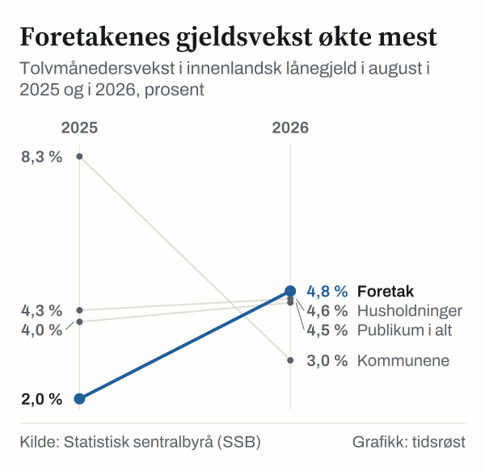

Husholdningenes innenlandske lånegjeld var 4 790 milliarder kroner ved utgangen av august 2026. Det viser kredittindikatoren K2 fra Statistisk sentralbyrå (SSB). Gjelden vokste 4,6 prosent siste tolv måneder, like mye som i juli.

## Hva kredittindikatoren måler

K2 viser hvor mye publikum har i innenlandsk lånegjeld, og hvor raskt gjelden vokser. Publikum er husholdninger, ikke-finansielle foretak og kommuneforvaltningen. I SSBs statistikk heter husholdningene «husholdninger mv.».

## Gjelden over tid

Husholdningenes gjeld var 2 058 milliarder kroner i august 2010. Siden 2020 har den økt med 1 048 milliarder kroner, eller 28,0 prosent, til 4 790 milliarder.

![Linjediagram over Gjelden har mer enn doblet seg: Husholdninger: 2 058 milliarder kroner i 2010, 2 203 milliarder kroner i 2011, 2 319 milliarder kroner i 2012, 2 484 milliarder kroner i 2013, 2 657 milliarder kroner i 2014, 2 831 milliarder kroner i 2015, 3 004 milliarder kroner i 2016, 3 200 milliarder kroner i 2017, 3 399 milliarder kroner i 2018, 3 575 milliarder kroner i 2019, 3 742 milliarder kroner i 2020, 3 935 milliarder kroner i 2021, 4 104 milliarder kroner i 2022, 4 256 milliarder kroner i 2023, 4 395 milliarder kroner i 2024, 4 580 milliarder kroner i 2025, 4 790 milliarder kroner i 2026.](./graf-1.svg)
*Husholdninger mv., innenlandsk lånegjeld ved utgangen av august, 2010–2026. Kilde: SSB, tabell 11599.*

## Gjeldsveksten

Gjeldsveksten er lavere enn for ti år siden. Fra 2010 til 2017 lå tolvmånedersveksten i august mellom 6,1 og 7,2 prosent. Den falt til 3,5 prosent i august 2024, og har siden steget til 4,3 prosent i 2025 og 4,6 prosent i 2026.

*Tolvmånedersvekst i husholdningenes innenlandske lånegjeld, utgangen av august, 2010–2026. Kilde: SSB, tabell 11599.*

## Sektorene

Den samlede innenlandske lånegjelden til publikum var 8 048 milliarder kroner i august 2026, og husholdningene sto for 59,5 prosent av den. For ikke-finansielle foretak økte gjeldsveksten fra 2,0 til 4,8 prosent siste år. For kommuneforvaltningen falt den fra 8,3 til 3,0 prosent.

*Tolvmånedersvekst i innenlandsk lånegjeld etter låntakersektor, august 2025 og august 2026. Kilde: SSB, tabell 11599.*

| Sektor | Gjeld, mrd. kroner | Vekst siste 12 mnd. |
|---|---:|---:|
| Husholdninger mv. | 4 790 | 4,6 % |
| Ikke-finansielle foretak | 2 420 | 4,8 % |
| Kommuneforvaltningen | 838 | 3,0 % |
| Publikum i alt | 8 048 | 4,5 % |

*Innenlandsk lånegjeld, utgangen av august 2026. Kilde: SSB, tabell 11599.*

## Om tallene

Gjeldsveksten regnes ut fra transaksjoner, altså nye lån minus nedbetalinger. Endringer i gjeldsbeholdningen som ikke skyldes nye lån eller nedbetalinger, er holdt utenfor.

## Kilder

- [SSB: Kredittindikator – siste statistikk](https://www.ssb.no/bank-og-finansmarked/finansielle-indikatorer/statistikk/kredittindikator)
- [SSB: Tabell 11599 – Innenlandsk lånegjeld, sesongjusterte og ujusterte beholdninger og transaksjoner, etter valuta, låntakersektor, statistikkvariabel og måned](https://www.ssb.no/statbank/table/11599)
