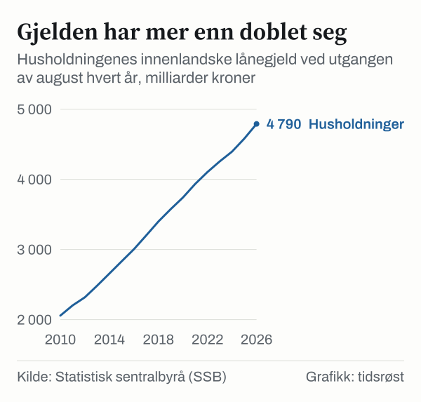
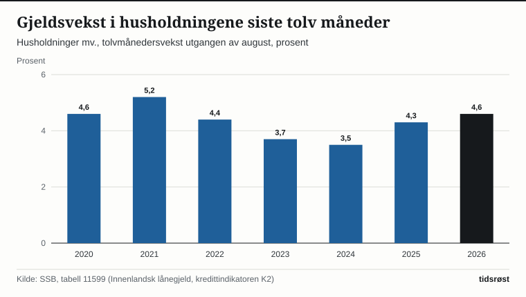

Husholdningenes innenlandske lånegjeld var 4 790 milliarder kroner ved utgangen av august 2026. Det viser kredittindikatoren K2 fra Statistisk sentralbyrå (SSB), som ble publisert 24. september 2026. Gjeldsveksten for husholdningene var 4,6 prosent siste tolv måneder, uendret fra juli.

## Hva måler kredittindikatoren?

Kredittindikatoren K2 viser hvor mye publikum, altså husholdninger, ikke-finansielle foretak og kommuneforvaltningen, har i innenlandsk lånegjeld, og hvor raskt gjelden vokser. Husholdningene kalles «husholdninger mv.» i SSBs statistikk, og tallene gjelder innenlandsk lånegjeld.

*Husholdninger mv., innenlandsk lånegjeld ved utgangen av august, milliarder kroner. Kilde: SSB, tabell 11599.*

Gjelden har økt fra 3 742 milliarder kroner i august 2020 til 4 790 milliarder kroner i august 2026. Det er en økning på 1 048 milliarder kroner, eller om lag 28 prosent, over seks år.

## Utviklingen i gjeldsveksten

Tolvmånedersveksten i husholdningenes gjeld var 3,5 prosent i august 2024, 4,3 prosent i august 2025 og 4,6 prosent i august 2026. Til sammenligning var veksten 5,2 prosent i august 2021.

*Tolvmånedersvekst i husholdningenes innenlandske lånegjeld, utgangen av august, prosent. Kilde: SSB, tabell 11599.*

## Slik fordeler gjelden seg

Den samlede innenlandske lånegjelden til publikum var 8 048 milliarder kroner ved utgangen av august 2026, med en tolvmånedersvekst på 4,5 prosent. Husholdningene sto for om lag 60 prosent av dette.

| Sektor | Gjeld, mrd. kroner | Vekst siste 12 mnd. |
|---|---:|---:|
| Husholdninger mv. | 4 790 | 4,6 % |
| Ikke-finansielle foretak | 2 420 | 4,8 % |
| Kommuneforvaltningen | 838 | 3,0 % |
| Publikum i alt | 8 048 | 4,5 % |

*Innenlandsk lånegjeld, utgangen av august 2026. Kilde: SSB, tabell 11599.*

Gjeldsveksten for kommuneforvaltningen falt fra 8,3 prosent i august 2025 til 3,0 prosent i august 2026. For ikke-finansielle foretak økte veksten fra 2,0 til 4,8 prosent i samme periode.

## Hva viser tallene?

Gjeldsveksten viser hvor mye husholdningene låner netto.

## Kilder

- [SSB: Kredittindikator – siste statistikk (august 2026, publisert 24. september 2026)](https://www.ssb.no/bank-og-finansmarked/finansielle-indikatorer/statistikk/kredittindikator)
- [SSB: Tabell 11599 – Innenlandsk lånegjeld, sesongjusterte og ujusterte beholdninger og transaksjoner, etter valuta, låntakersektor, statistikkvariabel og måned](https://www.ssb.no/statbank/table/11599)
