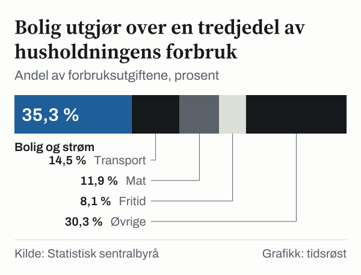
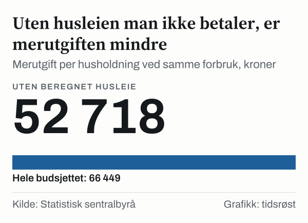

Tenk på et vanlig år, for eksempel i 2022: strømregningen, maten, bilen, ferien. Ifølge Forbruksundersøkelsen fra Statistisk sentralbyrå (SSB) brukte en gjennomsnittlig norsk husholdning 554,6 tusen kroner på varer og tjenester i 2022. Hvis den samme husholdningen hadde brukt penger på nøyaktig det samme med gjennomsnittsprisene i 2025, ville regningen blitt 621,0 tusen kroner. Det er 66,4 tusen kroner mer, eller 12,0 prosent.

Regnestykket måler prisene, ikke hva husholdninger faktisk gjør. Det holder mengdene fast og lar bare prisene endre seg. Spørsmålet er hvor merutgiften sitter, og svaret er ikke jevnt fordelt.

Vi har tatt budsjettet i 2022, gruppe for gruppe, og prisjustert hver post med prisutviklingen i den gruppen. Begge år er årsgjennomsnitt, slik at utgiften for et helt år sammenlignes med prisnivået for et helt år. Underveis dukker det opp et par overraskelser: én gruppe er blitt billigere, og en stor del av budsjettet består av en post som ikke betales.

## Samme kurv, nye priser: 66,4 tusen kroner mer

Boligen står for den største merutgiften, med 16,6 tusen kroner. Maten kommer på andreplass med 14,5 tusen kroner, foran fritid og transport med 8,8 tusen kroner hver. De ni andre gruppene utgjør til sammen 17,7 tusen kroner.

Prisindeksen for alle varer og tjenester var 89,2 i årsgjennomsnittet i 2022 og 100,0 i 2025. Det er tall uten enhet, men forholdet mellom dem sier hvor mye dyrere en fast kurv er blitt. Når vi bruker forholdet på hver post i budsjettet, får vi kroner i stedet for prosent.

Rekkefølgen er ikke den samme som i budsjettet. Transport er en større post enn mat, med en andel på 14,5 prosent mot 11,9 prosent, men gir en mindre merutgift. Grunnen er at prisene på mat steg mer enn prisene på transport. Det kommer vi tilbake til.

*Merutgift per husholdning ved samme forbruk, kroner. Kilde: Statistisk sentralbyrå.*

## Slik så budsjettet ut i 2022

Bolig, elektrisitet og brensel var den store posten allerede i 2022, med 195,7 tusen kroner, eller 35,3 prosent av forbruksutgiftene. Transport utgjorde 80,2 tusen kroner, mat og alkoholfrie drikkevarer 65,8 tusen kroner og fritid, sport og kultur 44,7 tusen kroner. De ni andre gruppene utgjorde til sammen 30,3 prosent: møbler og husholdningsartikler 5,1 prosent, informasjon og kommunikasjon 4,5 prosent, servering og overnatting 4,3 prosent, forsikring og finansielle tjenester 4,1 prosent, klær og skotøy og andre varer og tjenester 3,6 prosent hver, helse 2,3 prosent, alkohol og tobakk 2,2 prosent og utdanning 0,6 prosent.

Boligposten inneholder noe som ikke er en vanlig utgift. Beregnet husleie utgjorde 110,0 tusen kroner, eller 19,8 prosent av alle forbruksutgifter, og er en beregnet størrelse, ikke et beløp som betales. Betalt husleie utgjorde 27,5 tusen kroner. Elektrisitet og brensel utgjorde 36,0 tusen kroner, vann og andre boligtjenester 18,6 tusen kroner og vedlikehold og reparasjon 3,5 tusen kroner.

*Andel av forbruksutgiftene, prosent. Kilde: Statistisk sentralbyrå.*

## Prisene steg ujevnt, og maten skiller seg ut

Totalindeksen steg 12,1 prosent fra årsgjennomsnittet i 2022 til årsgjennomsnittet i 2025. Gruppene lå langt fra hverandre. Mat og alkoholfrie drikkevarer steg mest, 22,1 prosent, fulgt av fritid, sport og kultur med 19,8 prosent og forsikring og finansielle tjenester med 14,8 prosent. Andre varer og tjenester steg minst, 1,1 prosent, og klær og skotøy steg 4,0 prosent. Tabellen viser alle gruppene.

| Gruppe | Utgift i 2022 | Prisendring | Samme forbruk med prisene i 2025 | Merutgift |
|---|---|---|---|---|
| Bolig, elektrisitet og brensel | 195,7 tusen kroner | 8,5 % | 212,2 tusen kroner | 16,6 tusen kroner |
| Transport | 80,2 tusen kroner | 11,0 % | 89,0 tusen kroner | 8,8 tusen kroner |
| Mat og alkoholfrie drikkevarer | 65,8 tusen kroner | 22,1 % | 80,3 tusen kroner | 14,5 tusen kroner |
| Fritid, sport og kultur | 44,7 tusen kroner | 19,8 % | 53,6 tusen kroner | 8,8 tusen kroner |
| Møbler og husholdningsartikler | 28,3 tusen kroner | 11,9 % | 31,6 tusen kroner | 3,4 tusen kroner |
| Informasjon og kommunikasjon | 25,1 tusen kroner | 11,1 % | 27,9 tusen kroner | 2,8 tusen kroner |
| Servering og overnatting | 23,9 tusen kroner | 14,4 % | 27,3 tusen kroner | 3,4 tusen kroner |
| Forsikring og finansielle tjenester | 22,9 tusen kroner | 14,8 % | 26,2 tusen kroner | 3,4 tusen kroner |
| Andre varer og tjenester | 20,2 tusen kroner | 1,1 % | 20,4 tusen kroner | 0,2 tusen kroner |
| Klær og skotøy | 19,8 tusen kroner | 4,0 % | 20,6 tusen kroner | 0,8 tusen kroner |
| Helse | 12,5 tusen kroner | 12,7 % | 14,1 tusen kroner | 1,6 tusen kroner |
| Alkoholholdige drikkevarer og tobakk | 12,2 tusen kroner | 13,9 % | 13,9 tusen kroner | 1,7 tusen kroner |
| Utdanning | 3,4 tusen kroner | 13,1 % | 3,8 tusen kroner | 0,4 tusen kroner |

*Utgift per husholdning i 2022, prisendring fra årsgjennomsnittet i 2022 til årsgjennomsnittet i 2025 og det samme forbruket med prisene i 2025. Kilde: SSB.*

Mat er den gruppen der prisene steg mest. Gruppen steg 22,1 prosent, mer enn totalindeksen på 12,1 prosent. Husholdningen brukte 65,8 tusen kroner på mat i 2022, og det samme forbruket er 80,3 tusen kroner med prisene i 2025. Maten er dermed en forholdsvis liten post som har gitt en stor merutgift.

Bolig gikk den andre veien. Bolig, elektrisitet og brensel steg 8,5 prosent, under totalindeksen på 12,1 prosent. Gruppen gir likevel den største merutgiften, fordi den er så stor: 195,7 tusen kroner i 2022 ble til 212,2 tusen kroner med prisene i 2025. Betalt og beregnet husleie steg begge 12,5 prosent.

Fritid, sport og kultur har like stor merutgift som transport, 8,8 tusen kroner hver, selv om budsjettposten er 44,7 tusen kroner mot 80,2 tusen kroner. Den gruppen steg 19,8 prosent, mot 11,0 prosent for transport. Forsikring og finansielle tjenester steg 14,8 prosent og ga en merutgift på 3,4 tusen kroner, og servering og overnatting steg 14,4 prosent og ga 3,4 tusen kroner.

De minste merutgiftene er 0,2 tusen kroner for andre varer og tjenester, 0,4 tusen kroner for utdanning og 0,8 tusen kroner for klær og skotøy. Utdanning er en svært liten budsjettpost, 3,4 tusen kroner i 2022, mens andre varer og tjenester og klær og skotøy har små prisøkninger på 1,1 prosent og 4,0 prosent. Informasjon og kommunikasjon steg 11,1 prosent og ga 2,8 tusen kroner, mens helse steg 12,7 prosent og ga 1,6 tusen kroner.

*Prisendring i konsumprisindeksen mellom årsgjennomsnittet i 2022 og i 2025, prosent. Kilde: Statistisk sentralbyrå.*

## Strømmen trakk motsatt vei

Elektrisitet og brensel er den eneste undergruppen i boligposten der det samme forbruket har blitt billigere. Utgiften var 36,0 tusen kroner i 2022. Med prisene i 2025 er den 32,6 tusen kroner, altså minus 3,5 tusen kroner. Prisene falt 9,6 prosent.

Indeksen for elektrisitet og brensel var 110,6 i årsgjennomsnittet i 2022 og 100,0 i 2025, så prisnivået var høyere i 2022 enn i 2025. Hvilke år vi sammenligner, har mye å si for denne gruppen, og vi har ikke regnet på andre år.

De andre fire undergruppene i boligposten steg mellom 12,4 prosent og 13,1 prosent. Beregnet husleie ga en merutgift på 13,7 tusen kroner, betalt husleie 3,4 tusen kroner og vann og andre boligtjenester 2,3 tusen kroner.

## Uten beregnet husleie

Beregnet husleie er den største enkeltposten i boligen, men ikke et beløp som betales. Tar vi den ut av budsjettet, gjenstår 444,6 tusen kroner i 2022. Det samme forbruket er 497,3 tusen kroner med prisene i 2025. Merutgiften er 52,7 tusen kroner, eller 11,9 prosent.

Forskjellen til hele budsjettet er liten i prosent, 11,9 prosent mot 12,0 prosent, men stor i kroner: 52,7 tusen kroner mot 66,4 tusen kroner. En sammenligning uten beregnet husleie gir altså et annet bilde av hva som faktisk betales.

*Merutgift per husholdning ved samme forbruk, kroner. Kilde: Statistisk sentralbyrå.*

## Samme tall, annen lesning

Regnestykket kan gjøres på to måter. Vi kan prisjustere hver gruppe for seg, eller bruke totalindeksen på hele budsjettet. Gruppe for gruppe gir 621,0 tusen kroner. Med totalindeksen blir det 621,7 tusen kroner. Forskjellen er 698 kroner, så resultatet avhenger lite av metoden. De to tallene bygger på samme budsjett og samme prisindeks, men samler tallene på ulikt nivå, og det er derfor de kan sammenlignes som en kontroll av hverandre.

Regner vi boligen i fem undergrupper i stedet for som én gruppe, blir merutgiften 16,5 tusen kroner mot 16,6 tusen kroner. Forskjellen på 78 kroner viser at gruppeindeksen og undergruppene ikke gir helt samme svar.

Større er forskjellen mellom budsjettet og virkeligheten. Husholdninger endrer hva de bruker penger på når prisene endrer seg. Regnestykket forutsetter at ingen gjør det, og at alle har det gjennomsnittlige budsjettet i 2022. En husholdning med et annet forbruksmønster enn snittet har en annen merutgift enn tallene her.

## Det regnestykket ikke viser

Forbruksundersøkelsen er en utvalgsundersøkelse, og utgiftene har en usikkerhet. Standardfeilen for utgiften i alt er 7,8 tusen kroner, for boligen 2,8 tusen kroner og for transport 3,0 tusen kroner. Merutgiftene er regnet ut fra de publiserte gjennomsnittene, uten hensyn til disse usikkerhetsbåndene.

Undersøkelsen ble gjort i 2022, og vi har ikke et tilsvarende budsjett i 2025. Budsjettet med prisene i 2025 er derfor ikke målt, men regnet ut. Vi har valgt årsgjennomsnitt for begge år for å sammenligne like perioder. Tallene gjelder gjennomsnittet for alle husholdninger, ikke en bestemt husholdningstype, og sier ingenting om hva prisene gjør videre.

## Slik regnet vi

Utgiftene per husholdning i 2022 kommer fra SSBs Forbruksundersøkelse, med de tretten hovedgruppene i vare- og tjenestegrupperingen. Prisene kommer fra SSBs konsumprisindeks etter vare- og tjenestegruppe, med årlige indeksverdier i 2022 og i 2025. Vi har brukt SSBs egne årsgjennomsnitt, så vi har ikke regnet ut gjennomsnitt selv.

For hver gruppe har vi delt utgiften i 2022 på forholdet mellom indeksen i 2022 og indeksen i 2025. Det gir hva det samme forbruket koster med prisene i 2025. Merutgiften er differansen mellom de to beløpene, og samlet beløp er summen av de tretten gruppene. Vi har ikke regnet med andre vekter enn husholdningenes egne utgifter i 2022. Prisendringen i prosent er endringen i indeksen mellom de to årene. Beløpene i teksten er avrundet til hundre kroner, men beregningene bruker de uavrundede tallene fra SSB.

## Kilder

- [SSB: Utgift per husholdning per år, etter vare- og tjenestegruppe](https://www.ssb.no/statbank/table/14100)
- [SSB: Konsumprisindeks, etter vare- og tjenestegruppe og år](https://www.ssb.no/statbank/table/14701)
