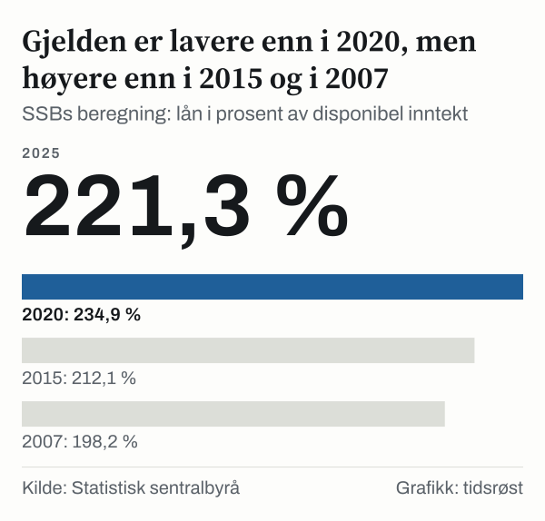
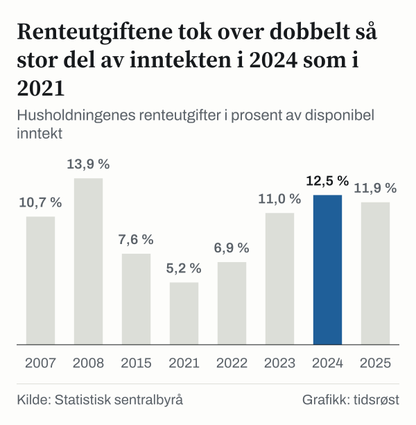

Øverst på listen over husholdningsgjeld blant tjuefire OECD-land i 2022 står Norge. Samlet gjeld tilsvarte 227,5 prosent av husholdningenes brutto disponibel inntekt, altså mer enn to års inntekt. Nederland fulgte med 215,9 prosent og Danmark med 197,8 prosent. Laveste verdi i sammenligningen var 24,6 prosent, i Mexico.

Brutto disponibel inntekt er OECDs mål på husholdningenes inntekt etter skatt og overføringer. Forholdet mellom gjeld og denne inntekten sier hvor stor gjelden er målt mot det husholdningene tjener. Det sier ikke hvor lett eller vanskelig gjelden er å betjene. Det avhenger blant annet av renten, og den kommer vi tilbake til lenger ned.

Førsteplassen kan leses på flere måter. Da vi stilte tallene side om side, viste det seg at Norges egen verdi knapt har beveget seg siden 2020, mens tallene for flere andre land har falt, særlig Danmarks, der serien har et sprang vi ikke kan forklare. Denne analysen går gjennom hvordan det har skjedd, hva som mangler i OECDs tall for årene siden 2022, og hva Statistisk sentralbyrå (SSB) sine egne tall sier om årene etterpå.

## Norge øverst i 2022

Norges 227,5 prosent lå over Nederlands 215,9 prosent, Danmarks 197,8 prosent og Sveriges 185,5 prosent i 2022. Finland hadde 144,2 prosent. OECDs oversikt har tall for tjuefire av de trettiåtte medlemmene, og vi vet ikke hvorfor de fjorten andre mangler. Euroområdet samlet hadde 103,8 prosent, og USA 101,6 prosent. Elleve av de tjuefire landene lå under hundre prosent, altså med gjeld som var mindre enn ett års inntekt.

De seks øverste var Norge, Nederland, Danmark, Australia, Sverige og Canada, og den siste av dem hadde 180,9 prosent. Finland lå på sjuendeplass med 144,2 prosent og var det nordiske landet med lavest gjeld i forhold til inntekt.

![Stolpediagram over Norge hadde høyest husholdningsgjeld av tjuefire OECD-land i 2022: Husholdningsgjeld: Norge: 227,5 %, Nederland: 215,9 %, Danmark: 197,8 %, Australia: 192,5 %, Sverige: 185,5 %, Canada: 180,9 %, Finland: 144,2 %, Storbritannia: 135,7 %, Frankrike: 121,3 %, Japan: 110,0 %, Portugal: 108,9 %, Belgia: 104,8 %, USA: 101,6 %, Irland: 97,1 %, Spania: 89,4 %, Tyskland: 84,2 %, Østerrike: 82,3 %, Chile: 81,9 %, Hellas: 80,1 %, Italia: 78,8 %, Tsjekkia: 60,7 %, Polen: 46,0 %, Ungarn: 37,4 %, Mexico: 24,6 %, Euroområdet: 103,8 %.](./graf-1.svg)
*Gjeld i prosent av brutto disponibel inntekt, i 2022; stiplet linje er euroområdet. Kilde: OECD.*

Norges verdi endret seg lite det siste året i serien: i perioden 2021–2022 gikk den fra 225,2 prosent til 227,5 prosent. I samme periode falt Danmarks verdi med 39,9 prosentpoeng, fra 237,7 prosent til 197,8 prosent. I 2021 lå Danmark dermed høyere enn Norge, og Nederland, med 224,6 prosent, lå like under.

Et fall på 39,9 prosentpoeng på ett år står i kontrast til året før, da Danmarks verdi falt med 7,7 prosentpoeng. Dokumentasjonen vi har brukt, forklarer ikke hvorfor den danske serien beveger seg slik, og vi gir derfor ingen forklaring. Rekkefølgen i toppen i 2022 er altså avhengig av den danske serien, og vi har ikke funnet en forklaring på den danske endringen.

## Fra fjerdeplass i 2007 til førsteplass i 2022

Lenger tilbake var rekkefølgen en annen. I 2007 hadde Danmark 269,0 prosent, Nederland 243,1 prosent og Irland 213,4 prosent. Norge lå på 190,4 prosent og dermed på fjerdeplass blant de tjuetre landene som har tall for det året. I 2015 var Norges verdi 203,7 prosent, bak Danmark på 257,3 prosent og Nederland på 254,3 prosent, og Norge var da på tredjeplass.

Over perioden 2015–2022 økte Norges verdi med 23,8 prosentpoeng. Danmarks verdi falt fra 257,3 prosent til 197,8 prosent og Nederlands fra 254,3 prosent til 215,9 prosent. Sverige økte med 14,7 prosentpoeng og Finland med 28,4 prosentpoeng.

*Gjeld i prosent av brutto disponibel inntekt, i 2015 og i 2022. Kilde: OECD.*

Irland lå på tredjeplass i 2007 med 213,4 prosent, men var nede på 97,1 prosent i 2022. Spania gikk fra 141,1 prosent i 2007 til 89,4 prosent i 2022, og Storbritannia fra 165,1 prosent til 135,7 prosent. Rangeringen har altså endret seg mye over femten år, også blant landene utenfor Norden.

De nordiske landene beveger seg ikke i takt. Norge og Finland økte mest, Sverige økte mindre, og Danmark falt. Island er ikke med i oversikten vi har brukt, så sammenligningen med Norden gjelder Danmark, Sverige og Finland.

Plasseringen i 2022 viser at gjelden i forhold til inntekt var høyere i Norge enn i de andre landene det året. Den sier ikke at norske husholdninger har tatt opp mer gjeld enn før på kort tid.

## Norge mangler i OECDs tall siden 2022

OECDs norske serie slutter i 2022, mens tallene for Danmark, Sverige og Finland løper til og med året 2025. I perioden 2022–2025 falt Danmarks verdi med 7,2 prosent, Sveriges verdi falt med 8,8 prosent og Finlands verdi falt med 9,0 prosent. Danmark kom i 2025 på 183,4 prosent, Sverige på 169,3 prosent og Finland på 131,3 prosent.

For å se hva som skjedde i Norge har vi regnet ut et eget forholdstall fra SSBs nasjonalregnskap: husholdningenes lån ved utgangen av året, delt på husholdningenes disponible inntekt det året. Beregningen gir 230,9 prosent i 2022 og 221,3 prosent i 2025, et fall på 4,2 prosent. Blant årene vi har regnet ut var verdien høyest i 2020, med 234,9 prosent. I 2015 var forholdet 212,1 prosent og i 2007 var det 198,2 prosent.

*SSBs beregning: lån i prosent av disponibel inntekt. Kilde: Statistisk sentralbyrå.*

Fallet i Norge er dermed mindre enn i de tre nordiske naboene i samme periode, regnet som prosentvis endring innen hver serie. Tallene er likevel ikke direkte sammenlignbare. SSB bruker sin egen avgrensning av disponibel inntekt og regner bare med husholdninger, mens OECD regner husholdninger og ideelle organisasjoner sammen. I 2022 var SSBs tall 230,9 prosent og OECDs tall 227,5 prosent, så de to målene gir ikke helt de samme tallene selv for samme år.

Legger vi SSBs tall for Norge i 2025 ved siden av OECDs tall for nabolandene, ligger SSBs tall for Norge over alle tre: 221,3 prosent mot 183,4 prosent i Danmark, 169,3 prosent i Sverige og 131,3 prosent i Finland. Tallene er ikke beregnet på samme måte, så dette er en grov sammenligning. Forskjellen mellom Norge og nabolandene er større enn forskjellen mellom SSBs og OECDs tall for Norge i 2022.

I perioden 2021–2025 økte husholdningenes lån med 17 prosent, mens disponibel inntekt økte med 21 prosent. Når nevneren vokser raskere enn telleren, faller forholdstallet, selv om gjelden i kroner fortsatt har økt.

## Renteutgiftene tok en større del av inntekten

Gjeldens størrelse er én ting, kostnaden ved å ha den en annen. SSB publiserer husholdningenes renteutgifter i nasjonalregnskapet, og delt på disponibel inntekt gir de en rentebelastning. Den var 5,2 prosent i 2021, 6,9 prosent i 2022 og 11,0 prosent i 2023. I 2024 var den 12,5 prosent, 2,4 ganger så stor som i 2021, og i 2025 var den 11,9 prosent. Det høyeste nivået blant årene vi har sett på, var 13,9 prosent i 2008.

*Husholdningenes renteutgifter i prosent av disponibel inntekt. Kilde: Statistisk sentralbyrå.*

I samme periode steg Norges Banks styringsrente fra 0,5 prosent på siste handelsdag i 2021 til 2,75 prosent på siste handelsdag i 2022 og 4,5 prosent på siste handelsdag i 2023, en økning på 4,0 prosentpoeng. Renten var 4,5 prosent også på siste handelsdag i 2024 og 4,0 prosent på siste handelsdag i 2025. Vi viser her bare at utviklingen skjedde i samme periode.

Målt i kroner økte husholdningenes renteutgifter med 175 prosent i perioden 2021–2025, fra 93,5 milliarder kroner til 256,9 milliarder kroner. I samme periode økte inntektene med 21 prosent og lånene med 17 prosent, så renteutgiftene økte mye mer i prosent.

Husholdningene har også renteinntekter, for eksempel på sparing. Trekker vi renteinntektene fra renteutgiftene, ble netto rentebelastning 4,7 prosent i 2021 og 8,7 prosent i 2025. Renteinntektene var 8,9 milliarder kroner i 2021. I 2025 var de 69,0 milliarder kroner, så de dempet økningen litt, men bare delvis.

## Gjelden mot eiendelene: et annet utsnitt

Gjeld er bare den ene siden av regnskapet. OECD publiserer også husholdningenes finansielle nettoformue, altså finansielle eiendeler minus gjeld, målt mot samme inntekt. I 2022 var den 110,0 prosent i Norge, 125,0 prosent i Finland, 459,3 prosent i Sverige og 573,0 prosent i Danmark. Med dette målet kommer Norge lavest av de fire nordiske landene, i motsetning til rangeringen på gjeld.

Målet har sine egne begrensninger. Verdien av boliger og annen realkapital er ikke med i finansiell nettoformue, så det sier ingenting om hva husholdningene eier utenom finansielle eiendeler. Tallene sier heller ikke hva forskjellene mellom landene skyldes.

Gjeldsforholdet og rentebelastningen er heller ikke to sider av samme sak. Gjeldsforholdet var høyere i 2021 enn i 2007, med 229,2 prosent mot 198,2 prosent, men rentebelastningen var lavere, med 5,2 prosent mot 10,7 prosent. Et høyt forholdstall mellom gjeld og inntekt gir altså ikke i seg selv en høy rentebelastning.

## Det statistikken ikke kan si

Først gjelder alle forholdstallene husholdningene samlet. De sier ikke hvordan gjelden er fordelt mellom husholdninger med ulik inntekt, alder eller boform, og et samlet forholdstall kan skjule store forskjeller mellom husholdninger.

Dernest slutter serien for Norge i 2022 i OECDs tabell. Vi har derfor ikke kunnet sammenligne Norge med de andre landene siden 2022 med samme definisjon. Tall fra nasjonalregnskapet kan dessuten revideres, og tallene for de siste årene er mest utsatt for det.

Videre omfatter rentebelastningen bare renter, ikke avdrag. En husholdning kan altså ha større løpende utgifter til lånene enn tallene her viser. Styringsrenten er dessuten et øyeblikksbilde fra én dag, mens renteutgiftene er summen over et helt år, så de to tallene kan ikke leses som et forhold mellom to størrelser. Rentebelastningen er heller ikke hva den enkelte betaler, men summen for alle husholdninger delt på summen av inntektene.

Til sist viser den danske serien et sprang som vi ikke har funnet en forklaring på. Om det skyldes revisjon, endret definisjon eller en reell endring, kan ikke avgjøres med dokumentene vi har brukt.

## Slik regnet vi

Sammenligningen av land bygger på OECDs oversikt over husholdningenes økonomi, målet for husholdningers og ideelle organisasjoners samlede gjeld, regnet som andel av brutto disponibel inntekt, årlige tall. Vi hentet verdier for utvalgte år siden 2007 der de finnes, og rangerte landene etter verdi. Forskjellene i prosentpoeng er enkle differanser mellom to av disse verdiene, og prosentvise endringer er regnet innen hver landserie. Euroområdet er tatt med som referanse og er ikke et land i rangeringen.

For Norge siden 2022 har vi hentet husholdningenes lån ved utgangen av året fra SSBs tabell over finansielle sektorregnskaper og husholdningenes disponible inntekt fra SSBs tabell over inntekts- og kapitalregnskapet, og delt det første tallet på det andre. Rentebelastningen er husholdningenes renteutgifter fra den siste av disse tabellene delt på disponibel inntekt samme år; netto rentebelastning trekker renteinntektene fra renteutgiftene først. Styringsrenten er Norges Banks rente på siste handelsdag i hvert år. Alle tall er hentet 23. oktober 2026.

## Kilder

- [OECD: Household indicators dashboard, gjeld og finansiell nettoformue som andel av brutto disponibel inntekt](https://sdmx.oecd.org/public/rest/dataflow/OECD.SDD.NAD/DSD_HHDASH@DF_HHDASH_INDIC/1.1)
- [SSB: Finansielle sektorregnskaper, årstall](https://www.ssb.no/statbank/table/10788)
- [SSB: Årlig inntekts- og kapitalregnskap, etter sektor](https://www.ssb.no/statbank/table/10799)
- [Norges Bank: Styringsrenten, oversikt over rentemøter og endringer](https://www.norges-bank.no/tema/pengepolitikk/Styringsrenten/Styringsrenten-Oversikt-over-rentemoter-og-endringer-i-styringsrenten-/)
