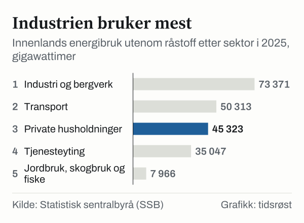
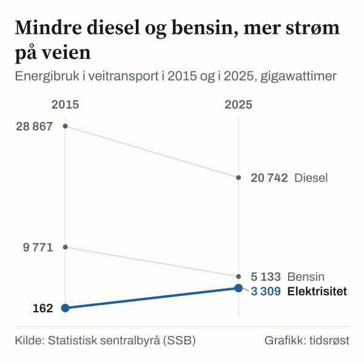

Innenlands energibruk i Norge, utenom energi brukt som råstoff, var 212,0 TWh (212 019 GWh) i 2025. Det viser energibalansen fra Statistisk sentralbyrå (SSB), publisert 12. juni 2026. Bruken var 1,0 prosent, eller 2,2 TWh, lavere enn i 2024, og det laveste nivået siden 2014. Private husholdninger sto for 45,3 TWh.

Energibalansen viser tilført energi, målt som energiinnholdet i energiproduktene. Det betyr at energi som går tapt ved bruk, for eksempel varme som forsvinner fra en vedovn, også er med i tallene.

## Hvem bruker energien

Industri og bergverk var den største forbrukssektoren i 2025, med 73,4 TWh, 34,6 prosent av totalen. Deretter fulgte transport med 50,3 TWh, private husholdninger med 45,3 TWh og privat og offentlig tjenesteyting med 35,0 TWh.

*Innenlands energibruk utenom råstoff etter sektor, 2025, GWh. Kilde: SSB, tabell 11561.*

| Sektor | 2024 (GWh) | 2025 (GWh) | Endring |
|---|---:|---:|---:|
| Industri og bergverk | 72 432 | 73 371 | +1,3 % |
| Transport | 52 504 | 50 313 | −4,2 % |
| Private husholdninger | 46 586 | 45 323 | −2,7 % |
| Privat og offentlig tjenesteyting | 34 840 | 35 047 | +0,6 % |
| Jordbruk og skogbruk | 3 957 | 3 904 | −1,3 % |
| Fiske | 3 896 | 4 062 | +4,3 % |
| **Totalt (utenom råstoff)** | **214 215** | **212 019** | **−1,0 %** |

*Kilde: SSB, tabell 11561.*

SSB forklarer økningen i industrien med at 2024 hadde flere tilfeller av driftsstans. Over tid har industriens energibruk falt med 11,5 prosent siden 2000, mens tjenesteytingen har økt med 32,8 prosent.

## Det som ikke er med

Noe energibruk holder SSB utenfor tallet på 212 TWh. Energi brukt som råstoff, for eksempel til ammoniakk, metanol og plast, var 25,7 TWh i 2025, 22,3 prosent mer enn året før. Eget forbruk i den energiproduserende sektoren var 61,4 TWh, og olje- og gassutvinningen sto for 52,4 TWh av det. Internasjonal bunkers, drivstoff til skip og fly i utenriks fart, var 9,5 TWh.

## Husholdningene

Private husholdninger brukte 45 323 GWh i 2025, 2,7 prosent mindre enn i 2024. Tallene omfatter også fritidshus. Elektrisitet utgjorde 84,3 prosent. Strømbruken falt 2,2 prosent, og vedbruken 7,0 prosent.

Ifølge SSB var 2025 et rekordvarmt år, slik at det trengtes mindre oppvarming. SSB skriver også at flere husholdninger lader elbil hjemme, og at det demper nedgangen i strømbruken.

![Linjediagram over Strøm er det meste av husholdningenes energi: Alle energivarer: 39 982 i 1990, 41 348 i 1991, 41 008 i 1992, 41 791 i 1993, 43 377 i 1994, 44 161 i 1995, 46 236 i 1996, 44 349 i 1997, 44 551 i 1998, 44 987 i 1999, 43 562 i 2000, 45 218 i 2001, 45 150 i 2002, 43 361 i 2003, 42 957 i 2004, 43 656 i 2005, 44 028 i 2006, 44 631 i 2007, 44 281 i 2008, 45 844 i 2009, 50 855 i 2010, 45 168 i 2011, 47 908 i 2012, 47 171 i 2013, 43 867 i 2014, 45 808 i 2015, 47 137 i 2016, 47 690 i 2017, 47 638 i 2018, 46 487 i 2019, 46 655 i 2020, 49 089 i 2021, 44 199 i 2022, 46 566 i 2023, 46 586 i 2024, 45 323 i 2025; Elektrisitet: 30 299 i 1990, 32 614 i 1991, 32 650 i 1992, 32 787 i 1993, 34 015 i 1994, 34 627 i 1995, 35 288 i 1996, 33 978 i 1997, 35 048 i 1998, 35 046 i 1999, 34 628 i 2000, 35 876 i 2001, 34 647 i 2002, 32 023 i 2003, 32 405 i 2004, 34 005 i 2005, 33 644 i 2006, 34 946 i 2007, 34 887 i 2008, 36 311 i 2009, 39 731 i 2010, 36 057 i 2011, 38 247 i 2012, 38 902 i 2013, 36 871 i 2014, 38 570 i 2015, 39 843 i 2016, 40 130 i 2017, 40 404 i 2018, 40 007 i 2019, 39 943 i 2020, 41 533 i 2021, 36 345 i 2022, 38 828 i 2023, 39 054 i 2024, 38 209 i 2025.](./graf-2.svg)
*Energibruk i private husholdninger, alle energivarer og elektrisitet, 1990–2025, GWh. Kilde: SSB, tabell 11561.*

| Energivare | 2000 (GWh) | 2024 (GWh) | 2025 (GWh) |
|---|---:|---:|---:|
| Elektrisitet | 34 628 | 39 054 | 38 209 |
| Ved og andre faste biobrensler | 6 094 | 5 603 | 5 213 |
| Fjernvarme | 238 | 1 873 | 1 863 |
| Olje og oljeprodukter | 2 571 | 43 | 27 |
| **Alle energivarer** | **43 562** | **46 586** | **45 323** |

*Kilde: SSB, tabell 11561. Andre energivarer er ikke vist.*

Bruken av olje i boliger har så godt som opphørt etter forbudet mot fyringsolje fra 2020. Fra 1990 til 2025 økte husholdningenes strømbruk med 26,1 prosent, og den samlede energibruken med 13,4 prosent. I 2025 justerte SSB ned faktoren for energiinnholdet i ved, fra 4,67 til 4,3 kWh per kilo.

## Per husholdning

SSB anslår at en norsk husholdning i gjennomsnitt brukte om lag 14 700 kWh strøm og 17 200 kWh energi i alt i 2024, uten fritidsboliger og med lading av elbil hjemme. Forskjellene mellom boligtyper er store.

| Boligtype | Strøm per husholdning 2022 (kWh) |
|---|---:|
| Enebolig | 19 676 |
| Våningshus | 20 159 |
| Rekkehus | 13 747 |
| Blokkleiligheter | 8 951 |

*Kilde: SSB, «Hva er gjennomsnittlig strømforbruk i husholdningene?».*

Andelen eneboliger med varmepumpe steg fra 44 til 65 prosent fra 2012 til 2022, ifølge SSB. En varmepumpe kan gi 2–4 ganger mer energi enn den bruker av strøm.

## Veitransport

I veitransport falt bruken av bensin og diesel med 8,2 prosent fra 2024 til 2025, mens strømbruken økte 18,9 prosent, til 3 309 GWh. Strøm utgjorde 9,8 prosent av energibruken i veitransport, mot 7,7 prosent året før. Ifølge SSB var det 20 prosent flere elektriske personbiler i 2025 enn i 2024, og 95 prosent av nybilsalget var elbiler.

*Energibruk i veitransport, diesel og bensin (uten innblandet biodrivstoff) og elektrisitet, 2015 og 2025, GWh. Kilde: SSB, tabell 11561.*

| Veitransport (GWh) | 2015 | 2019 | 2024 | 2025 |
|---|---:|---:|---:|---:|
| Bensin (ekskl. bio) | 9 771 | 7 783 | 5 878 | 5 133 |
| Autodiesel (ekskl. bio) | 28 867 | 24 936 | 22 303 | 20 742 |
| Elektrisitet | 162 | 858 | 2 783 | 3 309 |
| Veitransport totalt | 40 745 | 39 603 | 36 079 | 33 858 |

*Kilde: SSB, tabell 11561. Totalen inkluderer også andre energivarer, blant annet flytende biobrensler.*

## Kilder

- [SSB: Lavere energibruk i transport i 2025 (12. juni 2026)](https://www.ssb.no/energi-og-industri/energi/statistikk/produksjon-og-forbruk-av-energi-energibalanse-og-energiregnskap/artikler/lavere-energibruk-i-transport-i-2025)
- [SSB: Produksjon og forbruk av energi, energibalanse og energiregnskap](https://www.ssb.no/energi-og-industri/energi/statistikk/produksjon-og-forbruk-av-energi-energibalanse-og-energiregnskap)
- [SSB: Tabell 11561 – Energibalansen](https://www.ssb.no/statbank/table/11561)
- [SSB: Hva er gjennomsnittlig strømforbruk i husholdningene?](https://www.ssb.no/energi-og-industri/energi/artikler/hva-er-gjennomsnittlig-stromforbruk-i-husholdningene)
