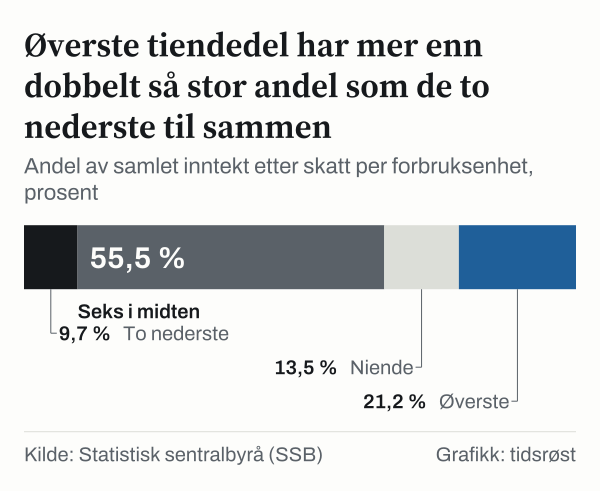
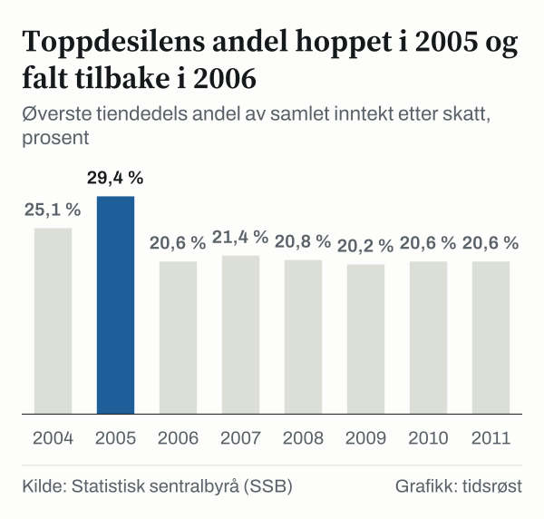

Hva skjer egentlig i halene av inntektsfordelingen, der de aller laveste og de aller høyeste inntektene ligger? Gjennomsnittet sier lite om dem, og medianen sier ingenting. Vi har stilt spørsmålet til tallene fra Statistisk sentralbyrå (SSB) og lett etter spor i begge ender.

Det første sporet er størrelsen. I 2024 hadde den tiendedelen av befolkningen med høyest inntekt 21,2 prosent av all inntekt etter skatt, mens den tiendedelen med lavest inntekt hadde 3,8 prosent. Det andre sporet er tidspunktet. Det meste av forskyvningen siden 1986 var på plass innen 2006, og siden 2006 har tallene beveget seg mye mindre. Det tredje sporet er de to hoppene i toppen. I 2005 og i 2021 steg den øverste tiendedelens andel kraftig, og året etter var den lavere igjen.

Hva betyr dette for deg som leser? At ett enkelt tall for «ulikheten» kan gi et skjevt bilde. En stabil midtdel kan skjule at toppen flytter seg, og en bevegelse i toppen sier ikke noe om hva som har skjedd i bunnen. Nedenfor går vi gjennom begge ender hver for seg, med egne beregninger, og er tydelige på hva tallene ikke kan svare på.

## Ti like store grupper, ett enkelt mål

Metoden er enkel. SSB rangerer alle personer etter inntekten etter skatt, justert for hvor stor husholdningen er og hvem som bor i den. Deretter deles rekken i ti like store grupper, desiler. Den første gruppen er den tiendedelen med lavest inntekt, den tiende er den med høyest. For hver gruppe oppgir SSB hvor stor del av den samlede inntekten etter skatt gruppen har.

Ved perfekt likhet ville hver gruppe hatt en tiendedel. Det har ingen gruppe, og det er heller ikke poenget. Poenget er hvordan avstanden endrer seg over tid, og hvor i fordelingen endringene skjer.

Justeringen for husholdningsstørrelse er viktig. Uten den ville en enslig person og en barnefamilie med samme samlede inntekt framstå som like godt stilt, og det er de ikke. Derfor måles inntekten per forbruksenhet, en felles regneenhet som SSB bruker for å gjøre husholdninger av ulik størrelse sammenlignbare.

## Nederst: en langsom glidning siden 1986

Spor nummer én ligger i bunnen. Den nederste tiendedelen hadde 4,5 prosent av inntekten etter skatt i 1986. I 2024 hadde den 3,8 prosent. Det er en nedgang på 0,7 prosentpoeng på knappe førti år, altså ingen rask bevegelse.

Samme bilde får vi når vi ser på hele nedre halvdel. De to nederste tiendedelene hadde til sammen 10,8 prosent i 1986. I 2024 hadde de 9,7 prosent. Hver eneste av de åtte nederste tiendedelene har en mindre andel i 2024 enn i 1986.

Øverste tiendedel gikk fra 18,1 prosent til 21,2 prosent, en økning på 3,1 prosentpoeng. Den niende tiendedelen står uendret på 13,5 prosent. Den øverste gruppen er den eneste med større andel i 2024 enn i 1986, mens de seks i midten har gått fra 57,4 prosent til 55,5 prosent av inntekten etter skatt, en nedgang på 1,9 prosentpoeng.

*Andel av samlet inntekt etter skatt per forbruksenhet, prosent. Kilde: Statistisk sentralbyrå (SSB).*

Avstanden mellom ytterpunktene viser det samme. I 1986 var forskjellen mellom andelen til øverste og nederste tiendedel 13,6 prosentpoeng. I 2024 var den 17,4 prosentpoeng, en økning på 3,8 prosentpoeng. Om vi legger sammen de to øverste og de to nederste tiendedelene, går de øverste fra 31,6 prosent til 34,7 prosent og de nederste fra 10,8 prosent til 9,7 prosent.

Øverste tiendedel har dermed mer enn dobbelt så stor andel som de to nederste til sammen. Det er en sammenligning av to ender, men den sier ikke hvordan de seks i midten har det. De seks i midten har samlet 55,5 prosent i 2024.

*Andel av samlet inntekt etter skatt per forbruksenhet, prosent. Kilde: Statistisk sentralbyrå (SSB).*

Her må vi være forsiktige med tidsaksen. I perioden 2006–2024 har øverste tiendedel gått opp 0,6 prosentpoeng, og den nederste har gått ned 0,3 prosentpoeng. Mesteparten av endringen siden 1986 hadde altså skjedd innen 2006. Neste spor handler om toppen.

## Øverst: en topp i 2005 og en i 2021

Det første hoppet ser vi i 2005. Øverste tiendedels andel var 25,1 prosent i 2004. I 2005 var den 29,4 prosent, en økning på 4,3 prosentpoeng på ett år. I 2006 var andelen 20,6 prosent, 8,8 prosentpoeng lavere.

*Øverste tiendedels andel av samlet inntekt etter skatt, prosent. Kilde: Statistisk sentralbyrå (SSB).*

SSB har selv beskrevet perioden i en artikkel i Samfunnsspeilet, publisert i 2008. SSB skrev at året 2005 var ett av årene da det ble utbetalt svært store aksjeutbytter. SSB skrev også at «Nye regler for kapitalbeskatning bidro til at husholdningene i toppen» tok ut mindre i aksjeutbytte i 2006, og at det da var en klar utjevning. Artikkelen nevner høyere sysselsetting i 2006 som en annen del av bildet. SSB påpekte samtidig at statistikken ikke dekker uttak av reinvesterte aksjeutbytter, slik at nedgangen i ulikhet kan være mindre enn tallene viser. Vi gjengir dette som SSBs egen beskrivelse og trekker ingen egne slutninger av det.

Den samme formen ser vi igjen i 2021. Da var den øverste tiendedelens andel 24,5 prosent, 2,9 prosentpoeng høyere enn i 2020. I 2022 var den 21,6 prosent, en nedgang på 2,9 prosentpoeng. Her har vi ikke funnet noen forklaring fra SSB i kildene vi har brukt, og vi gir derfor heller ingen. Hoppet er mindre enn i 2005, men formen er den samme: ett enkelt år der toppen springer ut, og et år senere der den er lavere igjen.

## Hvor starter halene i kroner?

Andeler forteller hvor mye av kaken gruppene har. De sier ikke hvor høy inntekten er der halen begynner. For det trenger vi grenseverdier. SSB oppgir hvilken inntekt etter skatt per forbruksenhet som skiller gruppene fra hverandre, regnet i faste priser slik at tallene kan sammenlignes over tid.

I 2024 lå grensen for den tiendedelen med lavest inntekt på 297 000 kroner. Midten, der halvparten har mer og halvparten mindre, lå på 513 500 kroner, og grensen for den tiendedelen med høyest inntekt lå på 830 500 kroner. Grensen for den hundredelen med aller høyest inntekt var 1 568 400 kroner.

Forholdet mellom grensen for høyeste og laveste tiendedel er 2,8. Vi kom fram til tallet ved å dele de to grensene på hverandre. I 2004 var forholdet 2,6. Grensen for høyeste hundredel er 3,1 ganger grensen for midten, mens midten er 1,7 ganger grensen for laveste tiendedel. Det er toppen av fordelingen som ligger lengst unna midten.

*Grenseverdi for inntekt etter skatt per forbruksenhet, faste priser, kroner. Kilde: Statistisk sentralbyrå (SSB).*

I perioden 2004–2024 har grensene steget i alle deler av fordelingen. Grensen for laveste tiendedel er 34,0 prosent høyere i faste priser, midten 40,7 prosent og grensen for høyeste tiendedel 44,5 prosent. Grensen for hundredelen med høyest inntekt er bare 23,3 prosent høyere, og den svinger kraftig mellom enkelte år.

Mønsteret finnes også her i 2021. Da steg grensen for høyeste hundredel 23,9 prosent fra året før, mens midten steg 0,7 prosent og grensen for laveste tiendedel 1,8 prosent. I 2022 falt grensen for høyeste hundredel 19,1 prosent.

## Lavinntektsandelen viser bunnen på en annen måte

Hittil har vi målt bunnen som en tiendedel av befolkningen. Et annet mål er hvor mange som ligger under en fast avstand til medianinntekten. SSB oppgir andelen personer i husholdninger med inntekt etter skatt under seksti prosent av medianen, og under femti prosent.

Den første andelen var 11,0 prosent i 2004. I 2024 var den 12,8 prosent, en økning på 1,8 prosentpoeng. Den andre var 6,1 prosent i 2004. I 2024 var den 7,0 prosent, en økning på 0,9 prosentpoeng. Begge går i samme retning som andelen til den nederste tiendedelen.

Et slikt mål er relativt. Når medianen stiger, stiger også grensen, og en person kan ha fått høyere inntekt i faste kroner og likevel havne under den. Andelen forteller derfor noe annet enn grensen for nederste tiendedel, som i faste priser har steget.

## To måter å lese de samme tallene på

Tallene kan leses på minst to måter, og begge er forenlige med dem.

Første lesning legger vekt på retningen over lang tid. Over snart førti år er den øverste tiendedelens andel større, mens andelen er mindre i alle de andre, bortsett fra den niende, som er uendret. Lavinntektsandelene har gått opp, og forskjellen mellom høyeste og laveste tiendedel har vokst.

Motsatt legger andre lesning vekt på stabiliteten siden 2006. Øverste tiendedels andel var 20,6 prosent i 2006. I 2024 var den 21,2 prosent, en forskjell på 0,6 prosentpoeng. Forholdet mellom grensene for høyeste og laveste tiendedel har endret seg lite, og grensene har steget for alle. I denne lesningen var mesteparten av bevegelsen siden 1986 på plass innen 2006, og det som kom etterpå er små justeringer.

Vi tar ikke stilling mellom lesningene. Det vi kan si, er at en sammenligning av situasjonen i 1986 med situasjonen i 2024 er sterkt påvirket av hvilke år vi velger som start og slutt.

## Det desilene ikke kan fortelle

Flere sider ved tallene setter grenser for hva vi kan lese ut av dem.

Første begrensning er at tiendedelene viser øyeblikksbilder. Personene i den øverste gruppen i 2005 er ikke nødvendigvis de samme som i 2006. Tallene sier hva fordelingen så ut som hvert år, ikke hva som skjedde med enkeltpersoner.

En annen begrensning er at statistikken måler inntekt etter skatt slik den framkommer i skatte- og registerdata. SSB har selv påpekt at statistikken ikke dekker uttak av reinvesterte aksjeutbytter. Vi har ikke gått gjennom hvordan hver enkelt inntektskomponent er behandlet over hele perioden siden 1986, og små forskjeller i tallene bør derfor leses som omtrentlige.

Videre er dette en fordeling av inntekt, ikke av formue. Den forteller ingenting om hva ulike grupper har å falle tilbake på.

Til slutt er grensene regnet i faste priser, slik SSB har publisert dem. Vi har ikke undersøkt hvilket prisår de er omregnet til, og de bør derfor ikke sammenlignes direkte med tall i løpende kroner.

## Slik regnet vi

Alle tall er hentet fra Statistikkbanken til SSB. Andelene kommer fra SSBs tabell over desilfordelt inntekt, grenseverdiene i kroner fra tabellen over persentilgrenser, og lavinntektsandelene fra tabellen over avstand til medianinntekten. Tabellkodene står i kildelisten. Alle gjelder inntekt etter skatt per forbruksenhet.

Vi har regnet differanser i prosentpoeng, summer av andeler, endringer i prosent for grenseverdiene og forholdstall mellom grenseverdier. De seks midterste tiendedelene er summen av tredje til åttende tiendedel. Endring i prosent er regnet som ny verdi minus gammel verdi, delt på gammel verdi.

Dette er ingen prognose. Tallene dekker perioden 1986–2024, og vi sier ingenting om hva som kommer.

## Kilder

- [SSB: Fordeling per forbruksenhet etter desil](https://www.ssb.no/statbank/table/04755)
- [SSB: Grenseverdier for inntekt etter skatt per forbruksenhet](https://www.ssb.no/statbank/table/10307)
- [SSB: Andel personer under ulike avstander til medianinntekten](https://www.ssb.no/statbank/table/06801)
- [SSB: Flere tar del i inntektsveksten (Samfunnsspeilet, desember 2008)](https://www.ssb.no/inntekt-og-forbruk/artikler-og-publikasjoner/flere-tar-del-i-inntektsveksten)
