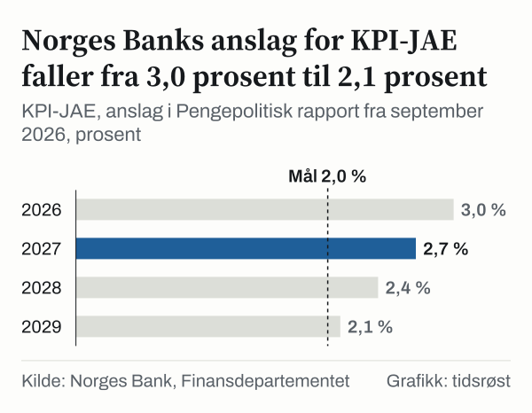

Norges Bank anslo i september 2026: kjerneinflasjonen, målt som KPI-JAE, ligger på 3,0 prosent i året 2026. Statistisk sentralbyrå (SSB) målte 3,0 prosent i september 2026. Anslaget for hele året og utfallet for den siste måneden ligger altså på samme sted.

Vi ser her på forskjellen mellom tallet og 2 prosent. Målet for pengepolitikken er en årsvekst i konsumprisene som over tid er nær 2 prosent. Forskjellen mellom 3,0 prosent og 2 prosent er 1,0 prosentpoeng. Forskjellen er vår egen beregning, ikke et tall fra Norges Bank eller SSB.

Kjerneinflasjon, her målt som KPI-JAE, er prisveksten på varer og tjenester når energivarer og virkningen av endrede avgifter er tatt ut. Tallet sier hvor mye mer det koster i en måned enn i samme måned året før.

Hver eneste måned siden januar 2021 er gjennomgått. Vi har lett etter spor i tallene: når tallet krysset 2 prosent, hvor høyt det gikk, og hvordan det har utviklet seg siden.

![Linjediagram over Kjerneinflasjonen toppet seg i juni 2023: KPI-JAE: jan. 2021: 2,7 %, feb. 2021: 2,7 %, mar. 2021: 2,7 %, apr. 2021: 2,0 %, mai 2021: 1,6 %, jun. 2021: 1,4 %, jul. 2021: 1,2 %, aug. 2021: 1,1 %, sep. 2021: 1,3 %, okt. 2021: 1,0 %, nov. 2021: 1,3 %, des. 2021: 1,8 %, jan. 2022: 1,3 %, feb. 2022: 2,1 %, mar. 2022: 2,1 %, apr. 2022: 2,6 %, mai 2022: 3,4 %, jun. 2022: 3,7 %, jul. 2022: 4,6 %, aug. 2022: 4,6 %, sep. 2022: 5,3 %, okt. 2022: 5,8 %, nov. 2022: 5,8 %, des. 2022: 5,7 %, jan. 2023: 6,5 %, feb. 2023: 5,9 %, mar. 2023: 6,1 %, apr. 2023: 6,4 %, mai 2023: 6,6 %, jun. 2023: 6,9 %, jul. 2023: 6,4 %, aug. 2023: 6,3 %, sep. 2023: 5,6 %, okt. 2023: 6,0 %, nov. 2023: 5,8 %, des. 2023: 5,5 %, jan. 2024: 5,3 %, feb. 2024: 4,8 %, mar. 2024: 4,6 %, apr. 2024: 4,3 %, mai 2024: 4,1 %, jun. 2024: 3,5 %, jul. 2024: 3,3 %, aug. 2024: 3,3 %, sep. 2024: 3,1 %, okt. 2024: 2,6 %, nov. 2024: 2,9 %, des. 2024: 2,7 %, jan. 2025: 2,7 %, feb. 2025: 3,5 %, mar. 2025: 3,3 %, apr. 2025: 3,0 %, mai 2025: 2,8 %, jun. 2025: 3,1 %, jul. 2025: 3,2 %, aug. 2025: 3,0 %, sep. 2025: 3,0 %, okt. 2025: 3,4 %, nov. 2025: 3,0 %, des. 2025: 3,2 %, jan. 2026: 3,4 %, feb. 2026: 3,0 %, mar. 2026: 3,0 %, apr. 2026: 3,2 %, mai 2026: 3,4 %, jun. 2026: 2,7 %, jul. 2026: 2,7 %, aug. 2026: 3,0 %, sep. 2026: 3,0 %; Mål: Mål: 2,0 %.](./graf-2.svg)
*Tolvmånedersendring i KPI-JAE, prosent. Kilde: Statistisk sentralbyrå (SSB), Finansdepartementet.*

## Hva målet er, og hva det måles mot

Vi begynner med teksten i selve målet. 18. september 2026 ble en ny bestemmelse om pengepolitikken fastsatt. Det operative målet står i den andre paragrafen: en årsvekst i konsumprisene som over tid er nær 2 prosent. Målet er altså satt for konsumprisindeksen, KPI, og det gjelder «over tid». Det er ikke et mål for en enkelt måned.

KPI-JAE er ikke det samme som KPI. SSB definerer KPI-JAE som KPI justert for avgiftsendringer og uten energivarer. Norges Bank publiserer anslag for KPI-JAE i sine rapporter ved siden av anslag for KPI.

Som referanse bruker vi 2 prosent når vi regner forskjellen fra tolvmånedersendringen. Forskjellen sier hvor mange prosentpoeng tallet er høyere eller lavere enn 2 prosent. Den sier ikke om målet er oppfylt, og det vurderer vi ikke.

## Måned for måned siden januar 2021

Rekken starter med 2,7 prosent: tolvmånedersendringen var 2,7 prosent i januar, februar og mars 2021. I april 2021 var den 2,0 prosent. Deretter gikk den ned, og laveste måned i hele rekken var oktober 2021 med 1,0 prosent.

Tallet var 1,8 prosent i desember 2021 og 1,3 prosent i januar 2022. Så snudde det. I februar 2022 var det 2,1 prosent, og siden da har ingen måned vært under 2 prosent. Kryssingen skjedde altså mellom januar og februar 2022.

Etter kryssingen steg tallet gjennom året 2022. Det var 3,4 prosent i mai 2022, 4,6 prosent i juli, 5,3 prosent i september og 5,8 prosent i oktober og november 2022. Stigningen fortsatte i 2023: 6,5 prosent i januar 2023, og toppen på 6,9 prosent i juni 2023.

Første halvår 2022 var tallet 2,1 prosent i februar, 2,1 prosent i mars, 2,6 prosent i april, 3,4 prosent i mai og 3,7 prosent i juni. I andre halvår var det 4,6 prosent i juli, 4,6 prosent i august, 5,3 prosent i september, 5,8 prosent i oktober, 5,8 prosent i november og 5,7 prosent i desember.

Toppen kom altså godt over et år etter kryssingen. Fra toppen til september 2026 er tallet redusert med 3,9 prosentpoeng, fra 6,9 prosent til 3,0 prosent.

År for år ser kurven slik ut. I 2022 gikk tallet fra 2,1 prosent i februar til 5,7 prosent i desember. I 2024 gikk det fra 5,3 prosent i januar til 2,7 prosent i desember. I 2025 gikk det fra 2,7 prosent i januar til 3,2 prosent i desember. Så langt i 2026 har det gått fra 3,4 prosent i januar til 3,0 prosent i september.

Innenfor hvert år varierer tallet. I 2023 var høyeste måned juni med 6,9 prosent og laveste måned desember med 5,5 prosent. I 2024 var høyeste måned januar med 5,3 prosent og laveste måned oktober med 2,6 prosent. I 2025 var høyeste måned februar med 3,5 prosent og laveste måned januar med 2,7 prosent.

Regnet som årsgjennomsnitt, slik SSB beregner det, var kjerneinflasjonen 1,7 prosent i 2021, 3,9 prosent i 2022 og 6,2 prosent i 2023. I 2024 var den 3,6 prosent, og i 2025 var den 3,1 prosent.

## Forskjellen fra 2 prosent i halvårsskiftene

Hvis vi trekker 2 prosent fra hver måned, får vi en forskjell i prosentpoeng. Søylediagrammet viser forskjellen i juni og desember hvert år, og i den siste måneden.

*Tolvmånedersendring i KPI-JAE fratrukket 2 prosent, i prosentpoeng. Kilde: Finansdepartementet, Statistisk sentralbyrå (SSB).*

I juni og desember 2021 lå tallet henholdsvis 0,6 prosentpoeng og 0,2 prosentpoeng lavere enn 2 prosent. I juni 2022 var forskjellen 1,7 prosentpoeng, og i desember 2022 var den 3,7 prosentpoeng, med tallet høyere enn 2 prosent. Største forskjell i diagrammet er 4,9 prosentpoeng, i juni 2023.

Etter toppen minket forskjellen: 3,5 prosentpoeng i desember 2023, 1,5 prosentpoeng i juni 2024, deretter 0,7 prosentpoeng i desember 2024. Den var 1,1 prosentpoeng i juni 2025, 1,2 prosentpoeng i desember 2025, så 0,7 prosentpoeng i juni 2026. I september 2026 var den 1,0 prosentpoeng.

Fra og med desember 2024 har forskjellen ligget mellom 0,7 prosentpoeng og 1,2 prosentpoeng, både i de fire halvårsskiftene og i september 2026. Månedstallene i 2026 har ligget mellom 2,7 prosent og 3,4 prosent.

## Fire mål på samme prisvekst

Neste spørsmål gjelder hvilket tall vi sammenligner. SSB publiserer flere avledede serier fra konsumprisindeksen. Tre av dem er KPI, KPI-JA og KPI-JE, som sammen med KPI-JAE gir fire ulike mål på samme prisvekst.

*Tolvmånedersendring, prosent. Kilde: Statistisk sentralbyrå (SSB), Finansdepartementet.*

Alle fire lå høyt i juni 2023: KPI på 6,4 prosent, KPI-JA på 6,1 prosent, KPI-JE på 7,1 prosent og KPI-JAE på 6,9 prosent. I september 2026 har de skilt lag. KPI var 3,4 prosent, KPI-JE 3,1 prosent og KPI-JAE 3,0 prosent. KPI-JA var 5,2 prosent.

KPI-JA var 5,2 prosent, mens de tre andre var mellom 3,0 prosent og 3,4 prosent. KPI-JA er KPI justert for avgiftsendringer, og forskjellen mellom KPI-JA og KPI er 1,8 prosentpoeng i september 2026. Vi har ikke undersøkt hva forskjellen skyldes.

Hvilket mål vi velger, påvirker også forskjellen fra 2 prosent. I september 2026 var den 1,4 prosentpoeng for KPI, 3,2 prosentpoeng for KPI-JA, 1,1 prosentpoeng for KPI-JE og 1,0 prosentpoeng for KPI-JAE. Målet i bestemmelsen er formulert for KPI.

## Norges Banks anslag for årene fremover

Gjennom hele saken har vi holdt oss til målte tall. Det finnes likevel en offentlig fremskriving av tallet, og den er Norges Banks, ikke vår. I Pengepolitisk rapport fra september 2026, publisert 24. september 2026, anslår Norges Bank at KPI-JAE blir 3,0 prosent i 2026, 2,7 prosent i 2027, 2,4 prosent i 2028 og 2,1 prosent i 2029.

*KPI-JAE, anslag i Pengepolitisk rapport fra september 2026, prosent. Kilde: Norges Bank, Finansdepartementet.*

Regnet mekanisk fra dette anslaget er forskjellen fra 2 prosent 0,7 prosentpoeng i 2027, 0,4 prosentpoeng i 2028, og 0,1 prosentpoeng i 2029. Forskjellen er vår beregning, ikke Norges Banks. Anslaget for KPI er 3,3 prosent i 2026 og 2,6 prosent i 2027.

Anslaget gjelder årsgjennomsnittet for hvert år, ikke en enkelt måned. Norges Banks tabell oppgir 3,1 prosent for utfallet i 2025, og SSBs årsgjennomsnitt for samme år er 3,1 prosent. Det sier bare at de to kildene gir samme tall i 2025. Vi har ikke sammenlignet hvordan tallene er beregnet.

Anslaget er Norges Banks. Vi har ikke vurdert det, og vi gjør ikke et eget anslag ved siden av.

## En annen måte å lese tallene på

Én lesning sammenligner med toppen i juni 2023: da var tolvmånedersendringen 6,9 prosent, og i september 2026 var den 3,0 prosent. En annen sammenligner med 2 prosent: 3,0 prosent er 1,0 prosentpoeng høyere. En tredje legger vekt på at tallet har ligget mellom 2,7 prosent og 3,4 prosent i hele året 2026, og at det ikke har vært lavere enn 2,7 prosent siden desember 2024.

Alle tre lesningene bruker de samme tallene. Forskjellen ligger i hva man sammenligner med. Tallene kan ikke avgjøre hvilken sammenligning som er den riktige, og det er ikke vår oppgave å gjøre det.

Enda en lesning er at KPI-JAE bare er ett av flere mål. Hvis vi i stedet ser på KPI, som målet i bestemmelsen er formulert for, var forskjellen fra 2 prosent 1,4 prosentpoeng i september 2026. For KPI-JA var den 3,2 prosentpoeng. Hvilket tall som er mest relevant, avhenger av spørsmålet man stiller.

## Grensene for en tolvmånedersrate

Et første forbehold: en tolvmånedersendring ser bakover. Den sammenligner én måned med samme måned året før. En uvanlig måned for et år siden påvirker derfor tallet nå, også om prisene den siste måneden har oppført seg som vanlig.

Tallene hopper dessuten fra måned til måned. I januar 2025 var tolvmånedersendringen 2,7 prosent, og i februar 2025 var den 3,5 prosent. Slike sprang gjør at en enkelt måned ikke alene sier noe om retningen.

Målet er satt «over tid». Vi har regnet forskjellen i hver enkelt måned, men målet gjelder et lengre forløp. Forskjellen i én måned er derfor ikke et mål på om målet er oppfylt.

Til slutt: vi har bare sett på nivået i prosent og ikke på hva som ligger bak. Vi har ikke delt KPI-JAE etter varer og tjenester, og vi sier ikke noe om hva som har drevet tallet opp eller ned.

## Slik regnet vi

Tolvmånedersendringene er hentet fra SSBs tabell over avledede serier fra konsumprisindeksen, serien KPI-JAE, for hver måned fra januar 2021 til september 2026. Fire andre serier, KPI, KPI-JA og KPI-JE, er hentet fra samme tabell for juni 2023 og september 2026. Årsgjennomsnittene er hentet fra den tilsvarende årstabellen.

Forskjellen fra 2 prosent er regnet slik: tolvmånedersendringen fratrukket 2 prosent. Målet på 2 prosent er hentet fra den andre paragrafen i bestemmelsen om pengepolitikken, slik den står på Lovdata.

Anslagene for perioden 2026–2029 er Norges Banks egne tall fra datafilen til Pengepolitisk rapport fra september 2026. Vi har ikke endret dem. Samme regnestykke, anslaget fratrukket 2 prosent, er brukt på anslagene som på de målte tallene.

## Kilder

- [SSB: Konsumprisindeks etter avledet serie, månedlige tall](https://www.ssb.no/statbank/table/14706)
- [SSB: Konsumprisindeks etter avledet serie, årlige tall](https://www.ssb.no/statbank/table/14707)
- [SSB: Konsumprisindeksen, om statistikken](https://www.ssb.no/priser-og-prisindekser/konsumpriser/statistikk/konsumprisindeksen)
- [Lovdata: Bestemmelse om pengepolitikken](https://lovdata.no/forskrift/2026-09-18-1815)
- [Norges Bank: Pengepolitisk rapport fra september 2026, datafil](https://www.norges-bank.no/contentassets/1462461ecf6a423eb7bc3e89c1cb0d2b/data-mpr-3-26.xlsx)
