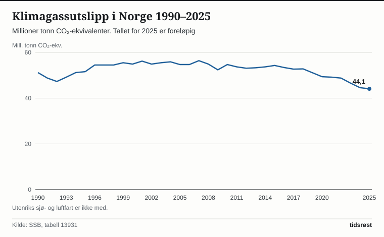

Norges samlede klimagassutslipp gikk ned til 44,1 millioner tonn CO₂-ekvivalenter i 2025, viser foreløpige tall fra Statistisk sentralbyrå (SSB) som ble lagt fram 4. juni 2026. Det er 0,5 millioner tonn (1,2 prosent) mindre enn året før, og 13,9 prosent lavere enn i referanseåret 1990. Etter klimaloven skal utslippene i 2030 være redusert med minst 55 prosent sammenlignet med 1990.

## Utslippene siden 1990

I referanseåret 1990 slapp Norge ut 51,2 millioner tonn CO₂-ekvivalenter (SSB-tabell 13931). Utover 1990-tallet vokste utslippene i takt med petroleumsaktiviteten, og fra 1996 til 2018 lå de mellom 52 og 57 millioner tonn i året, med en topp på 56,4 millioner tonn i 2007.

Siden 2019 har utslippene gått ned hvert år, og i 2025 var de 1,2 prosent lavere enn året før.

*Utslippene har gått ned hvert år siden 2019. Tallet for 2025 er foreløpig. Kilde: SSB, tabell 13931.*

Ifølge SSB er nedgangen i 2025 noe svakere enn de siste par årene.

SSB legger fram det endelige klimaregnskapet for 2025 i november 2026. Da tas det samtidig i bruk en oppdatert versjon av beregningsmodellen for veitrafikk for hele tidsserien tilbake til 1990.

## Utslipp etter kilde

Olje- og gassutvinning utgjorde 10,9 millioner tonn i 2025 – rundt en fjerdedel av de norske utslippene. Utslippene i sektoren var 0,9 prosent lavere enn i 2024. Utslippene fra landanleggene gikk ned, mens de på sokkelen økte litt. Samlet er utslippene i sektoren 32,5 prosent høyere enn i 1990.

Industri og bergverk sto for 10,7 millioner tonn i 2025. Siden 1990 har utslippene fra industrien gått ned med 44,0 prosent. Fra 2024 til 2025 gikk utslippene i industrien opp med 1,6 prosent, noe SSB forklarer med at flere anlegg hadde driftsstans i 2024, som ga lavere utslipp det året.

*Olje- og gassutvinning og industri var de største utslippskildene i 2025. Foreløpige tall. Kilde: SSB, tabell 13931.*

| Kilde | 2025 (mill. tonn) | Endring 1990–2025 | Endring 2024–2025 |
|---|---|---|---|
| Olje- og gassutvinning | 10,9 | +32,5 % | −0,9 % |
| Industri og bergverk | 10,7 | −44,0 % | +1,6 % |
| Luftfart, sjøfart, anleggsmaskiner m.m. | 7,4 | +38,9 % | +0,6 % |
| Veitrafikk | 6,9 | −6,9 % | −8,2 % |
| Jordbruk | 4,4 | −9,5 % | +0,9 % |
| Alle kilder | 44,1 | −13,9 % | −1,2 % |

## Utslipp fra veitrafikk

Utslippene fra veitrafikken gikk ned med 8,2 prosent fra 2024 til 2025, til 6,9 millioner tonn. I SSBs tidsserie tilbake til 1990 har utslippene fra veitrafikken ikke vært lavere, etter at de lå på 10,3 millioner tonn på toppen i 2015. Ifølge SSB var det 20 prosent flere elbiler på norske veier i 2025 enn året før, og elbiler utgjorde 95 prosent av nyregistrerte personbiler.

I jordbruket var utslippene 4,4 millioner tonn (ned 9,5 prosent siden 1990, og opp 0,9 prosent fra 2024), mens kategorien for innenriks luftfart, sjøfart, fiske og anleggsmaskiner utgjorde 7,4 millioner tonn.

De offisielle utslippstallene fra SSB og Miljødirektoratet følger FNs retningslinjer og omfatter utslipp som finner sted på norsk territorium.

## Kilder

- [SSB: Utslipp til luft (statistikkside, oppdatert 4. juni 2026)](https://www.ssb.no/natur-og-miljo/forurensning-og-klima/statistikk/utslipp-til-luft)
- [SSB: Liten nedgang i klimagassutslipp i 2025](https://www.ssb.no/natur-og-miljo/forurensning-og-klima/statistikk/utslipp-til-luft/artikler/liten-nedgang-i-klimagassutslipp-i-2025)
- [SSB Statistikkbanken: Tabell 13931 Klimagasser AR5, etter kilde](https://www.ssb.no/statbank/table/13931)
- [Miljødirektoratet: Norske utslipp og opptak av klimagasser](https://www.miljodirektoratet.no/ansvarsomrader/klima/klimagasser-utslippstall-regnskap/norske-utslipp-og-opptak-av-klimagasser/)
- [Lovdata: Lov om klimamål (klimaloven)](https://lovdata.no/dokument/NL/lov/2017-06-16-60)
