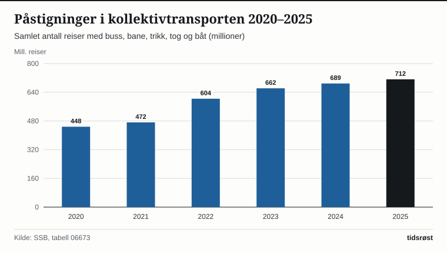

Norske passasjerer gjennomførte 712 millioner reiser med buss, T-bane, bybane, trikk, tog og båt i 2025, viser kollektivtransportstatistikken fra Statistisk sentralbyrå (SSB). Det er det høyeste passasjertallet som noen gang er registrert i Norge, og i løpet av første halvår 2026 har antall påstigninger økt videre med rundt 3 prosent sammenlignet med samme periode året før.

Veksten er særlig sterk i de store byregionene Oslo og Akershus, Bergen, Trondheimsområdet, Nord-Jæren, Kristiansandsregionen, Buskerudbyen og Nedre Glomma, der staten, fylkeskommunene og kommunene samarbeider gjennom langsiktige byvekstavtaler.

## Jevn passasjervekst hvert år etter pandemien

Etter at reisetallet var nede i 448 millioner under pandemiåret 2020, har kollektivtrafikken hentet seg raskt inn og satt nye rekorder i både 2024 (689 millioner reiser) og 2025 (712 millioner reiser).

Bussen er fortsatt det klart største kollektivmiddelet i Norge med 416 millioner påstigninger i 2025, tilsvarende 58,4 prosent av alle kollektivreiser. Deretter følger T-banen i Oslo og Bybanen i Bergen med 124 millioner reiser samlet, mens jernbanen passerte 84 millioner passasjerreiser.

*Samlet antall påstigninger i kollektivtransporten i Norge (millioner), 2020–2025. Kilde: SSB, tabell 06673.*

## Slik fordeler kollektivreisene seg mellom transportmidlene

Tabellen under viser utviklingen i påstigninger og billettinntekter for de fem hovedkategoriene i SSBs statistikk:

| Transportmiddel | Påstigninger 2023 (mill.) | Påstigninger 2025 (mill.) | Andel 2025 |
|---|---:|---:|---:|
| Buss | 391 | 416 | 58,4 % |
| Forstadsbane og T-bane | 116 | 124 | 17,4 % |
| Jernbane (tog) | 78 | 84 | 11,8 % |
| Trikk | 48 | 56 | 7,9 % |
| Passasjerbåt | 29 | 32 | 4,5 % |
| **Kollektivtransport i alt** | **662** | **712** | **100,0 %** |

*Kilde: SSB, tabell 06673.*

På jernbanen har åpningen av Follobanen og økt frekvens på lokaltogene på Østlandet, Jærbanen og Trønderbanen bidratt til at flere pendlere velger toget til og fra jobb.

*Antall påstigninger etter transportmiddel i 2025 (millioner). Kilde: SSB.*

## Elektriske bybusser og nasjonal reiseplanlegging via Entur

Parallelt med passasjerveksten har kollektivflåten gjennomgått en rask grønn omstilling. I Oslo, Bergen, Stavanger, Trondheim, Kristiansand, Bodø og Tromsø kjører nå brorparten av bybussene på batterielektrisitet eller biogass, noe som både kutter lokale klimagassutslipp og gir mindre støy i bygater og boligstrøk.

Samtidig har det statlige selskapet Entur samlet rutetider og billetter fra kollektivselskapene i hele landet på én felles digital plattform, slik at reisende enkelt kan planlegge reiser på tvers av fylkesgrenser og transportmidler.

## Kilder

- [SSB: Kollektivtransport – kvartals- og årsstatistikk](https://www.ssb.no/transport-og-reiseliv/landtransport/statistikk/kollektivtransport)
- [SSB Statistikkbanken: Tabell 06673 – Kollektivtransport, påstigninger og billettinntekter](https://www.ssb.no/statbank/table/06673)
- [Jernbanedirektoratet: Jernbanestatistikk og passasjertall](https://www.jernbanedirektoratet.no/jernbanesektoren/statistikk/)
- [Samferdselsdepartementet: Byvekstavtaler og satsing på kollektivtransport](https://www.regjeringen.no/no/tema/transport-og-kommunikasjon/kollektivtransport/byvekstavtaler/id2571927/)
