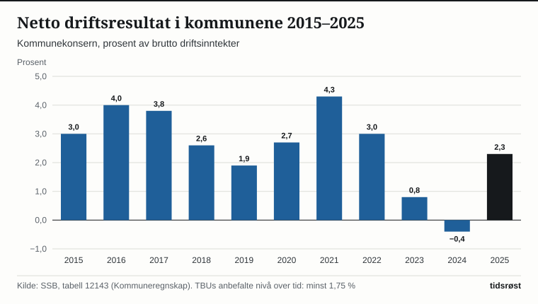
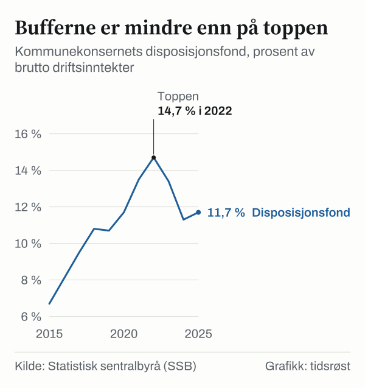

Kommunekonsernet hadde i 2025 et netto driftsresultat på 15,5 milliarder kroner. Det tilsvarer 2,3 prosent av brutto driftsinntekter, mot minus 0,4 prosent i 2024. Det viser Statistisk sentralbyrås (SSB) kommuneregnskap for kommunekonsernet, som ble omtalt i en artikkel 15. juni 2026.

## Hva er netto driftsresultat?

Netto driftsresultat er det som er igjen av driftsinntektene etter at kommunen har dekket driftsutgifter, renter og avdrag. Det brukes som mål på kommunenes økonomiske handlingsrom, fordi det viser hvor mye de kan sette av til investeringer og buffere. Teknisk beregningsutvalg for kommunal og fylkeskommunal økonomi (TBU) anbefaler at kommunene over tid bør ligge på minst 1,75 prosent.

*Netto driftsresultat for kommunekonsernet, prosent av brutto driftsinntekter. Kilde: SSB, tabell 12143.*

Resultatet lå over TBUs anbefaling til og med 2022. I 2023 var det 0,8 prosent, og i 2024 hadde kommunene samlet underskudd. Ifølge SSB er resultatet for 2025 tilbake på omtrent samme nivå som før pandemien.

## Gjeld og reserver

Kommunenes netto lånegjeld utgjorde 90,1 prosent av brutto driftsinntekter i 2025, ned 0,3 prosentpoeng fra året før. Gjeldsandelen er likevel høyere enn i 2015, da den var 78,3 prosent.

*Netto lånegjeld for kommunekonsernet, prosent av brutto driftsinntekter. Kilde: SSB, tabell 12143.*

Disposisjonsfondene, som er kommunenes frie buffere, utgjorde 11,7 prosent av driftsinntektene i 2025, opp fra 11,3 prosent i 2024, men lavere enn toppen på 14,7 prosent i 2022.

| Nøkkeltall, prosent av brutto driftsinntekter | 2023 | 2024 | 2025 |
|---|---:|---:|---:|
| Netto driftsresultat | 0,8 | −0,4 | 2,3 |
| Netto lånegjeld | 89,2 | 90,4 | 90,1 |
| Disposisjonsfond | 13,4 | 11,3 | 11,7 |

*Kilde: SSB, tabell 12143.*

## Forskjeller mellom kommunene

Det er forskjeller mellom kommunene. I 2025 hadde 41 av 357 kommuner negativ fri egenkapital i drift, opp fra 38 i 2024. Av disse står 23 kommuner i Robek-registeret. De negative disposisjonsfondene summerte seg til drøye 2 milliarder kroner, og Robek-kommunene sto for om lag 1,5 milliarder kroner av dette. Fra 2022 til 2025 økte antallet kommuner med negativt fond fra 9 til 41.

## Kilder

- [SSB: Fortsatt krevende økonomi i mange kommuner, tross samlet oppgang (15. juni 2026)](https://www.ssb.no/offentlig-sektor/kommunale-finanser/statistikk/kommuneregnskap/artikler/fortsatt-krevende-okonomi-i-mange-kommuner-tross-samlet-oppgang)
- [SSB: Tabell 12143 – Finansielle nøkkeltall i prosent av brutto driftsinntekter, kommunekonsern](https://www.ssb.no/statbank/table/12143)
