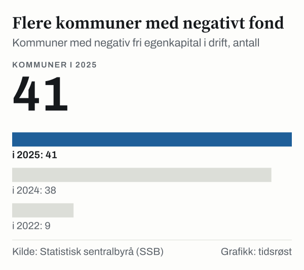

Kommunekonsernet hadde i 2025 et netto driftsresultat på 15,5 milliarder kroner. Det tilsvarer 2,3 prosent av brutto driftsinntekter, mot minus 0,4 prosent i 2024. Det viser de reviderte kommuneregnskapene fra Statistisk sentralbyrå (SSB), som ble omtalt i en artikkel 15. juni 2026.

*Netto driftsresultat for kommunekonsernet, prosent av brutto driftsinntekter, 2015–2025. Kilde: SSB, tabell 12143.*

## Hva er netto driftsresultat?

Netto driftsresultat er det som er igjen av driftsinntektene når driftsutgifter, renter og avdrag er betalt. SSB kaller det hovedindikatoren for økonomisk balanse i kommunesektoren. Overskuddet kan brukes til investeringer eller settes av til senere. Teknisk beregningsutvalg for kommunal og fylkeskommunal økonomi (TBU) anbefaler at kommunene over tid ligger på minst 1,75 prosent.

Resultatet lå over dette nivået hvert år fra 2015 til 2022. I 2023 falt det til 0,8 prosent, og i 2024 gikk kommunene samlet med underskudd. Ifølge SSB er resultatet for 2025 tilbake på omtrent samme nivå som før pandemien.

## Buffere og gjeld

Disposisjonsfondene er avsatte inntekter som kommunene fritt kan bruke til drift eller investeringer. De utgjorde 11,7 prosent av driftsinntektene i 2025, opp fra 11,3 prosent i 2024, men under toppen på 14,7 prosent i 2022.

*Disposisjonsfond for kommunekonsernet, prosent av brutto driftsinntekter, 2015–2025. Kilde: SSB, tabell 12143.*

Netto lånegjeld utgjorde 90,1 prosent av brutto driftsinntekter i 2025, ned 0,3 prosentpoeng fra året før. I 2015 var andelen 78,3 prosent.

| Nøkkeltall, prosent av brutto driftsinntekter | 2023 | 2024 | 2025 |
|---|---:|---:|---:|
| Netto driftsresultat | 0,8 | −0,4 | 2,3 |
| Disposisjonsfond | 13,4 | 11,3 | 11,7 |
| Netto lånegjeld | 89,2 | 90,4 | 90,1 |

*Kilde: SSB, tabell 12143.*

## Forskjeller mellom kommunene

Av landets 357 kommuner hadde 41 negativ fri egenkapital i drift i 2025, mot 38 i 2024. Det betyr at disposisjonsfondet minus tidligere underskudd er mindre enn null. 23 av de 41 står i Robek-registeret, der kommuner i økonomisk ubalanse, eller som ikke har vedtatt budsjett, økonomiplan eller regnskap innen fristene, blir oppført.

*Kommuner med negativ fri egenkapital i drift. Kilde: SSB, artikkel 15. juni 2026.*

Ifølge SSB økte antallet kommuner med negativt disposisjonsfond fra 9 i 2022 til 41 i 2025. De negative fondene summerte seg til drøye 2 milliarder kroner i 2025, og Robek-kommunene sto for om lag 1,5 milliarder kroner av dette.

## Kilder

- [SSB: Fortsatt krevende økonomi i mange kommuner, tross samlet oppgang (15. juni 2026)](https://www.ssb.no/offentlig-sektor/kommunale-finanser/statistikk/kommuneregnskap/artikler/fortsatt-krevende-okonomi-i-mange-kommuner-tross-samlet-oppgang)
- [SSB: Tabell 12143 – Finansielle nøkkeltall i prosent av brutto driftsinntekter, kommunekonsern](https://www.ssb.no/statbank/table/12143)
