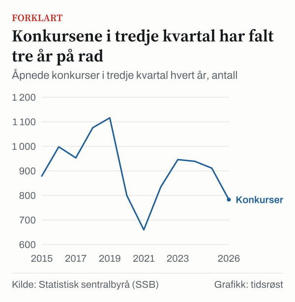
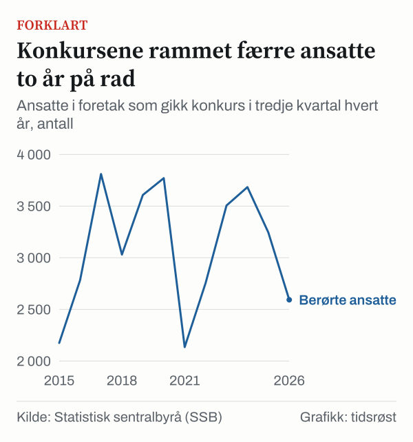

I 3. kvartal 2026 ble det åpnet 783 konkurser i Norge, ifølge Statistisk sentralbyrå (SSB). Det er 14,1 prosent færre enn i 3. kvartal 2025. Foretakene som gikk konkurs, hadde til sammen 2 593 ansatte, 20,1 prosent færre enn ett år tidligere.

## Færre konkurser og færre berørte ansatte

Fra 3. kvartal 2025 til 3. kvartal 2026 gikk antall åpnede konkurser ned fra 911 til 783, en nedgang på 128. Antall ansatte i foretakene som ble slått konkurs, sank i samme periode fra 3 245 til 2 593, eller 652 færre.

Antall berørte ansatte per konkurs sank fra 3,6 i 3. kvartal 2025 til 3,3 i 3. kvartal 2026. I 3. kvartal 2019 var snittet 3,2 ansatte per konkurs.

Omsetningen i foretakene som gikk konkurs, var 11,6 prosent lavere i 3. kvartal 2026 enn ett år før.

Ett kvartal er et smalt grunnlag. For de tre første kvartalene samlet ble det åpnet 2 653 konkurser i 2026, mot 3 233 i samme periode i 2025, en nedgang på 17,9 prosent. Antall berørte ansatte falt fra 12 173 til 10 073, en nedgang på 17,3 prosent.

Månedstallene peker samme vei. Det ble åpnet 328 konkurser i september 2026, mot 353 i september 2025. Det er 7,1 prosent færre.

*Åpnede konkurser i tredje kvartal hvert år, antall. Kilde: Statistisk sentralbyrå (SSB).*

## Hvor mange av konkursene gjelder enkeltpersonforetak?

Statistikken fra SSB deler konkursene i to grupper: konkurser i foretak som ikke er enkeltpersonforetak, og konkurser i enkeltpersonforetak, inkludert personlige konkurser.

Av konkursene i 3. kvartal 2026 var 758 i den første gruppen og 25 i den andre. Konkursene i enkeltpersonforetak utgjorde dermed 3,2 prosent av alle konkursene. Disse foretakene hadde 33 ansatte, eller 1,3 prosent av alle berørte ansatte.

Ett år tidligere, i 3. kvartal 2025, ble det åpnet 78 konkurser i enkeltpersonforetak, med 72 ansatte. De utgjorde da 8,6 prosent av konkursene. I 3. kvartal 2019 ble det åpnet 203 konkurser i enkeltpersonforetak.

Fra 3. kvartal 2025 til 3. kvartal 2026 falt antall konkurser i enkeltpersonforetak med 67,9 prosent. Antall konkurser i andre foretak falt med 9,0 prosent, fra 833 til 758. Antall ansatte i disse foretakene gikk ned fra 3 173 til 2 560.

## Tre næringer står for de fleste berørte ansatte

| Næring | Konkurser | Ansatte |
|---|---|---|
| Bygg og anlegg | 159 | 1 034 |
| Varehandel | 132 | 390 |
| Overnatting og servering | 87 | 264 |
| Alle næringer | 783 | 2 593 |

*Åpnede konkurser og ansatte i foretakene som gikk konkurs, 3. kvartal 2026, ny næringsgruppering. Kilde: SSB.*

Til sammen hadde bygg og anlegg, varehandel samt overnatting og servering 378 konkurser i 3. kvartal 2026. Det er 48,3 prosent av alle konkursene. De samme tre næringene hadde 1 688 berørte ansatte, eller 65,1 prosent av totalen.

Bygg og anlegg alene sto for 20,3 prosent av konkursene, men 39,9 prosent av de berørte ansatte.

## Færre konkurser enn i 1992 og i 2009

En egen månedlig serie fra SSB over åpnede konkurser går lenger tilbake. Summen av månedstallene for juli, august og september var 1 370 i 1992, 583 i 2007, 834 i 2008 og 1 028 i 2009.

Antall konkurser i 3. kvartal 2026, 783, er 42,8 prosent lavere enn summen for de samme månedene i 1992 og 23,8 prosent lavere enn i 2009. Sammenlignet med 3. kvartal 2019, da det ble åpnet 1 116 konkurser med 3 608 berørte ansatte, er antall konkurser 29,8 prosent lavere og antall berørte ansatte 28,1 prosent lavere.

Tallene viser at de to målene ikke alltid følger hverandre. Det ble åpnet 953 konkurser med 3 811 berørte ansatte i 3. kvartal 2017. Året etter, i 3. kvartal 2018, var det 1 076 konkurser, men 3 031 berørte ansatte. I 3. kvartal 2020 var antall konkurser 800, færre enn i 3. kvartal 2019, mens antall berørte ansatte steg til 3 771.

*Ansatte i foretak som gikk konkurs i tredje kvartal hvert år, antall. Kilde: Statistisk sentralbyrå (SSB).*

## Hva betyr den nye næringsgrupperingen?

Tallene for året 2026 er hentet fra en ny tabell hos SSB med ny næringsgruppering, mens tallene for tidligere år er hentet fra den gamle tabellen. For 2. kvartal 2026 finnes tall i både den gamle og den nye tabellen, og totalen er den samme: 950 konkurser.

Fordelingen på næringer er derimot ikke den samme. Bygg og anlegg hadde 237 konkurser i 2. kvartal 2026 etter den gamle grupperingen og 210 etter den nye, altså 27 færre. Varehandel hadde 141 etter den gamle grupperingen, der reparasjon av motorvogner var med, og 133 etter den nye. Overnatting og servering hadde 113 etter den gamle og 112 etter den nye.

Tall for enkeltnæringer i den gamle og den nye tabellen er derfor ikke direkte sammenlignbare.

## Kilder

- [SSB: Konkurser, ansatte og omsetning etter næring, ny næringsgruppering](https://www.ssb.no/statbank/table/14728/)
- [SSB: Konkurser, ansatte og omsetning etter næring, gammel næringsgruppering](https://www.ssb.no/statbank/table/09122/)
- [SSB: Åpnede konkurser per måned](https://www.ssb.no/statbank/table/09695/)
