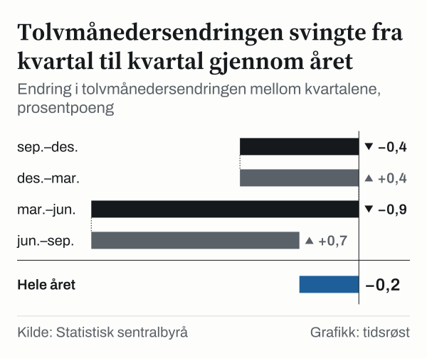

Den som fylte tanken i september 2026, betalte 26,3 prosent mer for drivstoff enn tolv måneder tidligere. Den som handlet mat, betalte 2,4 prosent mer. Den som leide bolig, betalte 3,6 prosent mer i husleie. Tre kvitteringer gir tre ulike tall. Likevel sier Statistisk sentralbyrå (SSB) at konsumprisindeksen, altså prisen på en fast handlekurv med varer og tjenester, steg 3,4 prosent fra september 2025 til september 2026.

Det ene tallet skjuler de andre. Indeksen er et gjennomsnitt, veid etter hvor mye husholdningene til sammen bruker på hver gruppe. De tretten hovedgruppene lå mellom minus 1,1 prosent og pluss 7,9 prosent. Spørsmålet i denne analysen er derfor enkelt å stille: hva holder totalen på 3,4 prosent, og hvor sitter avvikene?

For en vanlig husholdning betyr det at prisinntrykket er personlig. Den som bruker mye på drivstoff, har opplevd noe annet enn den som bruker mest på mat eller bolig. Vi har gått gjennom SSBs tall gruppe for gruppe og lagt vekter og prisendringer side om side.

## Totalen svingte gjennom året og endte på 3,4 prosent

Tolvmånedersendringen i totalindeksen var 3,6 prosent i september 2025. Den falt til 3,2 prosent i desember 2025, steg til 3,6 prosent i mars 2026 og falt til 2,7 prosent i juni 2026. I september 2026 var den 3,4 prosent. Mellom juni og september økte den altså med 0,7 prosentpoeng.

Tar vi alle fire kvartalssteg sammen, ender vi på en liten nedgang over hele året: tolvmånedersendringen var 0,2 prosentpoeng lavere i september 2026 enn i september 2025. Det store bildet er dermed stabilt, mens bevegelsene innenfor året er større enn forskjellen mellom start og slutt.

*Endring i tolvmånedersendringen mellom kvartalene, prosentpoeng. Kilde: Statistisk sentralbyrå.*

## Kurven består av tretten grupper, og boligen er størst

SSB har delt kurven i tretten hovedgrupper. Hver gruppe har en vekt som sier hvor stor del av kurven den utgjør. Vektene måles i promille og teller til sammen 1 000 promille. Tabellen viser vekt, tolvmånedersendring og avviket fra totalen på 3,4 prosent for hver gruppe i september 2026.

| Gruppe | Vekt | Tolvmånedersendring | Avvik fra totalen |
|---|---|---|---|
| Bolig, elektrisitet og brensel | 312,3 ‰ | 3,5 % | 0,1 pp |
| Transport | 138,1 ‰ | 4,8 % | 1,4 pp |
| Mat og alkoholfrie drikkevarer | 104,7 ‰ | 2,4 % | −1,0 pp |
| Fritid, sport og kultur | 84,5 ‰ | 4,0 % | 0,6 pp |
| Serverings- og overnattingstjenester | 59,4 ‰ | 6,0 % | 2,6 pp |
| Møbler, husholdningsartikler og vedlikehold | 58,5 ‰ | −1,1 % | −4,5 pp |
| Informasjon og kommunikasjon | 52,5 ‰ | 1,7 % | −1,7 pp |
| Andre varer og tjenester | 48,3 ‰ | 3,9 % | 0,5 pp |
| Klær og skotøy | 42,8 ‰ | 2,2 % | −1,2 pp |
| Alkoholholdige drikkevarer og tobakk | 34,1 ‰ | 2,6 % | −0,8 pp |
| Helse | 31,6 ‰ | 4,9 % | 1,5 pp |
| Forsikring og finansielle tjenester | 27,2 ‰ | 7,9 % | 4,5 pp |
| Utdanning | 6,1 ‰ | 4,3 % | 0,9 pp |

*Vekter i promille, tolvmånedersendring i prosent og avvik i prosentpoeng, september 2026. Kilde: SSB.*

Bolig, elektrisitet og brensel er størst med 312,3 promille. Sammen med transport utgjør den 450,4 promille, nesten halvparten av kurven. Boligen veier mer enn transport og mat til sammen, som kommer på 242,8 promille. Mesteparten av boligvekten ligger i beregnet husleie, en post SSB beskriver som noe som «viser boligkonsumet for selveierne». Den veier 206,0 promille, mens betalt husleie veier 49,1 promille. Til sammen utgjør de to husleieposten 255,1 promille, rundt en fjerdedel av kurven.

Vekten alene sier ikke hva som drev prisveksten. Den sier bare hvor mye en gruppe teller når gjennomsnittet regnes ut. Derfor må vekt og prisendring leses side om side.

## Åtte av tretten grupper steg raskere enn totalen

Åtte av de tretten hovedgruppene steg mer enn totalindeksen på 3,4 prosent. Forsikring og finansielle tjenester lå høyest med 7,9 prosent, fulgt av serverings- og overnattingstjenester med 6,0 prosent. Helse steg 4,9 prosent og transport 4,8 prosent. Avviket var størst i hver ende: forsikring og finansielle tjenester lå 4,5 prosentpoeng over totalen, mens avviket for møbler og husholdningsartikler var minus 4,5 prosentpoeng.

*Tolvmånedersendring minus totalindeksen, prosentpoeng, september. Kilde: Statistisk sentralbyrå.*

Gruppene som steg raskere enn totalen, utgjør 707,5 promille av kurven. De fem som steg saktere, utgjør 292,6 promille. Det store flertallet av kurven lå altså over snittet. Bolig, som alene veier 312,3 promille, lå bare 0,1 prosentpoeng over totalen. Den største gruppen følger dermed totalen nesten helt.

I den andre enden ligger møbler og husholdningsartikler, den eneste gruppen med negativ tolvmånedersendring: minus 1,1 prosent, med en vekt på 58,5 promille. Informasjon og kommunikasjon steg 1,7 prosent med en vekt på 52,5 promille, og klær og skotøy steg 2,2 prosent med 42,8 promille. På den andre siden steg helse 4,9 prosent, men veier bare 31,6 promille, og utdanning steg 4,3 prosent med en vekt på 6,1 promille. Matgruppen veier 104,7 promille, mer enn drivstoff, strøm og forsikring til sammen på 58,1 promille, og avviket fra totalen var minus 1,0 prosentpoeng.

## Små poster med store utslag, og én stor post midt på

Det første sporet er energi. Når SSB deler kurven etter leveringssektor, steg energivarene 15,0 prosent, 11,6 prosentpoeng mer enn totalen. De veier 34,2 promille. Innenfor transport steg drivstoff og smøremidler 26,3 prosent i september 2026, mot 2,2 prosent i september 2025. Drivstoffet veier 14,0 promille, og boligen veier 298,3 promille mer. I august 2026 var tolvmånedersendringen for drivstoff minus 0,2 prosent, så hoppet til september er 26,5 prosentpoeng.

Strøm viser det motsatte mønsteret. Elektrisitet inkludert nettleie steg 3,7 prosent i september 2026. Et år tidligere var tolvmånedersendringen 27,1 prosent, så den har falt med 23,4 prosentpoeng. Strømposten veier 32,3 promille.

Forsikring er neste spor. Forsikring steg 15,4 prosent og lå 12,0 prosentpoeng over totalen, men veier bare 11,8 promille. Drivstoff, strøm og forsikring veier til sammen 58,1 promille av kurven.

Servering og reise er det tredje sporet. Serveringstjenester steg 6,6 prosent og veier 51,4 promille. Passasjertransport med fly gikk motsatt vei og falt 6,6 prosent, med en vekt på 10,5 promille. Anskaffelse av kjøretøy steg 4,0 prosent og veier 57,4 promille.

Den store posten ligger midt i feltet. Betalt husleie steg 3,6 prosent, og beregnet husleie steg 3,3 prosent. Begge ligger nær totalen på 3,4 prosent. Hele gruppen bolig, elektrisitet og brensel steg 3,5 prosent. Den veier mest og beveger seg nesten som gjennomsnittet.

## Hva som har endret seg siden september 2025

Bildet var et annet for ett år siden. Tolvmånedersendringen for mat var 6,3 prosent i september 2025 og 2,4 prosent i september 2026, en endring på minus 3,9 prosentpoeng. For bolig, elektrisitet og brensel gikk den fra 6,1 prosent til 3,5 prosent, minus 2,6 prosentpoeng. Klær og skotøy gikk motsatt vei, fra minus 2,0 prosent til 2,2 prosent, en økning på 4,2 prosentpoeng. For andre varer og tjenester var økningen 5,1 prosentpoeng, fra minus 1,2 prosent til 3,9 prosent. Servering og overnatting økte 2,7 prosentpoeng og transport 1,9 prosentpoeng.

![Helningsdiagram over Prisveksten for mat og bolig ble lavere på ett år, for klær og andre varer høyere: sep. 2025: Mat: 6,3 %, Klær og sko: −2,0 %, Bolig og strøm: 6,1 %, Transport: 2,9 %, Fritid og kultur: 3,8 %, Servering og overnatting: 3,3 %, Forsikring og finans: 7,7 %, Andre varer og tjenester: −1,2 %; sep. 2026: Mat: 2,4 %, Klær og sko: 2,2 %, Bolig og strøm: 3,5 %, Transport: 4,8 %, Fritid og kultur: 4,0 %, Servering og overnatting: 6,0 %, Forsikring og finans: 7,9 %, Andre varer og tjenester: 3,9 %.](./graf-3.svg)
*Tolvmånedersendring i konsumprisindeksen, prosent. Kilde: Statistisk sentralbyrå.*

Deler vi kurven i varer og tjenester, steg varene 3,0 prosent og tjenestene 3,8 prosent i september 2026. Tjenestene veier 566,0 promille og varene 434,1 promille. Tjenestene steg dermed 0,8 prosentpoeng mer enn varene. I september 2025 var det omvendt, med 3,5 prosent for tjenester og 3,8 prosent for varer. Fra juni til september 2026 økte tolvmånedersendringen for tjenester med 1,2 prosentpoeng, mot 0,3 prosentpoeng for varer.

*Tolvmånedersendring i konsumprisindeksen, prosent. Kilde: Statistisk sentralbyrå.*

## En annen måte å lese tallene på

«Over totalen» og «under totalen» er relative begreper. En gruppe som steg 2,4 prosent, slik mat gjorde, ligger under snittet, men har likevel steget. Sammenligningen med totalen sier hvor gruppen ligger i feltet, ikke om den er stor eller liten isolert sett.

SSB skriver: «I konsumprisindeksen endres vektene en gang i året.» Vektene er derfor ikke de samme fra år til år. I september 2025 var boligens vekt 253,4 promille. I september 2026 er den 312,3 promille, en økning på 58,9 promille. Maten veide 12,7 promille mer i 2025 enn nå. Hva som ligger bak disse endringene i vektene, sier tabellene ikke noe om, og vi tolker dem ikke her. Vektene i tabellen er derfor ikke de samme som ble brukt for ett år siden, og sammenligninger av hvilke grupper som «telte mest» må ta hensyn til det.

Energi er en tredje komplikasjon. Tolvmånedersendringen sammenligner med samme måned året før, og et høyt nivå for ett år siden gir en lav tolvmånedersendring i dag, også når prisene ikke faller. Strømposten viser dette: 27,1 prosent i september 2025 og 3,7 prosent i september 2026.

## Det prisindeksen ikke viser

Indeksen beskriver en gjennomsnittlig handlekurv, ikke den enkelte husholdningens. Vektene er gjennomsnitt for alle, og en husholdning som bruker mer enn snittet på drivstoff eller servering, har et annet prisinntrykk enn tallene i tabellen.

Tallene er oppgitt med én desimal. Avvik på 0,1 prosentpoeng, som for bolig, ligger innenfor avrundingen. Vektene i en inndeling summerer heller ikke alltid nøyaktig: varer veier 434,1 promille og tjenester 566,0 promille, mens hele kurven er 1 000 promille.

Undergruppene vi har trukket frem, drivstoff, strøm, forsikring og fly, er valgt fordi de skiller seg ut. Det gir et skjevt utvalg: et tilsvarende utvalg av undergrupper med lave tall ville gitt et annet inntrykk av hvor prisene beveger seg mest.

Tabellene viser vekt og prisendring, men ikke hvor mye hver gruppe bidro til totalen. Det har vi ikke regnet ut, og denne analysen trekker ingen slutning om at én gruppe «forklarer» en bestemt del av totalen. Én måned sier dessuten lite: drivstoffet er et eksempel på at tolvmånedersendringen kan endre seg mye fra én måned til neste. Tallene sier ingenting om hva som skjer videre.

## Slik regnet vi

Alle tall kommer fra SSBs konsumprisindeks: tabellen etter vare- og tjenestegruppe for hovedgruppene og undergruppene, og tabellen etter leveringssektor for inndelingen i varer og tjenester. Vi har brukt tolvmånedersendring og vekter for september 2026, tolvmånedersendring for september 2025 og kvartalene mellom, samt vektene for september 2025.

Avviket for en gruppe er gruppens tolvmånedersendring minus totalens, i prosentpoeng. Endringer mellom to perioder er differansen mellom to tolvmånedersendringer. Vektsummene er enkle summer av vektene i promille. Vi har ikke multiplisert vekter med prisendringer og har derfor ikke regnet ut hver gruppes bidrag.

## Kilder

- [SSB: Konsumprisindeks, etter vare- og tjenestegruppe og måned](https://www.ssb.no/statbank/table/14700)
- [SSB: Konsumprisindeks, etter avledet serie og leveringssektor](https://www.ssb.no/statbank/table/14702)
- [SSB: Konsumprisindeksen, om statistikken](https://www.ssb.no/priser-og-prisindekser/konsumpriser/statistikk/konsumprisindeksen)
