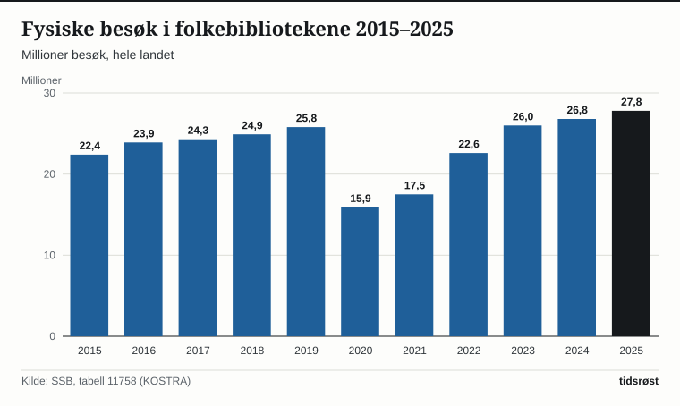

Seks av ti nordmenn var på kino i løpet av de siste tolv månedene, viser Norsk kulturbarometer 2025 fra Statistisk sentralbyrå (SSB), som ble lagt fram 5. mars 2026. Kinoen holder dermed stand som det mest brukte kulturtilbudet i landet, men har likevel mistet en betydelig del av publikummet sitt siden før pandemien: 62 prosent gikk på kino i 2025, mot 72 prosent i 2016. Enda brattere har nedturen vært for scenekunsten. Konserter, museer, festivaler og folkebibliotek har derimot hentet seg helt inn igjen til nivået fra midten av 2010-tallet.

## Slik har kulturvanene endret seg siden 2016

Kulturbarometeret er en landsomfattende spørreundersøkelse SSB har gjennomført med jevne mellomrom siden 1991. Deltakerne svarer på hvilke kulturarenaer de har besøkt de siste tolv månedene og hvor ofte. Fram til og med 2016 omfattet utvalget aldersgruppen 9–79 år, mens undersøkelsene fra og med 2021 tar med hele befolkningen fra 9 år og oppover. 2021-målingen ble dessuten gjort mens smittevernrestriksjoner holdt store deler av kulturlivet stengt.

Andelen av befolkningen som har oppsøkt de ulike kulturtilbudene minst én gang i løpet av det siste året, har utviklet seg slik:

| Kulturtilbud | 2016 | 2021 | 2023 | 2025 |
|---|---|---|---|---|
| Kino | 72 | 40 | 65 | 62 |
| Konsert | 62 | 23 | 58 | 60 |
| Idrettsarrangement | 55 | 29 | 48 | 49 |
| Folkebibliotek | 46 | 37 | 44 | 49 |
| Museum | 44 | 29 | 45 | 46 |
| Teater, musikal eller revy | 50 | 16 | 38 | 37 |
| Festival | 32 | 8 | 29 | 32 |

*Prosent. Kilde: SSB, tabell 13503.*

## Konsertene tar innpå kinoen

Under pandemien i 2021 stupte besøket over hele linjen: Andelen som hadde vært på konsert, falt fra 62 til 23 prosent, og for teater, musikal og revy krympet publikumsandelen fra 50 til 16 prosent. To år senere, i 2023, var det meste av korona-fallet hentet inn igjen, men siden den gang har utviklingen skilt lag.

*Fallet i 2021 var bratt for alle tilbudene, men kino og teater har ikke kommet helt tilbake. Kilde: SSB, tabell 13503.*

Fra 2023 til 2025 mistet kinoene ytterligere 3 prosentpoeng, samtidig som bibliotek, konserter og festivaler klatret videre. «Vi ser at konsert vokser frem som et av de aller mest populære kulturtilbudene», sier Fam Vivian Bekkengen, statistikkansvarlig for Norsk kulturbarometer i SSB, i byråets gjennomgang av tallene.

Kinonedgangen er særlig tydelig blant unge voksne. Blant 16–24-åringene gikk kinoandelen ned fra 90 prosent i 2016 til 82 prosent i 2025, og i aldersgruppen 25–44 år har andelen falt med hele 15 prosentpoeng fra 81 prosent i 2016. De ivrigste kinogjengerne finnes fortsatt blant barn og tenåringer mellom 9 og 15 år (92 prosent i 2025), mens bare 25 prosent av dem på 80 år og over var på kino.

## Rekordbesøk på bibliotekene – tross færre filialer

Folkebibliotekene skiller seg ut med klar vekst både i spørreundersøkelsen og i kommunenes egen KOSTRA-rapportering til SSB. I kulturbarometeret svarte 49 prosent at de hadde brukt et folkebibliotek i løpet av det siste året – 54 prosent av kvinnene mot 44 prosent av mennene, og hele 78 prosent blant barna mellom 9 og 15 år.

Totalt talte folkebibliotekene 27,8 millioner fysiske besøk i 2025. Etter bunnen på 15,9 millioner besøk under nedstengningene i 2020 har besøkstallet passert 2019-nivået på 25,8 millioner med rundt 7,6 prosent.

*Bibliotekbesøkene i 2025 var de høyeste i perioden. Kilde: SSB, tabell 11758.*

Også bokutlånet har skutt fart: 14,1 millioner utlånte bøker i 2025 er rundt 15 prosent mer enn de 12,2 millionene i 2019, drevet blant annet av at utlånet av barnebøker økte fra 6,7 til 8,3 millioner. Utlånet av fysisk film på bibliotekene er på sin side nesten borte – ned fra nær 2,0 millioner i 2016 til 0,3 millioner i 2025. Besøksrekorden har kommet til tross for at antall folkebibliotek i landet er redusert fra 675 i 2015 til 618 i 2025.

## Prislappen bremser unge konsert- og teatergjengere

Spørreundersøkelsen viser at interessen er større enn den faktiske bruken: Nær halvparten av de spurte oppgir at de gjerne skulle gått oftere i teateret, og rundt seks av ti ønsker seg oftere på kino. Det er særlig økonomi og mangel på tid som oppgis som bremseklosser. Blant unge mellom 16 og 24 år svarer hele 72 prosent at de skulle ønske de kunne gå oftere på konsert, og over halvparten av disse peker på billettprisene og egen økonomi som årsak.

Her stiller folkebibliotekene med en åpenbar fordel ved å være gratis. Ved siden av bokutlånet fungerer bibliotekene i økende grad som lokale møteplasser: I løpet av 2025 ble det holdt 75 294 arrangementer på norske folkebibliotek, med til sammen 1,9 millioner deltakere.

## 28,1 milliarder på kulturbudsjettet for 2027

I regjeringens forslag til statsbudsjett for 2027, lagt fram 7. oktober 2026, foreslås det en samlet ramme på 28,1 milliarder kroner under Kultur- og likestillingsdepartementet – en økning på rundt 946 millioner kroner fra 2026. Budsjettforslaget ligger nå til behandling i Stortinget.

Flere av budsjettgrepene er rettet direkte mot områdene i kulturbarometeret: Innkjøpsordningene for ny norsk litteratur under Norsk kulturfond foreslås styrket med 6 millioner kroner for å sende flere nye bøker ut til folkebibliotekene, samtidig som regjeringen arbeider med en egen leselyststrategi for voksne. Filmfeltet foreslås løftet med 75 millioner kroner – deriblant 5 millioner til en ny støtteordning for oppgradering av digitalt kinoutstyr rundt i landet – mens dansefeltet er tilgodesett med 10 millioner kroner ekstra.

«Derfor fortset vi styrkinga av innkjøpsordningane, no med ytterlegare seks millionar, slik at biblioteka over heile landet får fleire bøker», sier kultur- og likestillingsminister Lubna Jaffery (Ap) i departementets pressemelding.

## Kilder

- [SSB: Norsk kulturbarometer (statistikkside, oppdatert 5. mars 2026)](https://www.ssb.no/kultur-og-fritid/kultur/statistikk/norsk-kulturbarometer)
- [SSB: Færre går på kino og teater (5. mars 2026)](https://www.ssb.no/kultur-og-fritid/kultur/statistikk/norsk-kulturbarometer/artikler/faerre-gar-pa-kino-og-teater)
- [SSB Statistikkbanken: tabell 13503, Bruk av ulike kulturtilbud](https://www.ssb.no/statbank/table/13503)
- [SSB Statistikkbanken: tabell 11758, Aktivitet i folkebibliotek (KOSTRA)](https://www.ssb.no/statbank/table/11758)
- [SSB Statistikkbanken: tabell 11760, Bestand, utlån og omløpshastighet i folkebibliotek](https://www.ssb.no/statbank/table/11760)
- [Regjeringen.no: Eit rekordstort kulturbudsjett for fellesskap (7. oktober 2026)](https://www.regjeringen.no/no/aktuelt/eit-rekordstort-kulturbudsjett-for-fellesskap/id3174117/)
- [Regjeringen.no: Prop. 1 S (2026–2027) for Kultur- og likestillingsdepartementet](https://www.regjeringen.no/no/dokumenter/prop.-1-s-20262027/id3176084/)
