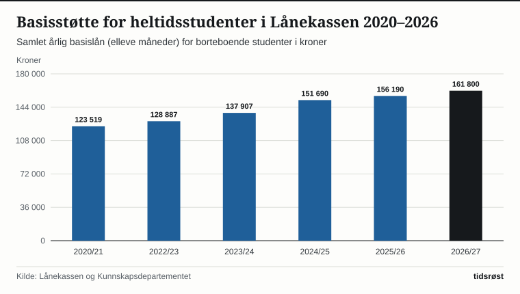

Statens lånekasse for utdanning (Lånekassen) ble opprettet i 1947 og er et av de mest sentrale velferds- og likestillingsvirkemidlene i Norge. I 2026 har Lånekassen over 1,2 millioner kunder – fordelt på rundt 415 000 elever og studenter som mottar utdanningsstøtte i løpet av studieåret, og nærmere 800 000 tidligere studenter som betaler tilbake lånene sine.

Samlet utbetaler Lånekassen over 42 milliarder kroner i lån og stipend hvert år, viser den offisielle statistikken fra etaten og Kunnskapsdepartementet.

## Kraftig opptrapping av basisstøtten for studenter

For borteboende studenter i høyere utdanning og på fagskole utbetales utdanningsstøtten i første omgang som et basislån over elleve måneder. Når studenten består eksamen og fullfører graden sin, blir inntil 40 prosent av basislånet gjort om til utdanningsstipend som man ikke skal betale tilbake.

*Årlig basisstøtte (elleve måneder) for borteboende heltidsstudenter i Lånekassen, 2020/21–2026/27. Kilde: Lånekassen og Kunnskapsdepartementet.*

De siste årene har regjeringen og Stortinget gjennomført ekstraordinære økninger i studiestøtten – blant annet et løft på 10 prosent i studieåret 2024/2025 – slik at basislånet har steget fra 123 519 kroner i 2020/2021 til over 161 000 kroner i studieåret 2026/2027. Studenter som har barn, eller som på grunn av nedsatt funksjonsevne ikke kan jobbe ved siden av studiene, har i tillegg rett til særskilte ekstrastipender.

## Slik virker støtteordningene for elever, studenter og voksne

Tabellen gir en oversikt over de viktigste ordningene i Lånekassen:

| Utdanningsnivå / gruppe | Hovedstøtte i Lånekassen | Stipendandel / særfordel |
|---|---|---|
| Videregående opplæring (ungdomsrett) | Utstyrsstipend og evt. borteboerstipend | 100 % stipend (ikke lån) |
| Høyere utdanning og fagskole | Basislån over 11 måneder + evt. skolepengelån | Inntil 40 % omgjøres til stipend ved bestått eksamen og grad |
| Voksne i grunnskole og videregående | Voksenstipend og lån til livsopphold | Fleksible ordninger for å fullføre fagbrev eller studiekompetanse |
| Yrkesaktive i etter- og videreutdanning | Deltidslån og tilleggslån for voksne | Tilpasset kombinasjon av jobb og nett-/samlingsbaserte studier |

*Kilde: Lånekassen, forskrift om utdanningsstøtte.*

Også personer med beskyttelse (flyktningstatus) eller opphold på humanitært grunnlag i Norge har rett til utdanningsstøtte fra Lånekassen på lik linje med norske statsborgere, inkludert flyktningstipend ved grunnskole- og videregående opplæring.

*Maksimal årlig sletting av studiegjeld i utvalgte regionale og yrkesrettede ordninger. Kilde: Lånekassen.*

## Opptil 60 000 kroner i årlig gjeldssletting i distriktene

Et av de mest treffsikre grepene i distriktspolitikken de siste årene er utvidelsen av ordningene for sletting av studiegjeld. I tiltakssonen i Finnmark og sju kommuner i Nord-Troms er den årlige gjeldsslettingen doblet til 20 prosent av opprinnelig lån, opptil **60 000 kroner i året**, for alle yrkesaktive som bor og arbeider i regionen i minst tolv måneder.

I tillegg har regjeringen innført en helt ny nasjonal distriktsordning som omfatter alle de 212 kommunene i sentralitetsklasse 5 og 6 over hele landet: Her kan yrkesaktive som bor og jobber i kommunen, få slettet **25 000 kroner** av studielånet sitt hvert eneste år frem til gjelden er nedbetalt.

## Kilder

- [Lånekassen: Offisiell statistikk og nøkkeltall om utdanningsstøtte](https://www.lanekassen.no/nb-NO/presse-og-samfunnskontakt/statistikk/)
- [Lånekassen: Sletting av gjeld når du bor i Finnmark, Nord-Troms eller utvalgte distriktskommuner](https://www.lanekassen.no/nb-NO/gjeld-og-betaling/finnmark-eller-nord-troms/)
- [Kunnskapsdepartementet: Utdanningsstøtte og forskrift om tildeling av utdanningsstøtte](https://www.regjeringen.no/no/tema/utdanning/utdanningsfinansiering/id1415/)
