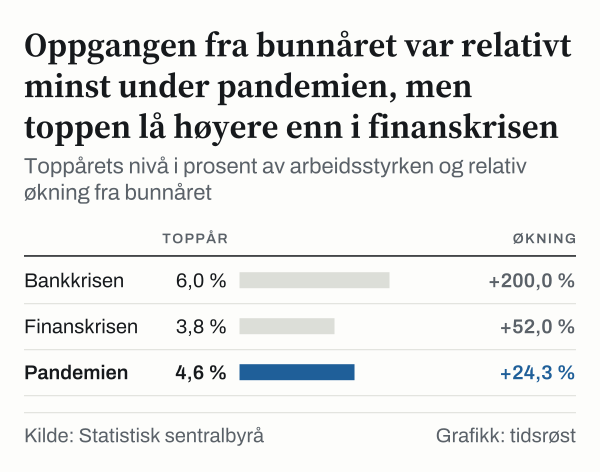
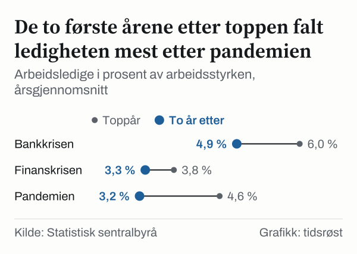

I 1993 var 6,0 prosent av arbeidsstyrken arbeidsledige, målt med arbeidskraftundersøkelsen (AKU) til Statistisk sentralbyrå (SSB). Dette er det høyeste årsnivået i en serie som begynner i 1972. Året etter var tallet 5,4 prosent, og i 1998 var det nede på 3,2 prosent.

Siden har Norge hatt to nye perioder med stigende ledighet som har fått egne navn. Under finanskrisen nådde ledigheten 3,8 prosent i 2010. Under pandemien nådde den 4,6 prosent i 2020. De tre periodene ligner hverandre mindre enn navnene antyder. Under bankkrisen var nivået høyest og veien opp lengst. Under pandemien var kurven kortere og brattere, og nedgangen etterpå var den raskeste av de tre.

For den som vil forstå hva et tall som 4,5 prosent ledighet betyr, gir historien en målestokk. I 2025 var ledigheten 4,5 prosent. Nivået er det samme som i 2015, og 0,8 prosentpoeng høyere enn i 2019. Vi har derfor satt de tre forløpene side om side, med samme tabell og samme mål, for å se hva som skiller dem. Sammenligningen er ikke en prognose, og tallene sier ingenting om hva som kommer.

## Bunnår og toppår: slik leser vi de tre periodene

Hva regnes som en nedtur? Vi bruker ingen egen definisjon. Vi har tatt med de tre periodene som har egne navn i norsk økonomisk historie: bankkrisen på slutten av åttitallet og begynnelsen av nittitallet, finanskrisen som kom i 2008 og pandemien som kom i 2020.

Navnene er etablerte periodebetegnelser, og vi bruker dem bare som merkelapper på tre perioder med stigende ledighet. Tidsrommene er bestemt av ledighetsserien, ikke av datoer for selve bankkrisen eller finanskrisen, og vi sier ingenting om bankene eller om hva som utløste periodene.

For hver periode har vi funnet bunnåret, altså det siste lave punktet før oppgangen, og toppåret, altså det året ledigheten var høyest i oppgangen. Bunnåret er henholdsvis i 1986, i 2007 og i 2019. Toppåret er henholdsvis i 1993, i 2010 og i 2020. Tallene er årsgjennomsnitt for personer fra femten til syttifire år, og ledigheten er andelen arbeidsledige av arbeidsstyrken.

*Arbeidsledige i prosent av arbeidsstyrken, årsgjennomsnitt fra bunnåret. Kilde: Statistisk sentralbyrå.*

Figuren viser de fire første årene fra bunnåret. Bankkrisen starter nesten flatt: ledigheten var 2,0 prosent i 1986 og 2,1 prosent i 1987, før den steg til 3,2 prosent i 1988 og 4,9 prosent i 1989. Finanskrisen starter lavere og stiger jevnere, fra 2,5 prosent i 2007 til 3,8 prosent i 2010. Pandemien har det høyeste utgangspunktet, 3,7 prosent i 2019, og tre år senere lå nivået under dette utgangspunktet, på 3,2 prosent i 2022.

Mellom bankkrisen og finanskrisen steg ledigheten også en periode, fra 3,2 prosent i 1999 til 4,6 prosent i 2005. Den oppgangen regnes ikke som en egen nedtur her, og den er ikke med. Avgrensningen er vår egen, og den påvirker hva sammenligningen kan si.

## Bankkrisen-perioden: sju år opp og fem år ned

Perioden med bankkrisen varte lengst: sju år fra bunn til topp, mot tre år for finanskrisen og ett år for pandemien. Ledigheten steg fra 2,0 prosent i 1986 til 6,0 prosent i 1993, og den steg i hvert eneste år fram til toppåret. Fra bunnår til toppår er økningen 4,0 prosentpoeng, eller 200 prosent regnet i forhold til utgangspunktet.

![Linjediagram over Ledigheten nådde sitt høyeste årsnivå i 1993: Arbeidsledighet: 2,1 % i 1987, 3,2 % i 1988, 4,9 % i 1989, 5,2 % i 1990, 5,5 % i 1991, 5,9 % i 1992, 6,0 % i 1993, 5,4 % i 1994, 4,9 % i 1995, 4,8 % i 1996, 4,0 % i 1997, 3,2 % i 1998, 3,2 % i 1999, 3,4 % i 2000, 3,5 % i 2001, 3,9 % i 2002, 4,5 % i 2003, 4,5 % i 2004, 4,6 % i 2005, 3,4 % i 2006, 2,5 % i 2007, 2,7 % i 2008, 3,3 % i 2009, 3,8 % i 2010, 3,4 % i 2011, 3,3 % i 2012, 3,8 % i 2013, 3,6 % i 2014, 4,5 % i 2015, 4,7 % i 2016, 4,2 % i 2017, 3,8 % i 2018, 3,7 % i 2019, 4,6 % i 2020, 4,4 % i 2021, 3,2 % i 2022, 3,6 % i 2023, 4,0 % i 2024, 4,5 % i 2025.](./graf-2.svg)
*Arbeidsledige i prosent av arbeidsstyrken, årsgjennomsnitt. Kilde: Statistisk sentralbyrå.*

Det største hoppet kom i 1989, da ledigheten i 1988 var 3,2 prosent og i 1989 var 4,9 prosent, en økning på 1,7 prosentpoeng på ett år. De neste fire årene fortsatte den å stige i et langsommere tempo: 5,2 prosent i 1990, 5,5 prosent i 1991, 5,9 prosent i 1992 og 6,0 prosent i 1993.

Nedgangen tok fem år, mot sju år for oppgangen. Tallene var 5,4 prosent i 1994 og 4,9 prosent i 1995, så 4,8 prosent i 1996, 4,0 prosent i 1997 og 3,2 prosent i 1998. Ledigheten falt altså i hvert år etter toppen. To år etter toppen var den 1,1 prosentpoeng lavere enn på toppen. Selv i 1998 lå den, med 3,2 prosent, over bunnåret i 1986, som var 2,0 prosent.

## Finanskrisen: lavt utgangspunkt og kort topp

Utgangspunktet for finanskrisen var lavere enn for pandemien, men høyere enn for bankkrisen. Årsgjennomsnittet var 2,5 prosent i 2007, 2,7 prosent i 2008, 3,3 prosent i 2009 og 3,8 prosent i 2010. Økningen fra bunnår til toppår er 1,3 prosentpoeng, altså 52 prosent regnet i forhold til utgangspunktet. I prosentpoeng er dette under en tredjedel av oppgangen under bankkrisen.

Vi har valgt endepunktene selv: mars 2008 er en av månedene med lavest nivå før oppgangen, og mars 2010 er en av flere måneder med høyest nivå. SSB publiserer sesongjusterte tall med tremåneders glidende gjennomsnitt, og de viser at ledigheten var 2,6 prosent i mars 2008 og 4,1 prosent i mars 2010. Økningen er 1,5 prosentpoeng i løpet av to år. Oppgangen kom altså gradvis, og toppen varte ikke lenge: årsgjennomsnittet var 3,4 prosent i 2011 og 3,3 prosent i 2012.

To år etter toppen var ledigheten 0,5 prosentpoeng lavere enn på toppen. Dette er den minste nedgangen av de tre periodene, men nivået var heller ikke høyt å falle fra. I 2013 steg ledigheten igjen, til 3,8 prosent, og den var 4,5 prosent i 2015. Vi har ikke regnet den oppgangen som en del av finanskrisen, og vi forklarer den ikke her.

## Pandemien: måneder i stedet for år

Perioden med pandemien har det korteste forløpet. Årsgjennomsnittet steg fra 3,7 prosent i 2019 til 4,6 prosent i 2020, en økning på 0,9 prosentpoeng eller 24,3 prosent regnet i forhold til utgangspunktet. Så falt det til 4,4 prosent i 2021 og 3,2 prosent i 2022.

Årsgjennomsnittet jevner ut forløpet. Månedstallene viser at ledigheten var 3,7 prosent i mars 2020, måneden før oppgangen tok seg opp, og 5,5 prosent i august 2020, som er toppmåneden. Hvert månedstall er et tremåneders glidende gjennomsnitt og dekker derfor mer enn én måned. Økningen er 1,8 prosentpoeng på fem måneder. Under finanskrisen tok en økning på 1,5 prosentpoeng to år. Målt i månedstall var pandemiens oppgang altså større enn finanskrisens, og den kom på en brøkdel av tiden.

I desember 2021 var ledigheten 3,5 prosent, noe som er 2,0 prosentpoeng lavere enn i august 2020 og lavere enn nivået på 3,7 prosent i mars 2020, før oppgangen.

*Toppårets nivå i prosent av arbeidsstyrken og relativ økning fra bunnåret. Kilde: Statistisk sentralbyrå.*

To år etter toppåret var ledigheten 1,4 prosentpoeng lavere enn på toppen, mot 1,1 prosentpoeng lavere etter bankkrisen og 0,5 prosentpoeng lavere etter finanskrisen. Pandemien har altså den største nedgangen av de tre på to år. Den er også målt over et brudd i serien i 2021, som vi kommer tilbake til.

AKU teller som arbeidsledige de som ikke har vært i arbeid, som har søkt jobb aktivt de siste fire ukene og som kan begynne innen to uker. Personer som er permittert i mer enn tre måneder, kan også telles som arbeidsledige hvis de søker jobb og er tilgjengelige. Vi bruker AKU fordi den dekker alle tre periodene med ett mål, men serien har brudd som beskrives lenger ned.

## Samme antall arbeidsledige, ulik rate

Toppåret under bankkrisen og toppåret under pandemien har én ting til felles. I 1993 var det 127 000 arbeidsledige, og i 2020 var det 130 000. Antallet var altså 2,4 prosent høyere i 2020. Likevel var raten 1,4 prosentpoeng lavere, 4,6 prosent mot 6,0 prosent.

Forklaringen ligger i nevneren. Arbeidsstyrken var 2,1 millioner i 1993. I 2020 var den 2,8 millioner, en økning på 33,3 prosent. Når arbeidsstyrken vokser, må flere være arbeidsledige for at raten skal holde seg like høy. Rater fra ulike tiår kan derfor ikke leses som et mål på hvor mange mennesker som ble rammet. De sier noe om hvor stor andel av dem som ønsket arbeid som ikke fikk det.

*Arbeidsledige i prosent av arbeidsstyrken, årsgjennomsnitt. Kilde: Statistisk sentralbyrå.*

## Kan de tre periodene settes side om side?

Det finnes gode grunner til å være forsiktig. SSB peker selv på tre omlegginger i serien. I tabellens merknader står det at AKU ble lagt om i 2006, blant annet ved «å senke aldersgrensen» fra seksten til femten år. I 2018 ble det tatt i bruk «en ny estimeringsmetode», og tallene ble revidert tilbake i tid, helt til i 2006. I 2021 ble AKU lagt om igjen, og SSB beregner at omleggingen ga et brudd i antallet arbeidsledige på 5 400 personer. SSB oppgir at dette anslaget ikke er statistisk signifikant.

Bankkrisen ligger før alle de tre omleggingene, finanskrisen ligger mellom to av dem, og pandemien krysser den siste. Vi kan ikke sette en størrelse på hva dette gjør med sammenligningen.

SSB publiserer også en nyere tabell med en annen oppbygging. I den er ledigheten 4,0 prosent i 2010, som er 0,2 prosentpoeng høyere enn i tabellen vi ellers bruker. I 2020 er tallet 4,7 prosent, som er 0,1 prosentpoeng høyere. Rekkefølgen mellom de to periodene endres ikke. Tabellene har ulik oppbygging, og vi har ikke gått inn på forskjellen. Den er en påminnelse om at tall fra ulike tabeller ikke uten videre kan settes sammen. Den nyere tabellen går ikke lenger tilbake enn til i 2009, så vi kan ikke regne om økningen fra bunnåret i 2007 med den.

## Hva et årsgjennomsnitt ikke viser

AKU bygger på et utvalg, og SSB oppgir derfor en feilmargin. For årsgjennomsnittet i 2025 er den 0,2 prosentpoeng i hver retning. Marginen for en forskjell mellom to år er større, og vi har ingen marginer for pandemiårene. Økningen under pandemien, 0,9 prosentpoeng, er større enn marginen for ett års nivå i 2025, men det sier ikke at den er sikker. Forskjellene mellom nedgangene etter toppene er mindre entydige, og rekkefølgen bør leses med forbehold.

Raten sier heller ikke noe om hvem som ikke er med. Den som ikke søker arbeid, regnes ikke som arbeidsledig, og den som er i arbeid i redusert stilling regnes som sysselsatt. Et årsgjennomsnitt kan dessuten skjule store utslag innenfor året, slik pandemien viser. Ingen av tallene her sier noe om årsaker. Vi har lagt periodene ved siden av hverandre, og det er alt.

## Slik regnet vi

Vi har brukt SSBs årlige tabell over arbeidsledige (prosent av arbeidsstyrken, årsgjennomsnitt, alle personer fra femten til syttifire år) for alle årsnivåene. Bunnår og toppår er valgt som det laveste punktet før og det høyeste punktet i hver oppgang. Månedstallene er hentet fra SSBs månedstabell (sesongjustert, tremåneders glidende gjennomsnitt). Antallet arbeidsledige kommer fra den årlige tabellen og arbeidsstyrken fra SSBs tabell over personer etter arbeidsstyrkestatus. Feilmarginen og de alternative årsnivåene i 2010 og i 2020 er fra SSBs nyere tabell.

Forskjeller i prosentpoeng er differansen mellom to prosentandeler. Økninger i prosent er endringen regnet i forhold til utgangspunktet. Alle tall er hentet fra SSBs åpne API i oktober 2026 og kontrollert en gang til mot kilden.

## Kilder

- [SSB: Arbeidsledige etter alder og år (AKU, årlige tall)](https://www.ssb.no/statbank/table/08517)
- [SSB: Personer etter arbeidsstyrkestatus, alder og år](https://www.ssb.no/statbank/table/05111)
- [SSB: Arbeidsstyrken, sysselsatte og arbeidsledige, månedstall](https://www.ssb.no/statbank/table/13760)
- [SSB: Personer etter arbeidsstyrkestatus, alder og år, med feilmarginer](https://www.ssb.no/statbank/table/13618)
- [SSB: Om arbeidskraftundersøkelsen (AKU)](https://www.ssb.no/aku)
