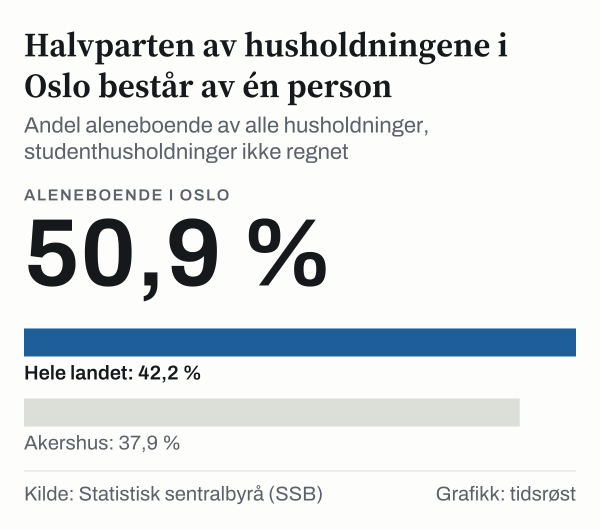

Akershus, 756 600 kroner. Rogaland, 739 600 kroner. Vestland, 704 800 kroner. Slik begynner rangeringen av fylkene etter medianinntekt etter skatt for husholdninger i 2024, og den slutter med Oslo på 635 200 kroner og Innlandet på 629 500 kroner. Hele landet lå på 676 100 kroner.

Det er fristende å lese rangeringen som en rangering av hvor folk har det best. Vi har sett nærmere på den i tallene fra Statistisk sentralbyrå (SSB), og bildet blir mer nyansert enn raden over lar forstå. Hovedfunnet er at Oslo, som står nest nederst på den samlede listen, ligger øverst i tre av fire husholdningstyper når vi sammenligner like med like.

En del av bildet er hvem husholdningene består av. I Oslo er 50,9 prosent av husholdningene aleneboende, mot 42,2 prosent i hele landet, når studenthusholdninger holdes utenfor. En husholdning av én person har i utgangspunktet én inntekt, og det kan bidra til en lavere median for alle husholdninger.

For leseren betyr det at en fylkesrangering også kan påvirkes av hvordan husholdningene er satt sammen. Nedenfor går vi gjennom rangeringen, forklaringen og de to måtene å lese tallene på, og vi sier hva de ikke kan brukes til.

## Rangeringen, fylke for fylke

Medianen er midten: Halvparten av husholdningene har mer enn medianen, og halvparten har mindre. Tallene er inntekt etter skatt for alle husholdninger i 2024, uavhengig av hvor mange som bor sammen.

Akershus ligger øverst med 756 600 kroner. Innlandet ligger nederst med 629 500 kroner. Forskjellen er 127 100 kroner, og medianen i Akershus er 1,2 ganger medianen i Innlandet. Bare fire av femten fylker ligger over landsmedianen: Akershus, Rogaland, Vestland og Møre og Romsdal. De øvrige elleve ligger under, og Oslo er blant dem med 635 200 kroner.

*Median inntekt etter skatt, alle husholdninger, kroner. Kilde: Statistisk sentralbyrå (SSB).*

Rangeringen er jevn i midten. Fra Trøndelag med 668 200 kroner til Østfold med 648 000 kroner er det bare 20 200 kroner mellom åtte fylker, og forskjellen mellom dem er liten sammenlignet med avstanden til Akershus og Rogaland øverst. Tre nordlige fylker ligger tett: Finnmark med 658 000 kroner, Nordland med 652 200 kroner og Troms med 650 600 kroner, alle under landsmedianen.

## Husholdningene i Oslo er satt sammen annerledes

Oslo skiller seg ut på en annen måte enn med inntekten. Det er det eneste fylket der mer enn halvparten av husholdningene består av én person: 50,9 prosent. Det neste fylket på listen er Finnmark med 45,2 prosent, og deretter Troms med 44,8 prosent. Akershus har den laveste andelen med 37,9 prosent, og samtidig den høyeste medianen.

En aleneboende har en lavere median enn et par. På landsbasis var medianinntekten etter skatt for aleneboende 397 500 kroner, for par uten barn 860 000 kroner og for par med barn 1 141 700 kroner. Et par uten barn har dermed en median som er 2,2 ganger så høy som for en aleneboende.

Aleneboende har lavere median enn par, og i Oslo utgjør de over halvparten av husholdningene. Vi har ikke regnet ut hvor stor del av avstanden til landsmedianen dette utgjør.

*Andel aleneboende av alle husholdninger, studenthusholdninger ikke regnet. Kilde: Statistisk sentralbyrå (SSB).*

Sammensetningen kan være en del av forklaringen, men tallene her viser ikke hvor stor del. Tallene sier heller ikke at aleneboende i Oslo tjener mindre enn andre: blant aleneboende har Oslo tvert imot høyest median.

## Samme husholdningstype, ny rangering

Når vi holder husholdningstypen fast, flytter Oslo seg opp. Blant aleneboende har Oslo høyest median med 431 600 kroner, foran Rogaland med 413 200 kroner. Blant par uten barn er Oslo også først med 960 300 kroner, foran Akershus med 923 500 kroner. Blant par med barn under atten år har Oslo høyest median med 1 238 300 kroner, foran Akershus med 1 206 600 kroner.

Bare i den fjerde gruppen, enslige mødre og fedre med barn under atten år, er Oslo ikke øverst. Der ligger Akershus på 595 100 kroner, Finnmark på 593 700 kroner og Oslo på 590 300 kroner, altså på tredjeplass.

Mot landsmedianen for hver husholdningstype ligger Oslo over i alle fire. Medianen for aleneboende er 8,6 prosent høyere i Oslo enn i landet, for par uten barn 11,7 prosent høyere, for par med barn 8,5 prosent høyere og for enslige forsørgere 3,9 prosent høyere. For alle husholdninger samlet er medianen i Oslo 6,0 prosent lavere enn landsmedianen.

*Median inntekt etter skatt i Oslo og forskjell mot landsmedianen, kroner. Kilde: Statistisk sentralbyrå (SSB).*

Den samlede medianen er høyest i Akershus, 121 400 kroner over Oslo. Men blant aleneboende er medianen i Oslo 18 500 kroner høyere enn i Akershus, og blant par med barn 31 700 kroner høyere. Oslo ligger altså ikke lavere enn landet i noen av de fire husholdningstypene, selv om samlet median er lavere.

Avstanden mellom høyeste og laveste fylke er ikke lik i alle husholdningstyper. For alle husholdninger samlet er den 127 100 kroner, og høyeste median er 1,20 ganger den laveste. Blant aleneboende er avstanden 59 500 kroner, med Oslo øverst og Østfold nederst, og forholdstallet er 1,16. Blant par uten barn er avstanden 161 500 kroner og forholdstallet 1,20, med Oslo øverst og Innlandet nederst. Blant par med barn er avstanden 185 100 kroner og forholdstallet 1,18, med Oslo øverst og Østfold nederst.

Minst er avstanden blant enslige forsørgere. Der er det 54 200 kroner mellom Akershus øverst og Telemark nederst, og forholdstallet er 1,10. Fylkene ligner mest på hverandre i den husholdningstypen, og er mest ulike i kroner blant par med barn.

## Fire år med vekst i alle fylker

Rangeringen er et øyeblikksbilde. Vi har også sett på utviklingen i perioden 2020–2024. Her setter fylkesinndelingen en grense: SSBs tabell bruker egne koder for Viken, Vestfold og Telemark og Troms og Finnmark bare for 2020–2023, og i 2024 er fylkene oppført hver for seg. Åtte fylker har uendret avgrensning i hele perioden 2020–2024: Oslo, Innlandet, Agder, Nordland, Trøndelag, Vestland, Møre og Romsdal og Rogaland.

I alle åtte steg medianen. Landsmedianen var 545 000 kroner i 2020. I 2024 var den 676 100 kroner, en økning på 24,1 prosent. Oslo hadde den høyeste veksten med 26,8 prosent og Nordland den laveste med 22,1 prosent. De seks øvrige fylkene lå mellom 23,3 prosent og 25,0 prosent. I 2020 var medianene oppgitt i hele tusen kroner, mens de i 2024 var oppgitt med hundrekroners presisjon.

*Median inntekt etter skatt, alle husholdninger, kroner. Kilde: Statistisk sentralbyrå (SSB).*

Forskjellene i vekst er små, men de er nok til å endre en plassering. I 2020 lå Innlandet 8 000 kroner over Oslo. I 2024 lå Oslo 5 700 kroner over Innlandet.

Tallene er løpende kroner og er ikke justert for prisstigning. Konsumprisindeksen er en nasjonal indeks, og vi har ikke sett på regionale prisforskjeller.

## To måter å lese rangeringen på

Den samlede rangeringen kan leses på to måter, og begge har noe for seg.

Første lesning tar medianen for alle husholdninger på alvor. Husholdningen er den enheten som deler utgifter, bolig og regninger. En husholdning av én person i Oslo har ikke tilgang til en partners inntekt, og det er det som ligger i tallet. Fra dette ståstedet beskriver Oslos median for alle husholdninger hva en typisk husholdning i fylket har å rutte med.

Motsatt sammenligner andre lesning like med like. Her er spørsmålet hva en aleneboende, et par uten barn eller et par med barn har i ulike fylker, og da ligger Oslo i toppen i tre av fire grupper. Fra dette ståstedet er spørsmålet hvordan hver husholdningstype ligger an i hvert fylke.

Begge lesningene bruker de samme tallene, og de besvarer to ulike spørsmål. Hvilken som er mest nyttig, avhenger av hva leseren vil vite. Ingen av dem sier noe om utgifter.

## Det medianen ikke viser

Medianen er ett tall for hele fylket. Den sier ingenting om hvor jevnt eller ujevnt inntektene er fordelt rundt midten, og to fylker med samme median kan se svært ulike ut.

Tallene i tabellen er ikke justert for husholdningens størrelse slik at en person som bor alene og en barnefamilie ville vært sammenlignbare. SSB har andre tabeller som justerer for husholdningsstørrelse, men vi har ikke brukt dem til fylkesvis sammenligning her.

Antall personer i husholdningene er heller ikke synlig i medianen. Et fylke med mange store barnefamilier og et fylke med mange enslige kan ha ulik median uten at noen av dem har det bedre eller dårligere enn de andre. Det er det vi forsøker å skille ut ved å sammenligne like husholdningstyper.

SSB opplyser i tabellen at «Studenthusholdninger og aleneboende barn» under atten år ikke er inkludert. SSB opplyser også at «Alle husholdninger» teller observasjoner som ikke er med i de fire husholdningstypene. Andelen aleneboende i Oslo gjelder derfor husholdninger uten studenthusholdninger, og vi trekker ingen slutning om dem.

Vi har brukt tallene slik SSB publiserte dem i januar 2026. Statistikk kan revideres, og små forskjeller mellom fylker, som de mellom Oslo og Innlandet, bør leses med det i bakhodet.

## Slik regnet vi

Alle tall kommer fra SSBs Statistikkbank, tabellen over inntekt for husholdninger etter region og husholdningstype, der vi har brukt medianen for inntekt etter skatt og antall husholdninger. Tabellkoden står i kildelisten. Tabellen omfatter ikke studenthusholdninger og aleneboende barn under atten år.

Vi har regnet forskjeller i kroner, prosentvis endring i perioden 2020–2024, forholdstall mellom to medianer og andelen aleneboende. Prosentvis endring er ny verdi minus gammel verdi, delt på gammel verdi. Andelen aleneboende er antall aleneboende husholdninger delt på alle husholdninger. For Oslo mot landet er endringen regnet fra landsmedianen til Oslos median.

Beløpene er løpende kroner. Vi har ikke justert for prisstigning og har ikke laget noen egen prognose.

## Kilder

- [SSB: Inntekt for husholdninger etter region og husholdningstype, median og antall](https://www.ssb.no/statbank/table/06944)
