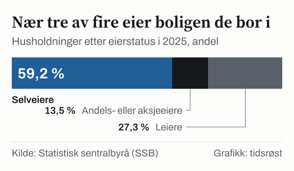

72,7 prosent av norske husholdninger eide boligen sin i 2025, viser boforholdsstatistikken fra Statistisk sentralbyrå (SSB): 59,2 prosent som selveiere og 13,5 prosent som andels- eller aksjeeiere, for eksempel i borettslag. De øvrige 27,3 prosent leide. Andelen leiere var høyest i Oslo med 33,8 prosent og lavest i Akershus med 24,1 prosent.

*Husholdninger i Norge etter eierstatus, 2025. Kilde: SSB, tabell 14891.*

## Fylkene

Etter Oslo hadde Finnmark (31,4 prosent), Troms (30,3 prosent) og Trøndelag (29,0 prosent) den høyeste andelen husholdninger som leier. Lavest var andelen i Akershus (24,1 prosent), Rogaland (24,4 prosent) og Telemark (24,5 prosent).

*Andel husholdninger som leier boligen, etter fylke, 2025. Den stiplede linjen viser hele landet. Kilde: SSB, tabell 14891.*

## Hele landet over tid

Fordelingen har vært stabil i ti år. I 2015 var 58,8 prosent av husholdningene selveiere, 13,5 prosent andels- eller aksjeeiere og 27,7 prosent leiere.

## Startlån

Husbanken er statens virkemiddel på boligområdet. Husbanken gir blant annet lån og tilskudd, og forvalter bostøtten. Husbankens største enkeltvirkemiddel er startlånet, som kommunene formidler. Ifølge Husbanken er startlån en låneordning for innbyggere som ikke får lån til boligkjøp i private banker.

I 2025 utbetalte kommunene 7 475 startlån på til sammen 16 165 millioner kroner, mot 8 027 lån og 17 048 millioner kroner i 2024. Ifølge Husbankens årsrapport var 61 prosent av husstandene som fikk startlån, barnefamilier.

| Virkemiddel i Husbanken | Målgruppe | Hovedformål |
|---|---|---|
| Startlån (via kommunene) | Husstander som ikke får lån i ordinær bank | Kjøp av egen bolig når ordinær bankfinansiering ikke er tilgjengelig |
| Lån og tilskudd til studentboliger | Studentsamskipnader og stiftelser | Bygging av studentboliger |
| Lån til boligkvalitet | Kommuner og utbyggere | Bygging og utbedring av boliger |
| Bostøtte | Husstander med lave inntekter og høye boutgifter | Månedlig økonomisk støtte til boutgifter |

*Kilde: Husbanken.*

## Hva tallene ikke viser

Statistikken viser hvem som eier eller leier boligen de bor i, ikke hvor store boliglån eierne har eller hva leien koster.

## Kilder

- [SSB Statistikkbanken: Tabell 14891 – Husholdninger etter eierstatus](https://www.ssb.no/statbank/table/14891)
- [Husbanken: Årsrapport 2025](https://www.husbanken.no/-/media/om-husbanken/arsrapporter/husbankens-arsrapport-2025.pdf)
- [Husbanken: Statistikk](https://www.husbanken.no/statistikk/)
