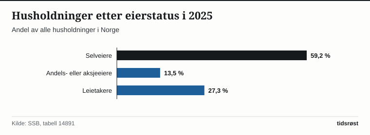

Ifølge SSBs boforholdsstatistikk eide 72,7 prosent av norske husholdninger boligen sin i 2025: 59,2 prosent som selveiere og 13,5 prosent som andels- eller aksjeeiere, for eksempel i borettslag. De øvrige 27,3 prosent leide.

Husbanken er statens virkemiddel på boligområdet. Husbanken gir blant annet lån og tilskudd, og forvalter bostøtten.

## Startlån

Husbankens største enkeltvirkemiddel er startlånet, som kommunene formidler. Ifølge Husbanken er startlån en låneordning for innbyggere som ikke får lån til boligkjøp i private banker. I 2025 utbetalte kommunene 7 475 startlån på til sammen 16 165 millioner kroner, mot 8 027 lån og 17 048 millioner kroner i 2024. Ifølge Husbankens årsrapport var 61 prosent av husstandene som fikk startlån, barnefamilier.

## Eierformer og Husbankens ordninger

Tabellen viser noen av Husbankens ordninger:

| Virkemiddel i Husbanken | Målgruppe | Hovedformål |
|---|---|---|
| Startlån (via kommunene) | Husstander som ikke får lån i ordinær bank | Kjøp av egen bolig når ordinær bankfinansiering ikke er tilgjengelig |
| Lån og tilskudd til studentboliger | Studentsamskipnader og stiftelser | Bygging av studentboliger |
| Lån til boligkvalitet | Kommuner og utbyggere | Bygging og utbedring av boliger |
| Bostøtte | Husstander med lave inntekter og høye boutgifter | Månedlig økonomisk støtte til boutgifter |

*Kilde: Husbanken.*

*Fordeling av husholdninger i Norge etter eierstatus, 2025. Kilde: SSB, tabell 14891.*

## Kilder

- [SSB Statistikkbanken: Tabell 14891 – Husholdninger etter eierstatus](https://www.ssb.no/statbank/table/14891)
- [Husbanken: Årsrapport 2025](https://www.husbanken.no/-/media/om-husbanken/arsrapporter/husbankens-arsrapport-2025.pdf)
- [Husbanken: Statistikk](https://www.husbanken.no/statistikk/)
