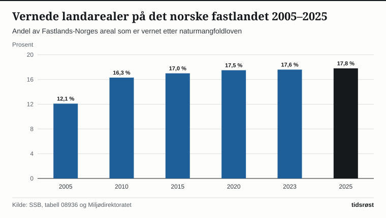
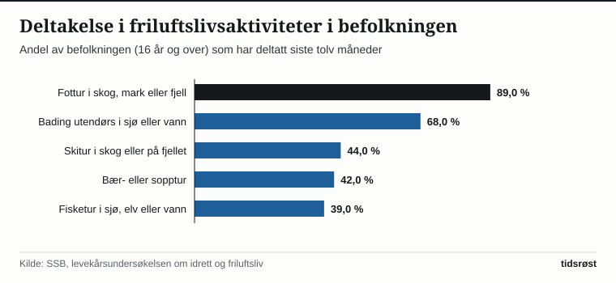

Norge har i dag 48 nasjonalparker – 41 på fastlandet og 7 på Svalbard – i tillegg til over 2 400 naturreservater og nær 200 landskapsvernområder. Samlet sett er 17,8 prosent av landarealet på det norske fastlandet vernet etter naturmangfoldloven, viser tall fra Statistisk sentralbyrå (SSB) og Miljødirektoratet.

Kombinert med den lovfestede *allemannsretten* i friluftsloven gir dette enhver som oppholder seg i Norge rett til å ferdes fritt til fots og på ski i utmark, raste, plukke ville bær og sopp, og telte i skog, fjell og langs kysten – uavhengig av hvem som eier grunnen.

## 17,8 prosent av fastlandet er vernet natur

Vernearbeidet i Norge kombinerer store sammenhengende fjell- og viddeområder som Hardangervidda, Jotunheimen, Rondane, Saltfjellet–Svartisen og Børgefjell med marint vern, kystnasjonalparker som Ytre Hvaler, Færder, Jomfruland og Raet, og **frivillig skogvern** i samarbeid med private skogeiere.

*Andel av Fastlands-Norges landareal som er vernet etter naturmangfoldloven, 2005–2025. Kilde: SSB, tabell 08936 og Miljødirektoratet.*

Gjennom ordningen med frivillig skogvern har staten og skogeierne vernet over 900 skogområder med viktig biologisk mangfold uten konflikter, og regjeringen arbeider systematisk videre mot målene i den globale naturavtalen gjennom den nasjonale handlingsplanen for naturmangfold.

## Slik er de norske verneområdene fordelt

Tabellen viser omfanget av de viktigste vernekategoriene på fastlandet og på Svalbard:

| Vernekategori (Fastlands-Norge) | Antall områder (ca.) | Vernet landareal (km²) | Andel av fastlandet |
|---|---:|---:|---:|
| Nasjonalparker | 41 | 32 050 | 9,9 % |
| Landskapsvernområder | 197 | 17 200 | 5,3 % |
| Naturreservater (inkl. frivillig skogvern) | 2 480 | 8 150 | 2,5 % |
| Øvrige verneformer | 115 | 250 | 0,1 % |
| **Fastlands-Norge samlet** | **2 833** | **57 650** | **17,8 %** |

*Kilde: SSB, tabell 08936 og Miljødirektoratet (Naturbase).*

På Svalbard er i tillegg over 65 prosent av landarealet (39 800 km²) og nær 87 prosent av territorialfarvannet vernet gjennom sju nasjonalparker og 22 naturreservater.

*Andel av befolkningen (16 år og over) som har deltatt i ulike friluftslivsaktiviteter siste tolv måneder. Kilde: SSB.*

## 590 DNT-hytter, gratis utstyrssentraler og tilrettelagt friluftsliv

I SSBs levekårsundersøkelser oppgir mer enn ni av ti voksne at de har vært på tur i naturen det siste året, og fotturer i skog, mark eller fjell samler hele 89 prosent av befolkningen.

Friluftslivet støttes av et tett samarbeid mellom stat, kommuner og frivillige organisasjoner: Den Norske Turistforening (DNT) og dens medlemsforeninger holder over 590 turisthytter og mer enn 22 000 kilometer T-merkede sommerstier og 4 300 kilometer kvistede vinterruter åpne for allmennheten. Samtidig gir kommunale og frivillige utlånssentraler (som BUA) i over 200 kommuner barn, unge og familier gratis lån av telt, soveposer, ski, skøyter og sykler – slik at alle kan ta del i naturopplevelsene uten å måtte kjøpe eget utstyr.

## Kilder

- [SSB: Vernet natur – statistikk over nasjonalparker og verneområder](https://www.ssb.no/natur-og-miljo/areal/statistikk/vernet-natur)
- [SSB Statistikkbanken: Tabell 08936 – Vernede områder etter vernekategori](https://www.ssb.no/statbank/table/08936)
- [SSB: Idrett og friluftsliv, levekårsundersøkelsen](https://www.ssb.no/kultur-og-fritid/idrett-og-friluftsliv/statistikk/idrett-og-friluftsliv-levekarsundersokelsen)
- [Miljødirektoratet: Norges nasjonalparker og allemannsretten](https://www.miljodirektoratet.no/ansvarsomrader/verneomrader/norges-nasjonalparker/)
