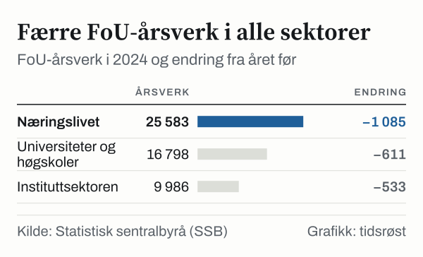

I 2024 ble det utført forskning og utviklingsarbeid (FoU) i Norge for 94,4 milliarder kroner, viser FoU-statistikken fra Statistisk sentralbyrå (SSB). Målt i løpende priser er det omtrent det samme som i 2023, da utgiftene var 94,5 milliarder kroner, og 22,9 prosent mer enn i 2019. Justert for prisvekst er bildet et annet: I faste priser var FoU-utgiftene 4,8 prosent lavere i 2024 enn året før, og bare 1,0 prosent høyere enn i 2019. SSBs siste publiserte tall gjelder 2024.

## Løpende og faste priser

Løpende priser er kronebeløpene slik de ble brukt hvert år. Når lønninger og andre kostnader stiger, øker beløpet selv om forskningsinnsatsen er den samme. SSB regner derfor også ut FoU-utgiftene i faste priser, der prisveksten er trukket ut og 2015 er basisår.

Målt i faste priser nådde FoU-utgiftene toppen i 2022 med 74,6 milliarder kroner. I 2024 var de 70,3 milliarder kroner, 5,7 prosent lavere enn toppåret.

![Linjediagram over Justert for prisvekst har FoU-utgiftene falt siden 2022: Faste priser: 43,6 milliarder kroner i 2003, 43,1 milliarder kroner i 2004, 45,3 milliarder kroner i 2005, 46,5 milliarder kroner i 2006, 49,2 milliarder kroner i 2007, 51,9 milliarder kroner i 2008, 51,2 milliarder kroner i 2009, 50,3 milliarder kroner i 2010, 51,3 milliarder kroner i 2011, 52,2 milliarder kroner i 2012, 53,4 milliarder kroner i 2013, 55,3 milliarder kroner i 2014, 60,2 milliarder kroner i 2015, 62,0 milliarder kroner i 2016, 66,5 milliarder kroner i 2017, 67,8 milliarder kroner i 2018, 69,6 milliarder kroner i 2019, 69,3 milliarder kroner i 2020, 71,4 milliarder kroner i 2021, 74,6 milliarder kroner i 2022, 73,8 milliarder kroner i 2023, 70,3 milliarder kroner i 2024.](./graf-1.svg)
*Samlede utgifter til forskning og utviklingsarbeid i Norge, faste 2015-priser, 2003–2024. Kilde: SSB, tabell 11010.*

## Hvem som utfører forskningen

Det norske forskningssystemet er delt inn i tre utførende sektorer. Næringslivet er den største og sto i 2024 for 46,6 milliarder kroner, 49,4 prosent av de samlede FoU-utgiftene. Universitets- og høgskolesektoren (inkludert helseforetakene) sto for 30,1 milliarder kroner (31,9 prosent), mens instituttsektoren utførte forskning for 17,7 milliarder kroner (18,7 prosent).

*FoU-utgifter etter utførende sektor i 2024, løpende priser. Universiteter og høgskoler inkluderer helseforetakene. Kilde: SSB, tabell 11010.*

| Utførende sektor | FoU-utgifter 2021 (mrd. kr) | FoU-utgifter 2024 (mrd. kr) | FoU-årsverk 2024 |
|---|---:|---:|---:|
| Næringslivet | 38,3 | 46,6 | 25 583 |
| Universiteter og høgskoler | 26,9 | 30,1 | 16 798 |
| Instituttsektoren | 16,4 | 17,7 | 9 986 |
| **Norge i alt** | **81,6** | **94,4** | **52 367** |

*Løpende priser. Kilde: SSB, tabell 11010.*

## Færre årsverk

Det ble utført 52 367 FoU-årsverk i 2024, 2 230 færre enn i 2023, da det var 54 597. Nedgangen gjaldt alle tre sektorene: Næringslivet hadde 1 085 færre årsverk, universiteter og høgskoler 611 færre og instituttsektoren 533 færre.

*FoU-årsverk etter utførende sektor i 2024 og endring fra 2023. Kilde: SSB, tabell 11010.*

## Ordninger og satsinger

For bedrifter finnes den statlige Skattefunn-ordningen, som administreres av Norges forskningsråd i samarbeid med Skatteetaten. Ordningen gir bedrifter som driver forsknings- og utviklingsprosjekter rett til skattefradrag. Satsene er beskrevet hos Skatteetaten.

Ifølge regjeringen.no ble det sommeren 2023 satt av minst én milliard kroner over fem år til forskning på kunstig intelligens. I juni 2025 ble det besluttet å opprette seks nasjonale forskningssentre for kunstig intelligens gjennom Norges forskningsråd.

Norske forskere deltar også i EUs rammeprogram Horisont Europa. Ifølge Kunnskapsdepartementet hadde norske aktører per november 2024 fått tildelt nesten 15 milliarder kroner fra programmet.

## Hva tallene ikke viser

FoU-statistikken måler hvor mye forskning og utviklingsarbeid som blir utført, i kroner og årsverk. Den sier ikke noe om hva forskningen fører til. Tallene for 2025 er ennå ikke publisert.

## Kilder

- [SSB Statistikkbanken: Tabell 11010 – FoU-personale, FoU-årsverk og FoU-utgifter etter sektor](https://www.ssb.no/statbank/table/11010)
- [Regjeringen: Regjeringens milliardsatsing – Norges seks nye forskningssentre for kunstig intelligens](https://www.regjeringen.no/no/aktuelt/regjeringens-milliardsatsing-dette-er-norges-seks-nye-forskningssentre-for-kunstig-intelligens/id3108609/)
- [Regjeringen: EU-midler til norsk forskning](https://www.regjeringen.no/no/aktuelt/rekordmykje-eu-pengar-til-norsk-forsking/id3076431/)
- [Skatteetaten: SkatteFUNN](https://www.skatteetaten.no/nn/bedrift-og-organisasjon/skatt-for-bedrift-og-organisasjon/skattemelding-for-naringsdrivande/fradrag/forskning-og-gave/skattefunn-ordninga/)
