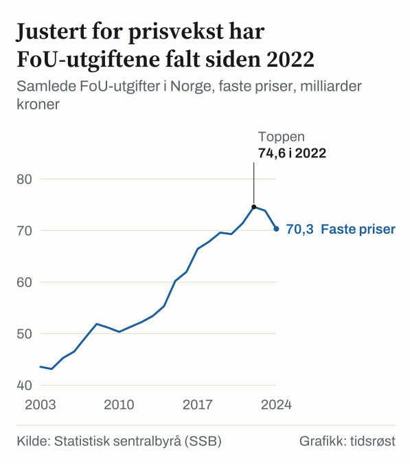
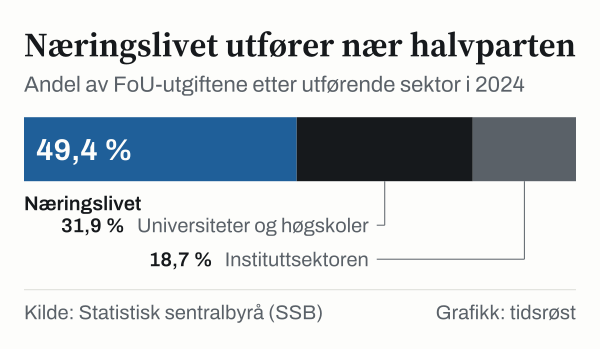

I 2024 ble det utført forskning og utviklingsarbeid (FoU) i Norge for 94,4 milliarder kroner, viser FoU-statistikken fra Statistisk sentralbyrå (SSB). Målt i løpende priser er det en økning på 23 prosent fra 2019, men nivået var omtrent uendret fra 2023, da utgiftene var 94,5 milliarder kroner. SSBs siste publiserte tall gjelder 2024.

Det ble utført 52 367 FoU-årsverk i 2024, fordelt mellom bedrifter, universiteter og høgskoler (inkludert helseforetakene) og forskningsinstitutter. Antall årsverk var lavere enn i 2023, da det var 54 597.

## Næringslivet står for nær halvparten av forskningsinnsatsen

Det norske forskningssystemet er delt inn i tre utførende sektorer. Næringslivet er den største og sto i 2024 for 46,6 milliarder kroner, 49,4 prosent av de samlede FoU-utgiftene. Universitets- og høgskolesektoren (inkludert helseforetakene) sto for 30,1 milliarder kroner (31,9 prosent), mens instituttsektoren utførte forskning for 17,7 milliarder kroner (18,7 prosent).

*Samlede utgifter til forskning og utviklingsarbeid (FoU) i Norge, løpende milliarder kroner. Kilde: SSB, tabell 11010.*

For bedrifter finnes den statlige Skattefunn-ordningen, som administreres av Norges forskningsråd i samarbeid med Skatteetaten. Ordningen gir bedrifter som driver forsknings- og utviklingsprosjekter rett til skattefradrag. Satsene er beskrevet hos Skatteetaten.

## Slik fordeler FoU-midlene seg mellom sektorene

Tabellen viser utviklingen i FoU-utgifter og FoU-årsverk i de tre sektorene:

| Utførende sektor | FoU-utgifter 2021 (mrd. kr) | FoU-utgifter 2024 (mrd. kr) | FoU-årsverk 2024 |
|---|---:|---:|---:|
| Næringslivet | 38,3 | 46,6 | 25 583 |
| Universiteter og høgskoler | 26,9 | 30,1 | 16 798 |
| Instituttsektoren | 16,4 | 17,7 | 9 986 |
| **Norge i alt** | **81,6** | **94,4** | **52 367** |

*Kilde: SSB, tabell 11010.*

*FoU-utgifter etter utførende sektor i 2024, milliarder kroner. Kilde: SSB, tabell 11010.*

## Kunstig intelligens og Horisont Europa

Ifølge regjeringen.no ble det sommeren 2023 satt av minst én milliard kroner over fem år til forskning på kunstig intelligens. I juni 2025 ble det besluttet å opprette seks nasjonale forskningssentre for kunstig intelligens gjennom Norges forskningsråd.

Norske forskere deltar også i EUs rammeprogram Horisont Europa. Ifølge Kunnskapsdepartementet hadde norske aktører per november 2024 fått tildelt nesten 15 milliarder kroner fra programmet.

## Kilder

- [SSB Statistikkbanken: Tabell 11010 – FoU-personale, FoU-årsverk og FoU-utgifter etter sektor](https://www.ssb.no/statbank/table/11010)
- [Regjeringen: Regjeringens milliardsatsing – Norges seks nye forskningssentre for kunstig intelligens](https://www.regjeringen.no/no/aktuelt/regjeringens-milliardsatsing-dette-er-norges-seks-nye-forskningssentre-for-kunstig-intelligens/id3108609/)
- [Regjeringen: EU-midler til norsk forskning](https://www.regjeringen.no/no/aktuelt/rekordmykje-eu-pengar-til-norsk-forsking/id3076431/)
- [Skatteetaten: SkatteFUNN](https://www.skatteetaten.no/nn/bedrift-og-organisasjon/skatt-for-bedrift-og-organisasjon/skattemelding-for-naringsdrivande/fradrag/forskning-og-gave/skattefunn-ordninga/)
