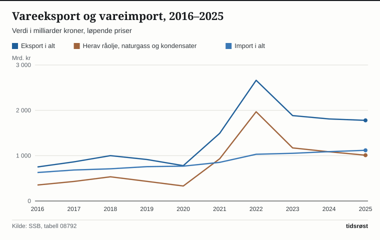

Norge solgte varer til utlandet for 1 778,8 milliarder kroner i 2025 og importerte for 1 117,9 milliarder kroner, viser statistikken fra Statistisk sentralbyrå (SSB). Det ga et overskudd i varehandelen på 660,9 milliarder kroner. EU-landene kjøpte varer for 1 175,4 milliarder kroner, 66,1 prosent av all norsk eksport.

*Norsk vareeksport i 2025 fordelt på EU-landene og andre land. Kilde: SSB, tabell 08804.*

## Hvor eksporten gikk

Målt etter enkeltland var Storbritannia (316,6 milliarder kroner) og Tyskland (310,1 milliarder kroner) de to største mottakerne av norske varer i 2025, fulgt av Nederland, Sverige, Polen, Frankrike og Danmark. Storbritannia er ikke med i EU-tallet.

*De ti største mottakerlandene for norsk vareeksport i 2025, milliarder kroner. Kilde: SSB, tabell 08804.*

Fastlandsvarer utgjorde 23,9 prosent av eksporten til Storbritannia og 21,2 prosent av eksporten til Tyskland. Resten var olje, gass, kondensater, skip og plattformer. Til USA eksporterte Norge varer for 68,3 milliarder kroner og til Kina for 48,7 milliarder kroner.

På importsiden kom 54,8 prosent av varene fra EU. Det ble importert varer fra Kina for 133,3 milliarder kroner og fra Tyskland for 130,6 milliarder kroner.

## Hva som ble eksportert

Råolje, naturgass og kondensater sto for 1 010,5 milliarder kroner, 56,8 prosent av eksportverdien i 2025. Naturgass sto alene for 570,9 milliarder kroner og råolje for 435,8 milliarder kroner.

Fastlandseksporten, som omfatter alle varer utenom olje, gass, kondensater, skip og oljeplattformer, vokste med 8,0 prosent til 768,1 milliarder kroner i 2025. EU kjøpte 55,4 prosent av fastlandseksporten. Når olje og gass holdes utenfor, var USA med 67,3 milliarder kroner det tredje største markedet for norsk fastlandseksport, etter Storbritannia og Sverige.

## Hva som har endret seg i 2026

I de åtte første månedene av 2026 økte eksporten med 11,6 prosent sammenlignet med samme periode i 2025. Både olje- og gasseksporten og fastlandseksporten økte:

| Januar–august (mrd. kr) | 2025 | 2026 | Endring |
|---|---:|---:|---:|
| Eksport i alt | 1 212,0 | 1 353,2 | +11,6 % |
| Herav råolje, naturgass og kondensater | 708,8 | 828,5 | +16,9 % |
| Fastlandseksport | 503,0 | 523,8 | +4,1 % |
| Import i alt | 722,5 | 744,3 | +3,0 % |
| Handelsbalanse | 489,6 | 608,9 | +24,4 % |

*Kilde: SSB, tabell 08792.*

Med 828,5 milliarder kroner sto råolje, naturgass og kondensater for 61,2 prosent av den samlede vareeksporten i de åtte første månedene av 2026, mot 58,5 prosent i samme periode året før.

## Eksporten over tid

Handelsbalansen varierer med verdien av olje- og gasseksporten. I toppåret 2022 ble det eksportert olje og gass for 1 969,0 milliarder kroner, den samlede vareeksporten var 2 662,6 milliarder kroner og handelsoverskuddet 1 631,7 milliarder kroner. I pandemiåret 2020 var overskuddet 10,6 milliarder kroner.

![Linjediagram over Eksporten toppet seg i 2022: Eksport: 788 milliarder kroner i 2010, 899 milliarder kroner i 2011, 935 milliarder kroner i 2012, 917 milliarder kroner i 2013, 909 milliarder kroner i 2014, 835 milliarder kroner i 2015, 752 milliarder kroner i 2016, 864 milliarder kroner i 2017, 1 000 milliarder kroner i 2018, 915 milliarder kroner i 2019, 779 milliarder kroner i 2020, 1 493 milliarder kroner i 2021, 2 663 milliarder kroner i 2022, 1 883 milliarder kroner i 2023, 1 810 milliarder kroner i 2024, 1 779 milliarder kroner i 2025; Import: 467 milliarder kroner i 2010, 509 milliarder kroner i 2011, 508 milliarder kroner i 2012, 528 milliarder kroner i 2013, 562 milliarder kroner i 2014, 615 milliarder kroner i 2015, 629 milliarder kroner i 2016, 684 milliarder kroner i 2017, 710 milliarder kroner i 2018, 758 milliarder kroner i 2019, 769 milliarder kroner i 2020, 853 milliarder kroner i 2021, 1 031 milliarder kroner i 2022, 1 052 milliarder kroner i 2023, 1 089 milliarder kroner i 2024, 1 118 milliarder kroner i 2025.](./graf-3.svg)
*Vareeksport og vareimport i alt, 2010–2025, milliarder kroner. Kilde: SSB, tabell 08804.*

## Hva tallene ikke viser

Statistikken gjelder varer, ikke tjenester. Alle beløpene er i løpende kroner uten prisjustering, så endringer fra år til år skyldes både mengder og priser.

## Kilder

- [SSB: Utenrikshandel med varer, hovedtall, tabell 08792](https://www.ssb.no/statbank/table/08792)
- [SSB: Utenrikshandel med varer etter land, årstall, tabell 08804](https://www.ssb.no/statbank/table/08804)
- [SSB: Utenrikshandel med varer etter land, månedstall, tabell 08803](https://www.ssb.no/statbank/table/08803)
