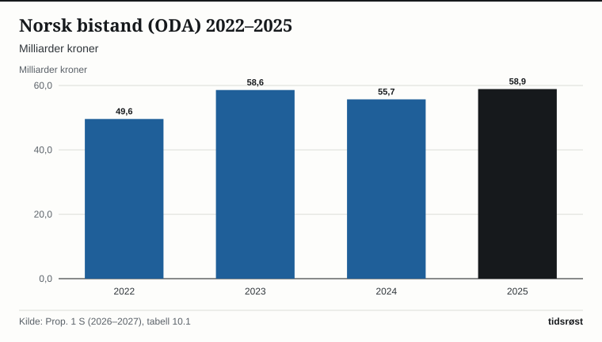

Norge ga 58,9 milliarder kroner i offisiell utviklingshjelp (ODA) i 2025. Det tilsvarer 1,03 prosent av bruttonasjonalinntekten (BNI), ifølge Utenriksdepartementets budsjettproposisjon Prop. 1 S (2026–2027), lagt fram 7. oktober 2026. For 2027 foreslår regjeringen en bistandsramme på 57,6 milliarder kroner, 0,93 prosent av anslått BNI.

## Utviklingen

Bistanden økte med 3,2 milliarder kroner fra 2024, da den var 55,7 milliarder. Ifølge proposisjonen skyldes økningen blant annet 2 milliarder kroner til Norfunds klimainvesteringsfond og 750 millioner kroner til Palestina og Gaza, som kom i tillegg til bistandsbudsjettet i nysalderingen for 2025.

*Samlet ODA-godkjent norsk bistand, 2022–2025. Kilde: Prop. 1 S (2026–2027), tabell 10.1.*

## FNs mål og de andre giverlandene

FNs generalforsamling har vedtatt et mål om at 0,7 prosent av BNI skal gå til ODA. Ifølge proposisjonen nådde bare fire medlemsland i OECDs utviklingskomité (DAC) målet i 2025: Norge, Luxembourg, Sverige og Danmark. Samlet ODA fra DAC-landene var 174,3 milliarder dollar, 0,26 prosent av samlet BNI. Det var et fall på 23,1 prosent reelt fra 2024.

## Hva pengene går til

Av bistanden i 2025 var 44 277 millioner kroner (75 prosent) øremerket, 11 741 millioner (20 prosent) kjernestøtte til multilaterale organisasjoner og 2 886 millioner (5 prosent) administrasjon.

Miljø og energi var største sektor i 2025, med 14 597 millioner kroner, 25 prosent av totalen. Beløpet økte med 54,6 prosent fra 2024. Ifølge proposisjonen skyldes det økt bistand til Ukraina, der energisikkerhet er en viktig del av støtten.

![Stolpediagram over Miljø og energi er største sektor: Bistand: Miljø og energi: 14,60 milliarder kroner, Multilateral kjernestøtte: 11,74 milliarder kroner, Nødhjelp: 7,90 milliarder kroner, Kostnader i Norge mv.: 5,94 milliarder kroner, Styresett og sivilt samfunn: 5,46 milliarder kroner, Multisektor og annet: 4,35 milliarder kroner, Helse og sosiale tjenester: 2,96 milliarder kroner, Økonomisk utvikling: 2,09 milliarder kroner, Utdanning: 1,95 milliarder kroner, Produksjon og handel: 1,92 milliarder kroner.](./graf-2.svg)
*Norsk bistand etter sektor, 2025. Kilde: Prop. 1 S (2026–2027), tabell 10.2.*

Kostnader i Norge var 5 938 millioner kroner. Ifølge proposisjonen er det i hovedsak ODA-godkjente flyktningutgifter for ukrainere og administrasjon.

## Geografisk fordeling

Av den øremerkede bistanden gikk 12 411 millioner kroner (28 prosent) til Europa og 8 238 millioner (19 prosent) til Afrika. Europa får mest på grunn av den sivile og humanitære støtten til Ukraina og nabolandene gjennom Nansen-programmet. Den var til sammen 12,5 milliarder kroner i 2025. 15 741 millioner kroner (36 prosent) var geografisk uspesifisert, en kategori som ifølge proposisjonen omfatter en stor andel støtte til Afrika sør for Sahara.

![Helningsdiagram over Europa er regionen som får mest: i 2022: Europa: 5,89 milliarder kroner, Afrika: 7,75 milliarder kroner, Midtøsten: 2,73 milliarder kroner, Asia og Oseania: 3,07 milliarder kroner, Latin-Amerika: 1,47 milliarder kroner, Uspesifisert: 16,21 milliarder kroner; i 2025: Europa: 12,41 milliarder kroner, Afrika: 8,24 milliarder kroner, Midtøsten: 3,21 milliarder kroner, Asia og Oseania: 2,54 milliarder kroner, Latin-Amerika: 2,13 milliarder kroner, Uspesifisert: 15,74 milliarder kroner.](./graf-3.svg)
*Øremerket norsk bistand etter region, 2022 og 2025. Kilde: Prop. 1 S (2026–2027), tabell 10.3.*

Andelen av den landfordelte bistanden som gikk til de minst utviklede landene og andre lavinntektsland, falt fra 44 prosent i 2022 til 29 prosent i 2025. Ifølge proposisjonen skyldes det i stor grad økt bistand til Ukraina, som regnes som et lavere mellominntektsland. Bistanden til Palestina og palestinske flyktninger var 2,16 milliarder kroner i 2025.

## Forslaget for 2027

Regjeringen foreslår en bistandsramme på 57 597,1 millioner kroner i 2027. Av dette ligger 53 283,6 millioner på Utenriksdepartementets budsjett og 4 097,9 millioner på Klima- og miljødepartementets. Forslaget tilsvarer 0,93 prosent av anslått BNI og er om lag 1 milliard kroner høyere enn saldert budsjett for 2026.

## Kilder

- [Regjeringen: Prop. 1 S (2026–2027) – Utenriksdepartementet (offentliggjort 7. oktober 2026)](https://www.regjeringen.no/no/dokumenter/prop.-1-s-20262027/id3175636/)
