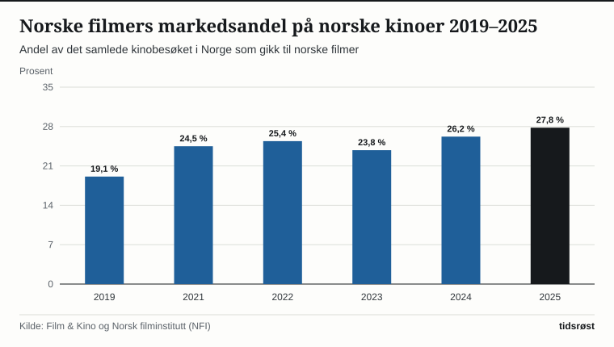
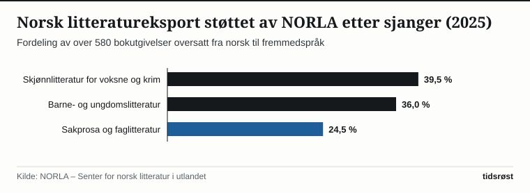

Norsk film, litteratur og dataspill har de siste årene markert seg både hos hjemmepublikummet og på de største internasjonale arenaene. I 2025 valgte norske kinogjengere norsk film på 27,8 prosent av alle solgte kinobilletter, viser bransjestatistikken fra Film & Kino og Norsk filminstitutt (NFI).

Med en nasjonal markedsandel på over en fjerdedel av kinobesøket ligger Norge helt i toppsjiktet i Europa, der bare et fåtall langt større språkområder som Frankrike har en tilsvarende oppslutning om egenprodusert film.

## Bred publikumsoppslutning og priser ved internasjonale festivaler

Bak fremgangen ligger en bevisst satsing på både brede publikumsfilmer, familie- og barnefilmer, dokumentarfilmer og kunstnerisk ambisiøse spillefilmer. De siste årene har norske spillefilmer og dokumentarer hentet hjem toppbemerkelser fra filmfestivalene i Cannes, Berlin og Sundance samt Oscar-nominasjoner og -priser, samtidig som norske familiefilmer og historiske dramaer samler hundretusenvis av tilskuere på kinoene fra Kristiansand til Kirkenes.

*Norske filmers andel av det samlede kinobesøket i Norge, 2019–2025. Kilde: Film & Kino og Norsk filminstitutt.*

En særegen styrke ved det norske kinosystemet er den desentraliserte strukturen med rundt 200 kinoer i kommunalt og privat eie, kombinert med ordningen *Bygdekinoen* som bringer ferske kinofilmer ut til over 150 mindre tettsteder og grender uten fast kinosal.

## Nøkkeltall for norsk film, litteratur og kulturstøtte

Tabellen viser sentrale virkemidler og resultater i den statlige kultur- og mediesatsingen:

| Kulturområde | Sentralt offentlig virkemiddel | Årlig omfang / resultat |
|---|---|---|
| Spillefilm, dokumentar og serier | Norsk filminstitutt (NFI) og regionale filmfond | Over 850 mill. kr i tilskudd; 27,8 % norsk kinomarkedsandel |
| Dataspillutvikling | NFI – tilskudd til norske dataspill | Styrket ramme under regjeringens dataspillstrategi |
| Litteratur og folkebibliotek | Innkjøpsordningene under Kulturdirektoratet | Sikrer nye norske barne-, voksen- og sakprosabøker til alle folkebibliotek |
| Litteratureksport | NORLA (Senter for norsk litteratur i utlandet) | Over 580 bokoversettelser årlig til mer enn 50 språk |
| Samisk film og litteratur | Internasjonalt samisk filminstitutt (ISFI) og Sametinget | Økt produksjon av film, serier og bøker på samiske språk |

*Kilde: Kultur- og likestillingsdepartementet, Norsk filminstitutt, Kulturdirektoratet og NORLA.*

*Fordeling av norske bokutgivelser oversatt til fremmedspråk med støtte fra NORLA i 2025. Kilde: NORLA.*

## Boklov, innkjøpsordninger og sterk vekst for barnebøker i utlandet

På litteraturområdet trådte den nye bokloven i kraft i 2024. Loven lovfester fastpris på nye bøker i tolv måneder etter utgivelse og sikrer lik tilgang til litteratur over hele landet, samtidig som Kulturdirektoratets innkjøpsordninger sørger for at ny norsk skjønnlitteratur, sakprosa, tegneserier og barne- og ungdomslitteratur kjøpes inn i opptil 775 eksemplarer til folkebibliotekene.

Utenfor landets grenser har Senter for norsk litteratur i utlandet (NORLA) bidratt til at over 580 norske bøker i 2025 ble oversatt til mer enn 50 språk. Norsk barne- og ungdomslitteratur utgjør nå hele 36 prosent av de oversatte titlene og har fått en stadig sterkere posisjon hos lesere i Tyskland, Norden, Frankrike, Spania og Asia.

## Kilder

- [Norsk filminstitutt (NFI): Tall, innsikt og årsrapporter for film, serier og spill](https://www.nfi.no/tall-og-innsikt)
- [Film & Kino: Kinostatistikk og besøkstall ved norske kinoer](https://www.kino.no/)
- [NORLA – Senter for norsk litteratur i utlandet: Årsrapporter og oversettelsesstatistikk](https://norla.no/)
- [Kultur- og likestillingsdepartementet: Bokloven, film- og dataspillpolitikk](https://www.regjeringen.no/no/tema/kultur-idrett-og-frivillighet/id1125/)
