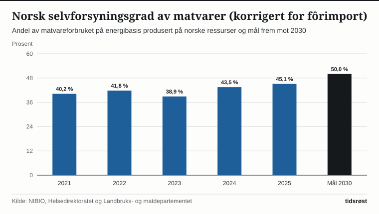
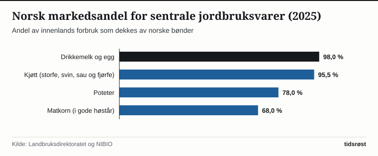

Ved inngangen til 2026 var om lag 37 500 jordbruksbedrifter i drift i Norge, viser landbruksstatistikken fra Statistisk sentralbyrå (SSB). Til sammen skjøtter bøndene rundt 9,8 millioner dekar jordbruksareal i drift – fra korn- og grønnsaksbygdene rundt Oslofjorden, Mjøsa, Jæren og Trondheimsfjorden til melke- og sauebrukene i fjell- og fjordbygdene og i Nord-Norge.

I tillegg til selve gårdsbrukene sysselsetter den norske mat- og drikkevareindustrien over 40 000 ansatte, og er dermed landets største fastlandsindustri målt i sysselsetting.

## Strategi for 50 prosent selvforsyning og nye beredskapslagre

Målt på energibasis dekker norskprodusert mat nær 50 prosent av kostholdet i Norge, og når det korrigeres for importerte fôrråvarer, økte selvforsyningsgraden til om lag 45,1 prosent i 2025 etter gode korn- og grovfôravlinger, viser beregninger fra Norsk institutt for bioøkonomi (NIBIO) og Helsedirektoratet.

I stortingsmeldingen om selvforsyning og matsikkerhet har regjeringen fastsatt en tydelig strategi for å løfte den fôrkorrigerte selvforsyningsgraden til 50 prosent innen 2030. Satsingen omfatter økt planteproduksjon av matkorn, frukt, bær, poteter og grønnsaker, samt høyere andel norske råvarer i husdyrfôret.

*Norsk selvforsyningsgrad av matvarer korrigert for import av fôrråvarer, 2021–2025 og mål for 2030. Kilde: NIBIO, Helsedirektoratet og Landbruks- og matdepartementet.*

Parallelt har staten gjenopprettet den nasjonale beredskapslagringen av matkorn gjennom langsiktige avtaler mellom Landbruksdirektoratet og kornaktørene, med mål om at lagrene skal romme 82 500 tonn matkorn – tilsvarende tre måneders forbruk av mel og kornvarer for hele befolkningen.

## Norskprodusert andel og dyrehelse i europatoppen

Tabellen viser nøkkeltall for norsk jordbruksproduksjon og selvforsyning på enkeltområder:

| Varegruppe | Norsk markedsandel (ca.) | Årlig norsk produksjon (ca.) |
|---|---:|---|
| Kumelk og meierivarer | 98 % | 1 450 millioner liter |
| Egg | 98 % | 70 000 tonn |
| Kjøtt i alt (storfe, svin, sau, fjørfe) | 95,5 % | 355 000 tonn |
| Poteter | 78 % | 360 000 tonn |
| Korn (matkorn og fôrkorn samlet) | 65–75 % | 1,2–1,4 millioner tonn (avhengig av vekstsesong) |

*Kilde: Landbruksdirektoratet, NIBIO og SSB.*

*Andel av innenlands forbruk dekket av norsk produksjon for utvalgte jordbruksvarer. Kilde: Landbruksdirektoratet og NIBIO.*

En særlig styrke ved det norske landbruket er god dyrehelse og plantehelse. Ifølge Det europeiske legemiddelbyråets (EMA) ESVAC-rapporter og det norske overvåkingsprogrammet NORM-VET har Norge det aller laveste forbruket av antibiotika til matproduserende dyr i Europa – bare en brøkdel av gjennomsnittet ellers i verden – noe som gir trygg mat og lav forekomst av antibiotikaresistens.

## Kilder

- [SSB: Jordbruksbedrifter, areal og husdyrhold i Norge](https://www.ssb.no/jord-skog-jakt-og-fiskeri/jordbruk/statistikk/struktur-i-jordbruket)
- [Landbruksdirektoratet: Markedsrapporter, kornberedskap og jordbruksstatistikk](https://www.landbruksdirektoratet.no/nb/statistikk-og-utviklingstrekk)
- [Landbruks- og matdepartementet: Meld. St. 11 (2023–2024) Strategi for auka sjølvforsyning av jordbruksvarer](https://www.regjeringen.no/no/dokumenter/meld.-st.-11-20232024/id3028379/)
- [Veterinærinstituttet: NORM-VET – Overvåking av antibiotikaresistens og antibiotikaforbruk hos dyr](https://www.vetinst.no/overvaking/antibiotikaresistens-norm-vet)
