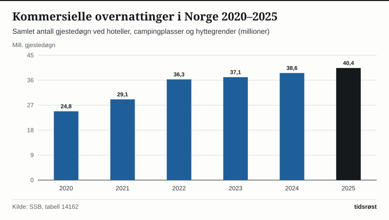
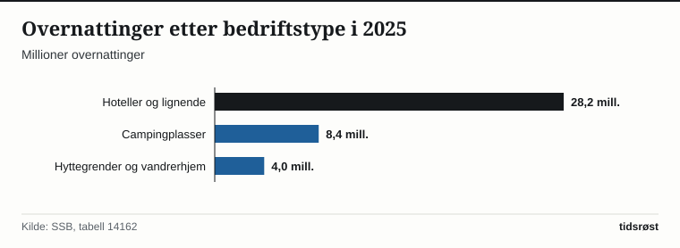

Aldri før har det blitt registrert så mange overnattinger ved norske hoteller, campingplasser, hyttegrender og vandrerhjem som i 2025. Ifølge overnattingsstatistikken fra Statistisk sentralbyrå (SSB) endte det samlede tallet på 40,6 millioner overnattinger, opp 5,2 prosent fra rekorden i 2024 (38,6 millioner). Det er første gang tallet passerer 40 millioner.

I perioden januar–august 2026 var det 31,0 millioner overnattinger, 2,3 prosent flere enn i samme periode i 2025 (30,3 millioner).

## Sterk vekst i utenlandske gjester

Norske gjester utgjør fortsatt grunnmuren i reiselivet med 26,4 millioner overnattinger i 2025 (65,1 prosent av totalen), en økning på 1,0 prosent. Utenlandstrafikken vokste raskere og nådde 14,2 millioner overnattinger i 2025, en oppgang på 14,0 prosent på ett år.

Tyskland er det største enkeltmarkedet for utenlandske overnattinger i Norge med 2,6 millioner overnattinger i 2025, fulgt av USA (1,6 millioner), Sverige (1,3 millioner), Nederland, Storbritannia og Danmark (cirka 1 million hver).

*Overnattinger ved hoteller, campingplasser, hyttegrender og vandrerhjem i Norge (millioner), 2020–2025. Kilde: SSB, tabell 14162.*

## Hoteller, camping og hyttegrender

Tabellen viser hvordan overnattingene fordeler seg mellom norske og utenlandske gjester og mellom ulike typer overnattingsbedrifter:

| Kategori | 2023 (mill.) | 2024 (mill.) | 2025 (mill.) | Endring 2024–2025 |
|---|---:|---:|---:|---:|
| Hoteller og lignende | 25,3 | 26,7 | 28,2 | +5,3 % |
| Campingplasser | 7,9 | 8,0 | 8,4 | +5,7 % |
| Hyttegrender og vandrerhjem | 3,8 | 3,9 | 4,0 | +3,2 % |
| **Overnattinger i alt** | **37,0** | **38,6** | **40,6** | **+5,2 %** |
| – Herav norske gjester | 25,9 | 26,2 | 26,4 | +1,0 % |
| – Herav utenlandske gjester | 11,1 | 12,4 | 14,2 | +14,0 % |

*Kilde: SSB, tabell 14162. Tallene er summert fra månedstall og avrundet.*

Hotellene sto for 69,4 prosent av overnattingene i 2025, campingplassene for 20,7 prosent og hyttegrender og vandrerhjem for 9,9 prosent.

*Overnattinger etter bedriftstype i 2025 (millioner). Kilde: SSB, tabell 14162.*

## Kilder

- [SSB: Rekordmange overnattingar i 2025](https://www.ssb.no/transport-og-reiseliv/reiseliv/statistikk/overnattingar/artikler/rekordmange-overnattingar-i-2025)
- [SSB Statistikkbanken: Tabell 14162 – Overnattingar etter region, innkvarteringstype og bustadland](https://www.ssb.no/statbank/table/14162)
