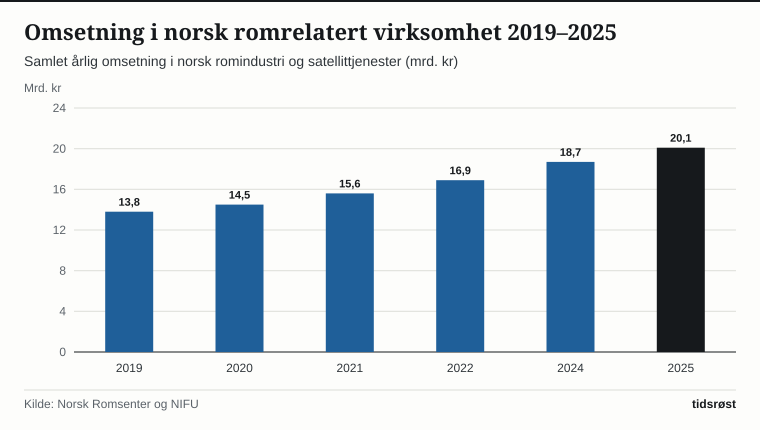

Takket være sin beliggenhet langt mot nord, store havområder og sterke maritime teknologimiljøer har Norge bygget opp en internasjonalt ledende romsektor. Ifølge tall fra Norsk Romsenter og kartlegginger utført av NIFU passerte den samlede omsetningen i norsk romrelatert virksomhet 20,1 milliarder kroner i 2025 – opp fra 13,8 milliarder kroner i 2019.

Næringen sysselsetter mer enn 3 200 høyt kvalifiserte fagfolk i bedrifter og forskningsmiljøer over hele landet, fra Andøya og Tromsø i nord til Trondheim, Oslo, Raufoss, Horten og Kongsberg i sør.

## Hver krone gjennom ESA gir flerdobbel verdiskaping

Norge har vært fullt medlem av Den europeiske romorganisasjonen (ESA) siden 1987 og deltar også i EUs romprogram – inkludert jordobservasjonsprogrammet *Copernicus* og navigasjonssystemet *Galileo*. Norsk Romsenter opplyser at hver statlig krone som investeres gjennom ESA, i snitt gir over fire kroner tilbake i form av høyteknologiske kontrakter og langsiktig kommersiell omsetning for norske bedrifter.

*Årlig omsetning i norsk romrelatert virksomhet (milliarder kroner), 2019–2025. Kilde: Norsk Romsenter og NIFU.*

## Nøkkelknutepunkter i den norske rominfrastrukturen

Norges geografiske posisjon fra 58 til 81 grader nord gir et unikt fortrinn for romvirksomhet, fordi satellitter i polare baner passerer over nordområdene på samtlige fjorten daglige omløp rundt jorden:

| Knutepunkt / program | Lokalisering | Hovedoppgave |
|---|---|---|
| Svalbard satellittstasjon (SvalSat / KSAT) | Platåberget ved Longyearbyen (78° N) | Verdens største polarstasjon med over 170 antenner for vær- og miljøsatellitter |
| Andøya Space | Andenes i Nordland (69° N) | Romhavn for småsatellitter, forskningsraketter og atmosfæreforskning |
| Tromsø satellittstasjon og KSAT-hovedkontor | Tromsø | Sanntidsanalyse av satellittbilder for oljevern, iskartlegging og skipstrafikk |
| Nasjonale AIS- og radarsatellitter | Kystverket / Forsvarets forskningsinstitutt / Norsk Romsenter | Overvåking av skipstrafikk og maritim sikkerhet i norske havområder |
| Arctic Satellite Broadband Mission (ASBM) | Space Norway (polar høyelliptisk bane) | Bredbåndsdekning for fly, skip og beredskap i hele Arktis nord for 65° N |

*Kilde: Norsk Romsenter, Nærings- og fiskeridepartementet og Kystverket.*

Gjennom det statlige selskapet Space Norways oppskyting av de to ASBM-satellittene har Arktis for første gang fått sammenhengende bredbåndsdekning via satellitt helt opp til Nordpolen – et stort løft for kystvakten, redningstjenesten, fiskeriflåten og sivil luftfart over polhavet.

*Fordeling av verdiskapingen i norsk romsektor etter hovedsegment. Kilde: Norsk Romsenter.*

## Sikrere skipsfart og ny romlov for fremtidens romfart

Satellittdata fra de norske NORSAT-mikrosatellittene og det europeiske Copernicus-programmet strømmer døgnet rundt inn til Kystverkets sjøtrafikksentraler i Vardø og ellers langs kysten, samt til Meteorologisk institutt. Dermed kan norske myndigheter oppdage drivende skip i uvær, ulovlig fiske og oljeutslipp på havet i løpet av minutter, samtidig som presise iskart trygger ferdselen ved Svalbard.

I 2026 har regjeringen også lagt frem forslag til en helt ny og moderne romlov til erstatning for den gamle loven fra 1969, slik at Norge har et fremtidsrettet og trygt regelverk for bærekraftig aktivitet i rommet og ved romhavnen på Andøya.

## Kilder

- [Norsk Romsenter: Nøkkeltall, årsrapporter og norske satellittprogrammer](https://www.romsenter.no/)
- [Nærings- og fiskeridepartementet: Regjeringens rompolitikk og arbeid med ny romlov](https://www.regjeringen.no/no/tema/naringsliv/romvirksomhet/id2009204/)
- [Kystverket: Satellittovervåking (AIS) og maritim beredskap i norske havområder](https://www.kystverket.no/sjovegen/ais/)
