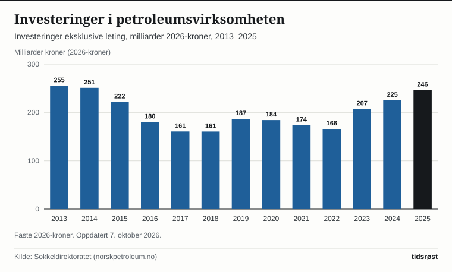

Norsk sokkel produserte 239,2 millioner standard kubikkmeter oljeekvivalenter (Sm³ o.e.) i 2025, mot 240,7 millioner året før. Ved årsskiftet 2025/2026 var 97 felt i produksjon. Tallene kommer fra Sokkeldirektoratet og Energidepartementet, som driver nettstedet norskpetroleum.no, oppdatert 7. oktober 2026.

## Produksjonen

Produksjonen i 2025 var 9,4 prosent lavere enn i toppåret 2004, da den var 264,2 millioner Sm³ o.e. Oljeproduksjonen økte med 3,8 prosent fra 2024, mens gassproduksjonen falt med 3,0 prosent. Gass utgjorde om lag 50 prosent av totalproduksjonen.

*Salgbar olje- og gassproduksjon på norsk sokkel, 1990–2025, millioner Sm³ o.e. Kilde: Sokkeldirektoratet, figurgrunnlag på norskpetroleum.no.*

| Produkt (millioner Sm³ o.e.) | 2024 | 2025 |
|---|---:|---:|
| Olje | 102,90 | 106,81 |
| Kondensat | 1,29 | 1,03 |
| NGL (våtgass) | 12,22 | 10,85 |
| Gass (normalisert til 40 MJ) | 124,26 | 120,57 |
| **Totalt** | **240,67** | **239,26** |

*Kilde: Sokkeldirektoratet, figurgrunnlag på norskpetroleum.no. I løpende tekst oppgir norskpetroleum.no 240,7 og 239,2 millioner Sm³ o.e.*

## Feltene

Siden produksjonen startet i 1971 er det produsert olje og gass fra 129 felt. Av de 97 feltene i produksjon ved årsskiftet lå 69 i Nordsjøen, 25 i Norskehavet og 3 i Barentshavet. Tre nye felt startet produksjonen i 2025: Halten Øst og Verdande i Norskehavet og Johan Castberg i Barentshavet.

Ved utgangen av 2025 pågikk 19 utbyggingsprosjekter, 12 nye feltutbygginger og 7 endringer i eksisterende felt. 91 funn blir, eller kan bli, vurdert bygget ut. Myndighetene godkjente planen for Fram Sør i 2025. Det ble avsluttet 49 letebrønner, og letingen ga 21 funn.

## Gasseksporten

Det ble solgt 121,8 milliarder Sm³ gass i 2025. Om lag 95 prosent av gassen går i rørledninger til andre land i Europa. Resten eksporteres som flytende naturgass (LNG) fra Melkøya ved Hammerfest. Tyskland er det største første leveringspunktet, med 40,6 prosent av eksporten.

*Norsk gasseksport etter første leveringspunkt, 2025. Kilde: Sokkeldirektoratet/Gassco, figurgrunnlag på norskpetroleum.no.*

Første leveringspunkt er der gassen kommer i land. Mye av gassen sendes videre til andre land. Eksporten etter leveringspunkt var 120,82 milliarder Sm³, 3,8 prosent mindre enn i 2024. Det er en annen oppstilling enn salgsvolumet, og tallene er derfor ikke identiske.

Ifølge foreløpige tall fra SSB var eksportverdien i 2025 571 milliarder kroner for naturgass og 436 milliarder for råolje. Råolje, naturgass og kondensat utgjorde 56,8 prosent av den samlede vareeksporten.

## Investeringer

Investeringene i petroleumsvirksomheten, uten leting, er anslått til 246 milliarder kroner for 2025, målt i 2026-kroner. Det er 21 milliarder kroner, eller 9,5 prosent, mer enn i 2024. Sokkeldirektoratet oppgir historiske tall til og med 2024, og tallet for 2025 er en prognose. Laveste nivå siden 2013 var rundt 161 milliarder kroner i 2017 og 2018.

*Investeringer i petroleumsvirksomheten uten leting, milliarder 2026-kroner, 2013–2025. Tallet for 2025 er en prognose. Kilde: Sokkeldirektoratet, figurgrunnlag på norskpetroleum.no.*

Ifølge norskpetroleum.no var de samlede kostnadene på sokkelen nesten 400 milliarder kroner i 2025. Rundt 60 prosent var investeringer, 25 prosent driftskostnader og 9 prosent letekostnader. Letekostnadene er anslått til 33 milliarder kroner.

## Kilder

- [Norskpetroleum.no: Produksjonsprognoser (oppdatert 7. oktober 2026)](https://www.norskpetroleum.no/produksjon-og-eksport/produksjonsprognoser/)
- [Norskpetroleum.no: Eksport av olje og gass](https://www.norskpetroleum.no/produksjon-og-eksport/eksport-av-olje-og-gass/)
- [Norskpetroleum.no: Aktivitetsnivå på feltene](https://www.norskpetroleum.no/utbygging-og-drift/aktivitetsniva-pa-feltene/)
- [Norskpetroleum.no: Felt](https://www.norskpetroleum.no/fakta/felt/)
- [Norskpetroleum.no: Investeringer og kostnader](https://www.norskpetroleum.no/okonomi/investeringer-og-driftskostnader/)
- [SSB: Tabell 08800 – Utenrikshandel med varer, hovedtall](https://www.ssb.no/statbank/table/08800)
