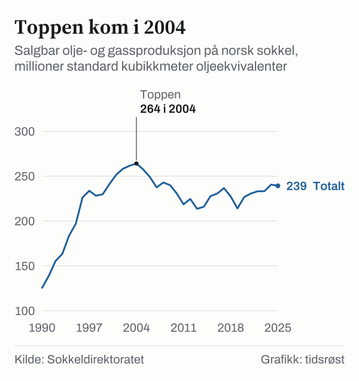

Norsk sokkel produserte 239,2 millioner standard kubikkmeter oljeekvivalenter (Sm³ o.e.) i 2025, mot 240,7 millioner året før. Ved årsskiftet 2025/2026 var det 97 felt i produksjon, og investeringene i petroleumsvirksomheten var 246 milliarder 2026-kroner. Tallene kommer fra Sokkeldirektoratet og Energidepartementet, som driver nettstedet norskpetroleum.no, og sidene ble oppdatert 7. oktober 2026.

## Produksjonen i 2025

Produksjonen var litt lavere enn i 2024. I toppåret 2004 ble det produsert 264,2 millioner Sm³ o.e., så nivået i 2025 er 9,4 prosent lavere (regnet fra figurgrunnlaget). Oljeproduksjonen økte fra 102,90 til 106,81 millioner Sm³, en økning på 3,8 prosent, og norskpetroleum.no peker på nye felt som hovedårsak. Gassproduksjonen falt fra 124,26 til 120,57 millioner Sm³ o.e. (minus 3,0 prosent) etter at 2024 var et rekordår for gass. Gass utgjorde om lag 50 prosent av totalproduksjonen, og det ble solgt 121,8 milliarder Sm³ gass.

*Salgbar olje- og gassproduksjon per år, millioner Sm³ o.e. Kilde: Sokkeldirektoratet, via norskpetroleum.no.*

| Produkt (millioner Sm³ o.e.) | 2024 | 2025 |
|---|---:|---:|
| Olje | 102,90 | 106,81 |
| Kondensat | 1,29 | 1,03 |
| NGL (våtgass) | 12,22 | 10,85 |
| Gass (normalisert til 40 MJ) | 124,26 | 120,57 |
| **Totalt** | **240,67** | **239,26** |

*Kilde: Sokkeldirektoratet, via norskpetroleum.no. Totalene i tabellen er summen av radene i figurgrunnlaget (240,67 og 239,26). Norskpetroleum.no oppgir i løpende tekst 240,7 og 239,2 millioner Sm³ o.e. for 2024 og 2025; derfor er 239,2 brukt i artikkelen, mens 239,26 er brukt i tabell og regnestykker. Grafen over er rundet til hele tall.*

## 97 felt i drift

Siden produksjonen startet i 1971 har det vært produsert olje og gass fra 129 felt. Av de 97 feltene i produksjon ved årsskiftet lå 69 i Nordsjøen, 25 i Norskehavet og 3 i Barentshavet. Tre nye felt startet produksjonen i 2025: Halten Øst og Verdande i Norskehavet og Johan Castberg i Barentshavet.

Ved utgangen av 2025 pågikk 19 utbyggingsprosjekter, hvorav 12 var nye feltutbygginger og 7 var endringer i eksisterende felt. Det var 91 funn som blir, eller kan bli, vurdert bygget ut. I 2025 ble det ikke levert plan for nye feltutbygginger, men myndighetene godkjente planen for Fram Sør. Det ble avsluttet 49 letebrønner, og de ga 21 funn.

## Gasseksport til Europa

Norge eksporterte om lag 122 milliarder Sm³ gass i 2025, i all hovedsak til Europa, ifølge norskpetroleum.no. Det tilsvarer mer enn 30 prosent av det samlede gassforbruket i EU og Storbritannia. Norge er verdens fjerde største gasseksportør, etter Russland, Qatar og USA. Om lag 95 prosent av gassen går i rørledninger, mens resten eksporteres som flytende naturgass (LNG) fra Melkøya ved Hammerfest. Rørsystemet er over 8 800 kilometer langt.

| Første leveringspunkt | 2024 (mrd. Sm³) | 2025 (mrd. Sm³) | Andel 2025 |
|---|---:|---:|---:|
| Tyskland | 47,77 | 49,01 | 40,6 % |
| Storbritannia | 31,22 | 29,05 | 24,0 % |
| Frankrike | 15,97 | 14,65 | 12,1 % |
| Belgia | 15,93 | 14,90 | 12,3 % |
| Danmark | 8,30 | 9,11 | 7,5 % |
| LNG | 6,41 | 4,11 | 3,4 % |
| **Totalt** | **125,60** | **120,82** | **100 %** |

*Kilde: Sokkeldirektoratet, via norskpetroleum.no. Andelene er regnet ut fra tallene i tabellen; summen av radene i 2025 er 120,83 på grunn av avrunding.*

Tabellen viser første leveringspunkt. Mye av gassen sendes videre til andre land, og Danmark inkluderer overføring til Polen gjennom Baltic Pipe. Totalen i tabellen, 120,82 milliarder Sm³, er en annen oppstilling enn salgsvolumet på 121,8 milliarder Sm³ over, og tallene er derfor ikke helt identiske. Eksporten var 4,78 milliarder Sm³ (3,8 prosent) lavere enn i 2024.

Eksportverdien av råolje, naturgass og kondensat var om lag 1 000 milliarder kroner i 2025, 57 prosent av total norsk vareeksport. Gass sto for en større andel enn væskene. Tall fra Statistisk sentralbyrå (SSB, tabell 08800, oppdatert 15. mai 2026) viser en eksportverdi i 2025 på 571 milliarder kroner for naturgass og 436 milliarder for råolje, regnet i løpende kroner og ifølge foreløpige tall. Råolje, naturgass og kondensat utgjorde 56,8 prosent av total vareeksport etter SSBs tall.

## Investeringer og prognoser

Investeringene, uten letevirksomhet, var 246 milliarder 2026-kroner i 2025. Beløpene er oppgitt i 2026-kroner, det vil si at tidligere år er prisjustert til 2026-nivå slik at årene kan sammenlignes. Det er 21 milliarder (9,5 prosent) mer enn i 2024, og 9 milliarder under nivået i 2013, som er første år i serien. Laveste nivå i årene 2013 til 2025 var 161 milliarder i 2017 og 2018.

*Investeringer eksklusive leting, milliarder 2026-kroner. Kilde: Sokkeldirektoratet, via norskpetroleum.no. I figurgrunnlaget er tallene for 2013 til 2024 historiske og tallene fra 2025 merket som prognose.*

Samlede kostnader var nesten 400 milliarder kroner i 2025, med om lag 94 milliarder i driftskostnader og 33 milliarder i letekostnader. Samlede investeringer i petroleumsnæringene, inkludert lete- og avslutningskostnader, utgjør om lag en femtedel av alle investeringer i produksjonskapital i Norge.

Sokkeldirektoratets prognoser anslår investeringene til 248 milliarder kroner i 2026 og 224 milliarder i 2027, med gradvis fall mot 187 milliarder i 2030 fordi flere utbyggingsprosjekter blir ferdige. For produksjonen anslås 244,2 millioner Sm³ o.e. i 2026 og 205,2 millioner i 2030. Norskpetroleum.no understreker at anslagene er usikre og avhenger av nye funn, utbyggingsbeslutninger og tiltak på eksisterende felt.

## Kilder

- [Norskpetroleum.no: Produksjonsprognoser (oppdatert 7. oktober 2026)](https://www.norskpetroleum.no/produksjon-og-eksport/produksjonsprognoser/)
- [Norskpetroleum.no: Eksport av olje og gass (oppdatert 7. oktober 2026)](https://www.norskpetroleum.no/produksjon-og-eksport/eksport-av-olje-og-gass/)
- [Norskpetroleum.no: Aktivitetsnivå på feltene (oppdatert 7. oktober 2026)](https://www.norskpetroleum.no/utbygging-og-drift/aktivitetsniva-pa-feltene/)
- [Norskpetroleum.no: Felt](https://www.norskpetroleum.no/fakta/felt/)
- [Norskpetroleum.no: Investeringer og kostnader (oppdatert 7. oktober 2026)](https://www.norskpetroleum.no/okonomi/investeringer-og-driftskostnader/)
- [SSB: Tabell 08800 – utenrikshandel med varer, hovedtall (oppdatert 15. mai 2026)](https://www.ssb.no/statbank/table/08800)
