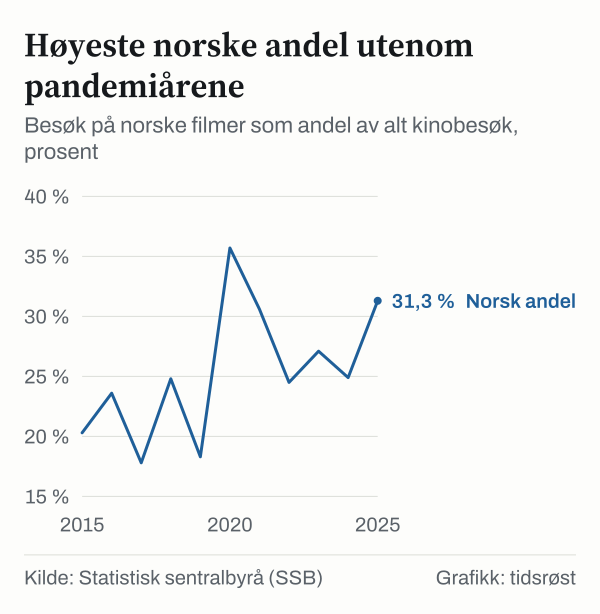
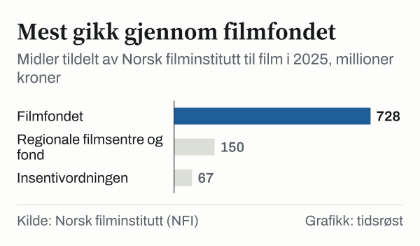

Norske filmer hadde 31,3 prosent av kinobesøket i Norge i 2025, ifølge årsrapporten for 2025 fra Norsk filminstitutt (NFI). Det totale kinobesøket var 8,4 millioner, og norske filmer hadde 2,6 millioner besøk. SSBs kinostatistikk viser samme andel. I 2024 var den 24,9 prosent.

*Besøk på norske filmer som andel av alt kinobesøk, 2015–2025. Kilde: SSB, tabell 11817.*

NFI skriver at andelen er den høyeste etter årtusenskiftet, utenom pandemiårene. I pandemiårene 2020 og 2021 var andelen 35,7 og 30,6 prosent.

## Hvorfor andelen steg

Besøket på norske filmer var omtrent som før pandemien. Det er besøket på utenlandske filmer som har falt. Ifølge SSB lå besøket på utenlandske filmer mellom 9,1 og 10,0 millioner hvert år fra 2015 til 2019. I 2025 var det 5,7 millioner. NFI skriver at den høye norske andelen derfor mest henger sammen med lavere besøk på utenlandske filmer.

*Kinobesøk på norske og utenlandske filmer, 2015–2025. Utenlandske filmer er alt kinobesøk minus besøk på norske filmer. Kilde: SSB, tabell 11817.*

Den mest sette filmen på norske kinoer i 2025 var den norske filmen *Hvis ingen går i fella*, med 451 000 besøkende. Ifølge NFI sto de seks mest sette norske filmene for 1,7 millioner besøk, 65 prosent av besøket på norsk film. 35 norske kinofilmer hadde premiere i 2025. Samme år vant *Drømmer* Gullbjørnen i Berlin.

## Statlig støtte til film og dataspill

NFI forvalter de statlige virkemidlene på film- og dataspillområdet. Ifølge årsrapporten tildelte NFI til sammen 945,4 millioner kroner til filmrelaterte formål i 2025. Den største delen gikk gjennom filmfondet.

*Tildelinger fra Norsk filminstitutt til film i 2025, millioner kroner. Insentivordningen er oppgitt som samlet ramme. Kilde: NFI, årsrapport 2025.*

I tillegg ga NFI 50,8 millioner kroner i tilskudd til utvikling av dataspill.

## Om tallene

NFI og SSB teller besøket på norske filmer litt ulikt: 2 624 344 i NFIs nøkkeltall og 2 620 243 i SSBs tabell for 2025. Andelen blir 31,3 prosent i begge.

## Kilder

- [Norsk filminstitutt: Årsrapport 2025](https://www.regjeringen.no/contentassets/4c8a3c491a484f4084d5a315140eaacd/norsk-filminstitutt-arsrapport-2025-med-riksrevisjonens-beretning.pdf)
- [SSB Statistikkbanken: Tabell 11817 – Kino og kinobesøk](https://www.ssb.no/statbank/table/11817)
