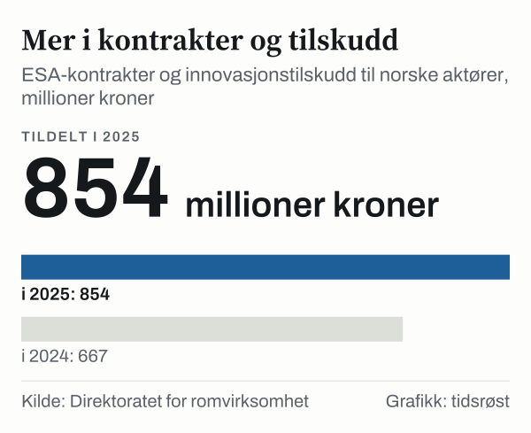

Den nye romloven trådte i kraft 1. juli 2026, ifølge Nærings- og fiskeridepartementet. Den erstatter en lov fra 1969 som bare handlet om oppskyting fra norsk territorium. Samtidig har Andøya fått sin første testoppskyting, og norske aktører fikk mer i europeiske romkontrakter i 2025 enn året før.

## Hva er nytt

Stortingets næringskomité avga 25. november 2025 innstilling om lov om aktiviteter i verdensrommet (romloven). Loven avløser lov 13. juni 1969 nr. 38 om oppskyting av gjenstander fra norsk territorium ut i verdensrommet.

Den nye loven er en rammelov. Detaljkravene skal fastsettes i forskrifter. Ifølge innstillingen er formålet å legge til rette for en sikker og bærekraftig bruk av verdensrommet.

## Hva det betyr for aktørene

Ifølge lovforslaget som komiteen tilrådde, må den som allerede driver romaktivitet når loven trer i kraft, søke om tillatelse innen 12 måneder for å kunne fortsette.

## Andøya: første testoppskyting

I mars 2025 gjennomførte ISAR den første testoppskytingen fra Andøya. Ifølge årsrapporten til Direktoratet for romvirksomhet ble oppskytingen avbrutt etter kort tid på grunn av feil, og raketten falt ned i sikkerhetssonen. Direktoratet skriver at oppskytingen likevel ble «regnet som en suksess», fordi den viste at det europeiske kontinentet har fått sin første romhavn der raketter kan skytes ut i bane.

## Kontrakter til norsk romindustri

Ifølge årsrapporten fikk norske aktører 833,4 millioner kroner i ESA-kontrakter og 20,6 millioner kroner i innovasjonstilskudd i 2025, til sammen 854 millioner kroner. I 2024 var tilsvarende tall 667 millioner kroner.

*ESA-kontrakter og innovasjonstilskudd tildelt norske aktører, 2024 og 2025. Kilde: Direktoratet for romvirksomhet, årsrapport 2025.*

I EU-programmet Copernicus hadde norske aktører kontrakter for 92,3 millioner euro fra 2021 til 30. juni 2025. Ifølge direktoratet gjør det Norge til den sjette største nasjonen i programmet.

## Europa

Ved ESAs ministerrådskonferanse i november 2025 fikk ESA deklarasjoner fra medlemslandene på til sammen 22,1 milliarder euro for perioden 2026–2028. Årsrapporten omtaler det som rekord.

Etaten som forvalter de statlige virkemidlene på området, het Norsk Romsenter fra 1987. Fra 1. september 2025 heter den Direktoratet for romvirksomhet.

## Kilder

- [Direktoratet for romvirksomhet: Årsrapport 2025](https://www.regjeringen.no/contentassets/036ffda0c81e4b3f99456a78ec31df0e/arsrapport-2025-direktoratet-for-romvirksomhet.pdf)
- [Nærings- og fiskeridepartementet: Romåret 2026](https://www.regjeringen.no/no/tema/naringsliv/forskning-og-innovasjon/romvirksomhet/romaret2026/id3169970/)
- [Stortinget: Innst. 32 L (2025–2026) om ny lov om aktiviteter i verdensrommet](https://stortinget.no/no/Saker-og-publikasjoner/Publikasjoner/Innstillinger/Stortinget/2025-2026/inns-202526-032l/?all=true)
