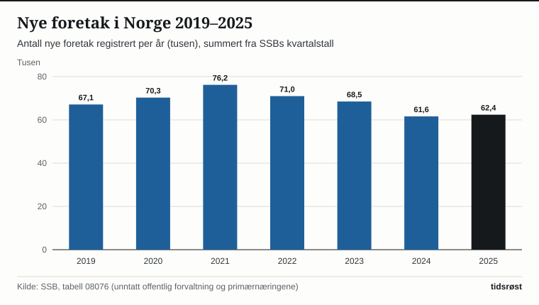

I løpet av 2025 ble det registrert 65 400 nye foretak i Enhetsregisteret og Foretaksregisteret i Norge, viser nyetableringsstatistikken fra Statistisk sentralbyrå (SSB). Det tilsvarer rundt 180 nye bedrifter hver eneste kalenderdag året gjennom, og i første halvår 2026 har antall nyregistrerte aksjeselskaper økt videre med om lag 3,4 prosent sammenlignet med fjoråret.

Ved inngangen til 2026 var det totalt over 640 000 aktive bedrifter i norsk næringsliv, hvorav hele 99 prosent er små og mellomstore bedrifter med under 100 ansatte.

## Aksjeselskap og enkeltpersonforetak dominerer

De fleste som starter virksomhet i Norge, velger enten enkeltpersonforetak (ENK) eller aksjeselskap (AS). I 2025 var rundt 33 100 av de nyetablerte foretakene enkeltpersonforetak og om lag 30 200 aksjeselskaper, mens resten besto av blant annet ansvarlige selskaper og samvirkeforetak.

*Antall nyetablerte foretak i Norge per år (tusen), 2020–2025. Kilde: SSB, tabell 10585 og Brønnøysundregistrene.*

Etter at kravet til minste aksjekapital for aksjeselskap ble satt til 30 000 kroner – og stiftelsesutgiftene til blant annet revisor og bankgebyr kan dekkes av selve aksjekapitalen – har det blitt langt mer tilgjengelig å velge selskapsformen AS, som gir gründeren begrenset personlig økonomisk risiko og sosiale rettigheter som ansatt i eget selskap.

## Nøkkeltall for nyetableringer og organisasjonsformer

Tabellen viser fordelingen av nyetablerte foretak i Norge de tre siste årene:

| Organisasjonsform | 2023 | 2024 | 2025 | Andel 2025 |
|---|---:|---:|---:|---:|
| Enkeltpersonforetak (ENK) | 32 400 | 32 800 | 33 100 | 50,6 % |
| Aksjeselskap (AS) | 28 100 | 28 900 | 30 200 | 46,2 % |
| Øvrige organisasjonsformer | 2 000 | 2 100 | 2 100 | 3,2 % |
| **Nyetableringer i alt** | **62 500** | **63 800** | **65 400** | **100,0 %** |

*Kilde: SSB, tabell 10585.*

Målt etter bransje skjer flest nyetableringer innen faglig, vitenskapelig og teknisk tjenesteyting (21,4 prosent) – som omfatter ingeniørrådgivning, arkitekter, regnskap og konsulentvirksomhet – fulgt av bygg og anlegg (14,2 prosent), varehandel (13,5 prosent) og IT og kommunikasjon (11,8 prosent).

*Andel av nyetablerte foretak etter næringshovedområde i 2025. Kilde: SSB.*

## Heldigital registrering og ny gründermelding fra regjeringen

Gjennom samarbeidet mellom Brønnøysundregistrene, Altinn og norske banker kan gründere i dag stifte aksjeselskap, få bekreftet aksjekapitalinnskuddet digitalt fra banken og motta organisasjonsnummer i løpet av få dager uten ett eneste papirskjema.

Samtidig har Nærings- og fiskeridepartementet fulgt opp stortingsmeldingen om gründere og oppstartsbedrifter – med ambisjon om at Norge skal være et av verdens beste land å starte og utvikle bedrift i. Gjennom Innovasjon Norge, Siva (med 34 inkubatorer og 38 næringshager over hele landet) og det statlige investeringsselskapet Investinor tilbys oppstartsbedrifter både oppstartstilskudd, risikolån, eksportveiledning og tidligfasekapital.

## Kilder

- [SSB: Nyetableringer – kvartals- og årsstatistikk over nye foretak](https://www.ssb.no/virksomheter-foretak-og-regnskap/virksomheter-og-foretak/statistikk/nyetableringer)
- [SSB Statistikkbanken: Tabell 10585 – Nyetablerte foretak etter organisasjonsform og næring](https://www.ssb.no/statbank/table/10585)
- [Brønnøysundregistrene: Statistikk over nyregistreringer i Enhetsregisteret og Foretaksregisteret](https://www.brreg.no/om-oss/tall-og-statistikk/)
- [Innovasjon Norge: Årsrapport og finansiering for oppstartsbedrifter](https://www.innovasjonnorge.no/tjeneste/oppstartsfinansiering)
