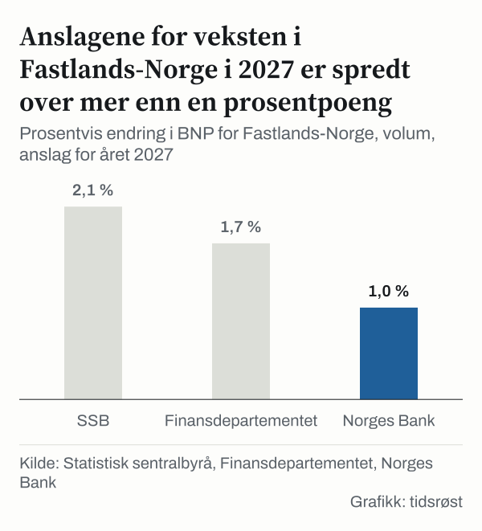
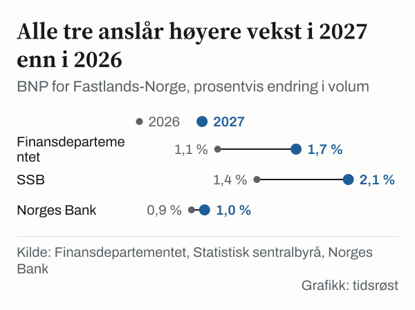
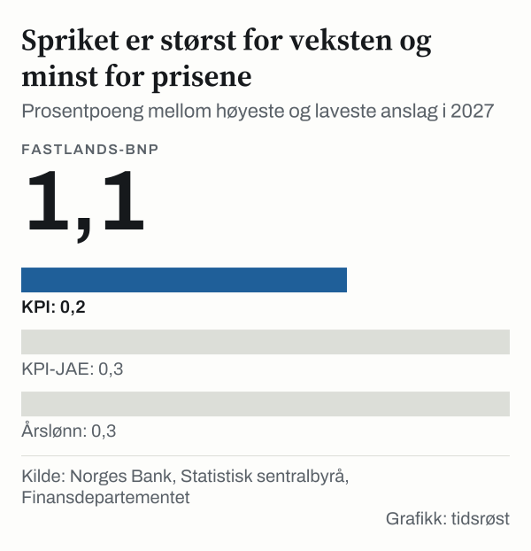
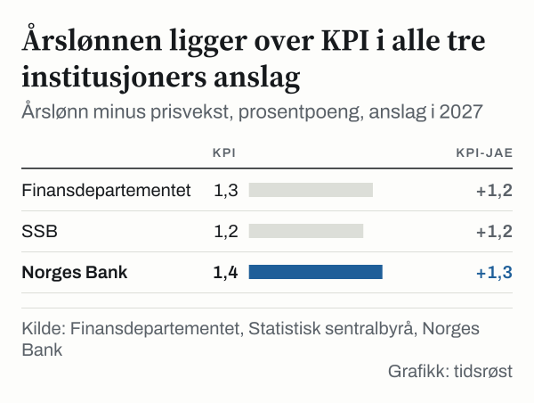

I juni anslo Norges Bank at tolvmånedersveksten i konsumprisene ville være 3,0 prosent i august 2026. Utfallet ble 3,3 prosent. For KPI-JAE, den underliggende prisveksten, var anslaget 3,3 prosent og utfallet 3,0 prosent. I september la banken fram nye anslag: 3,5 prosent for KPI og 2,9 prosent for KPI-JAE i september. Utfallene ble 3,4 prosent og 3,0 prosent. Avvikene er mellom 0,1 prosentpoeng og 0,3 prosentpoeng, og de går begge veier.

Det er én måte å lese et offisielt anslag på: som et punkt der det senere kommer en fasit. Den andre er å legge flere anslag for samme år side om side og se hvor de er enige. Når vi gjør det for året 2027, avhenger svaret av hva vi ser på. For veksten i Fastlands-Norge ligger anslagene fra Norges Bank, Finansdepartementet og Statistisk sentralbyrå (SSB) mellom 1,0 prosent og 2,1 prosent, et sprik på 1,1 prosentpoeng. For prisveksten målt ved konsumprisindeksen (KPI) ligger de mellom 2,5 prosent og 2,7 prosent, et sprik på 0,2 prosentpoeng.

For den som følger med på økonomien betyr det at det ikke finnes ett eneste anslag for året 2027. Noe er det stor enighet om, annet er mer åpent. Her går vi gjennom hvor spriket er og hvor det ikke er.

## Fire utgivere, fire tidspunkt

Anslagene vi sammenlikner kommer fra fire offisielle kilder. SSB publiserte sine 15. september 2026 i Konjunkturtendensene. Norges Bank la fram sine 24. september 2026 i den pengepolitiske rapporten. Finansdepartementet offentliggjorde nøkkeltallene i nasjonalbudsjettet 7. oktober 2026. Det internasjonale pengefondet (IMF) la fram World Economic Outlook 13. oktober 2026.

De tre norske institusjonene har anslag for de samme størrelsene, og det gjør det mulig å stille dem opp mot hverandre. IMF gir færre størrelser, men dekker blant annet total-BNP og prisvekst. Da blir bildet bredere.

Tidspunktene er ulike, så anslagene bygger på ulik informasjon. Mellom SSBs publisering i september og IMFs i oktober er det nesten en måned.

## Veksten: der anslagene skiller lag

BNP for Fastlands-Norge er verdiskapingen i økonomien uten olje- og gassvirksomheten. I 2027 er anslagene 2,1 prosent fra SSB, 1,7 prosent fra Finansdepartementet og 1,0 prosent fra Norges Bank.

*Prosentvis endring i BNP for Fastlands-Norge, volum, anslag for året 2027. Kilde: Statistisk sentralbyrå, Finansdepartementet, Norges Bank.*

Første spørsmål er om spriket bare skyldes at institusjonene starter fra ulike nivåer i 2026. Det gjør det ikke. I 2026 er anslagene 0,9 prosent fra Norges Bank, 1,1 prosent fra Finansdepartementet og 1,4 prosent fra SSB, et sprik på 0,5 prosentpoeng. I 2027 er spriket 1,1 prosentpoeng, mer enn dobbelt så stort.

Det neste spørsmålet er hvor mye veksten tar seg opp. Alle tre anslår høyere vekst i 2027 enn i 2026, men økningen varierer. Finansdepartementet anslår en økning på 0,6 prosentpoeng, SSB på 0,7 prosentpoeng og Norges Bank på 0,1 prosentpoeng.

*BNP for Fastlands-Norge, prosentvis endring i volum. Kilde: Finansdepartementet, Statistisk sentralbyrå, Norges Bank.*

Tar vi med olje og gass, får vi total-BNP. I 2027 ligger anslagene slik: SSB 1,2 prosent, IMF 1,3 prosent og Norges Bank 0,1 prosent. Mellom høyeste og laveste anslag er det 1,2 prosentpoeng.

Her går anslagene motsatt vei av Fastlands-BNP. For total-BNP anslår alle tre lavere vekst i 2027 enn i 2026. Norges Bank anslår 1,0 prosent i 2026 og 0,1 prosent i 2027, en nedgang på 0,9 prosentpoeng. SSB anslår 1,4 prosent i 2026 og 1,2 prosent i 2027, IMF 1,5 prosent og 1,3 prosent. For begge er nedgangen 0,2 prosentpoeng.

## Hva som ligger under vekstanslagene

Hvis vi vil forstå spriket, kan vi se på delene. Norges Bank og SSB har begge anslag for husholdningenes konsum og inntekt i 2027, og her peker tallene i hver sin retning.

Norges Bank anslår at husholdningenes konsum vokser med 2,6 prosent i 2027. SSB anslår 2,1 prosent. Forskjellen er 0,5 prosentpoeng, og det er altså Norges Bank som anslår sterkest konsumvekst. Husholdningenes disponible realinntekt viser det motsatte bildet. Her anslår Norges Bank 1,1 prosent og SSB 1,9 prosent, en forskjell på 0,8 prosentpoeng.

Norges Banks anslag har altså raskere konsumvekst enn SSBs, men et lavere anslag for BNP for Fastlands-Norge. Tallene i tabellene viser hva institusjonene anslår, men ikke hvorfor. Begrunnelsene står i rapportene.

Sysselsettingen er et tredje tall. Finansdepartementet anslår en vekst på 0,4 prosent i 2027, SSB 0,6 prosent og Norges Bank 0,3 prosent. Her ligger de tre tett, innenfor 0,3 prosentpoeng.

To andre tall ligger tett. For petroleumsinvesteringene anslår Norges Bank minus 4,0 prosent i 2027, og SSB anslår det samme for investeringer i utvinning og rørtransport. For boligprisene anslår Norges Bank 3,6 prosent og SSB 3,5 prosent, en forskjell på 0,1 prosentpoeng.

Anslag flytter seg også over tid. I Norges Banks rapport fra juni var anslaget for veksten i Fastlands-Norge i 2027 på 0,8 prosent. I rapporten fra september er det 1,0 prosent, en oppjustering på 0,2 prosentpoeng. KPI-anslaget for året 2027 gikk fra 2,4 prosent til 2,6 prosent, også 0,2 prosentpoeng opp. For KPI-JAE gikk anslaget fra 2,8 prosent til 2,7 prosent, 0,1 prosentpoeng ned.

## Prisene og lønningene: anslag som ligger tettere

Her blir bildet annerledes. For KPI i 2027 ligger anslagene slik: SSB 2,5 prosent, Norges Bank 2,6 prosent og Finansdepartementet 2,7 prosent. Spriket er 0,2 prosentpoeng. IMF anslår 2,8 prosent som årsgjennomsnitt. Tar vi med IMF, er spriket 0,3 prosentpoeng.

KPI-JAE er KPI justert for avgiftsendringer og uten energivarer. Forskjellen mellom de to prismålene er 0,1 prosentpoeng hos Finansdepartementet og hos Norges Bank, og null hos SSB. Her anslår SSB 2,5 prosent, Norges Bank 2,7 prosent og Finansdepartementet 2,8 prosent. Spriket er 0,3 prosentpoeng.

Årslønnen gir samme mønster. Finansdepartementet og Norges Bank anslår begge 4,0 prosent i 2027, SSB 3,7 prosent. Også her er spriket 0,3 prosentpoeng.

*Prosentpoeng mellom høyeste og laveste anslag i 2027. Kilde: Norges Bank, Statistisk sentralbyrå, Finansdepartementet.*

SSB og Norges Bank er også tett på hverandre når vi ser på banen videre. SSB anslår KPI-vekst på 3,2 prosent i 2026, 2,5 prosent i 2027 og 2,2 prosent i 2028. Norges Bank anslår 3,3 prosent, 2,6 prosent og 2,3 prosent. Linjene ligger 0,1 prosentpoeng fra hverandre alle tre årene. I 2025 var KPI-veksten 3,1 prosent.

*Konsumprisindeksen, prosentvis endring fra året før. Kilde: Statistisk sentralbyrå, Norges Bank.*

Når lønn og priser er anslått, kan vi regne ut differansen. Dette er vår egen beregning av institusjonenes tall, ikke et anslag fra dem. Trekker vi KPI fra årslønnen, får vi 1,3 prosentpoeng med Finansdepartementets tall, 1,2 prosentpoeng med SSBs og 1,4 prosentpoeng med Norges Banks. Med KPI-JAE blir differansen 1,2 prosentpoeng, 1,2 prosentpoeng og 1,3 prosentpoeng. I alle tre institusjoners anslag ligger altså årslønnen over prisveksten i 2027.

Finansdepartementet skriver i pressemeldingen (7. oktober 2026) at lønningene har steget mer enn prisene, og at «denne utviklingen ventes å fortsette i år og neste år».

*Årslønn minus prisvekst, prosentpoeng, anslag i 2027. Kilde: Finansdepartementet, Statistisk sentralbyrå, Norges Bank.*

## Ledigheten måles to steder

Ledighet ser ved første øyekast ut til å passe inn i mønsteret med tette anslag, men den gjør det ikke. Finansdepartementet anslår registrert ledighet på 2,1 prosent i 2027, og Norges Bank anslår 2,3 prosent. Spriket er 0,2 prosentpoeng. SSB anslår derimot 4,4 prosent.

Forskjellen mellom 2,1 prosent og 4,4 prosent gjelder to ulike mål. Registrert ledighet teller dem som er registrert som arbeidssøkere hos Nav. SSB bruker arbeidskraftundersøkelsen (AKU), en utvalgsundersøkelse der ledighet er definert etter internasjonale regler. Tallene kan ikke leses mot hverandre.

## En annen måte å se spriket på

Spriket for veksten kan også leses motsatt. Tre institusjoner med ulike utgivelsesdatoer anslår alle at veksten i Fastlands-Norge tar seg opp i 2027. De anslår alle prisvekst i et smalt intervall, mellom 2,5 prosent og 2,7 prosent, og i alle tre ligger årslønnsanslaget over KPI-anslaget. På disse punktene er det mer enighet enn uenighet.

Samtidig er spriket for veksten stort i forhold til nivået. Det er 1,1 prosentpoeng, omtrent like mye som det laveste anslaget selv, 1,0 prosent. For prisene er forholdet motsatt: spriket på 0,2 prosentpoeng er lite i forhold til anslag rundt 2,6 prosent.

## Det anslagene ikke kan si

Tabellene viser punktanslag, uten angivelse av hvor usikre de er. Alle institusjonene oppdaterer anslagene jevnlig, slik Norges Banks anslag for året 2027 allerede er revidert mellom juni og september.

Størrelsene er heller ikke alltid identiske. BNP for Fastlands-Norge og total-BNP er to ulike mål, og de beveger seg i hver sin retning fra året 2026 til året 2027. IMFs prisanslag er et årsgjennomsnitt, mens SSB, Norges Bank og Finansdepartementet bruker den årlige endringen i KPI. Ledighet har vi vist at ikke kan leses på tvers. Og anslagene er laget til ulike tider, fra 15. september til 13. oktober 2026, med ulik kunnskap om de siste månedenes tall.

Til slutt viser tallene hva institusjonene anslår, ikke hva som er riktig. Utfallet for året 2027 er ikke kjent, og vi har ikke noe eget anslag. Det er først når nasjonalregnskapet for året er publisert at anslagene kan sammenliknes med fasit.

## Slik regnet vi

Vi har hentet anslagene for året 2027 fra de siste utgavene som var publisert da vi samlet tallene: SSBs Konjunkturtendensene fra 15. september 2026, Norges Banks pengepolitiske rapport fra september 2026 med tabellen over makroøkonomiske hovedstørrelser, Finansdepartementets nøkkeltall i nasjonalbudsjettet, IMFs World Economic Outlook fra oktober 2026. Månedstallene for KPI og KPI-JAE i august og september 2026 er fra SSBs tabell over avledede serier fra konsumprisindeksen. Norges Banks tidligere anslag er fra den pengepolitiske rapporten i juni 2026. Sitatet er fra Finansdepartementets pressemelding.

Spriket er høyeste minus laveste anslag blant de tre norske institusjonene, regnet med én desimal. Differansen mellom lønn og priser er årslønnsanslaget minus KPI-anslaget fra samme institusjon. Avvik mellom Norges Banks anslag og utfallet er utfallet fra SSB minus bankens anslag for samme måned. Alle anslag er hentet slik institusjonene selv publiserer dem; vi har ikke justert dem og har ikke laget egne anslag.

## Kilder

- [Finansdepartementet: Nøkkeltall i nasjonalbudsjettet](https://www.regjeringen.no/id3174610/)
- [Norges Bank: Pengepolitisk rapport, september 2026](https://www.norges-bank.no/contentassets/fc580519ec63404980e5daada0ca7790/ppr-3-26.pdf)
- [Norges Bank: Pengepolitisk rapport, juni 2026](https://www.norges-bank.no/contentassets/c1ae1dbac64d43c898f234aa2744eb4b/ppr-2-26.pdf)
- [SSB: Konjunkturtendensene, makroøkonomiske hovedstørrelser og prognoser](https://www.ssb.no/kt)
- [SSB: Konsumprisindeksen](https://www.ssb.no/kpi)
- [IMF: World Economic Outlook](https://www.imf.org/en/publications/weo)
- [IMF: DataMapper, reell BNP-vekst for Norge](https://www.imf.org/external/datamapper/NGDP_RPCH@WEO/NOR)
