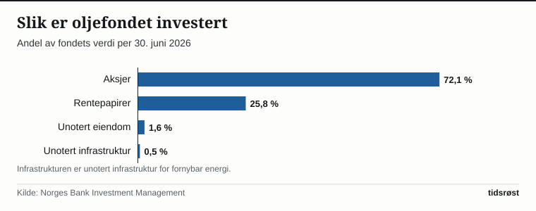

Ved halvårsskiftet 30. juni 2026 nådde Statens pensjonsfond utland – oljefondet – en markedsverdi på 22 683 milliarder kroner, viser halvårsrapporten Norges Bank Investment Management (NBIM) la fram 12. august. Ved utgangen av 2010 sto fondet i 3 077 milliarder kroner. På 15 år har formuen dermed blitt drøyt sju ganger så stor.

## Tidenes høyeste kroneavkastning på et halvår

Bare i løpet av første halvår 2026 kastet fondet av seg 9,4 prosent, noe som tilsvarer en regnskapsmessig avkastning på 1 753 milliarder kroner. Det er den høyeste kroneavkastningen i et enkelt halvår i fondets historie, og 0,22 prosentpoeng bedre enn fondets referanseindeks.

Oppgangen ble drevet av børsoppgang internasjonalt. Aksjeporteføljen ga en avkastning på 13,0 prosent, mens renteinvesteringene steg med 0,9 prosent. Unotert eiendom ga 3,0 prosent, mens unotert infrastruktur for fornybar energi gikk tilbake med 0,2 prosent.

– Resultatet er drevet av god avkastning i aksjemarkedet, særlig fra asiatiske teknologiaksjer, uttalte fondets leder Nicolai Tangen da halvårstallene ble lagt fram.

Til tross for gevinsten på 1 753 milliarder kroner økte den samlede fondsverdien med et lavere beløp – 1 416 milliarder kroner – gjennom halvåret. Forklaringen ligger i valutamarkedet: En sterkere norsk krone mot flere av hovedvalutaene trakk verdien målt i norske kroner ned med 427 milliarder. Samtidig tilførte staten 89 milliarder kroner i friske midler etter fradrag for forvaltningskostnader.

## Fra 3 000 til over 22 000 milliarder kroner

Ser man på utviklingen siden 2010, har fondet vokst i nesten samtlige kalenderår. Milepælen på 6 000 milliarder kroner ble passert ved utgangen av 2014, og fem år senere, ved årsskiftet 2019/2020, krysset fondet 10 000 milliarder kroner. Veksten skjøt ytterligere fart mellom 2022 og 2024, da verdien hoppet fra 12 429 til 19 742 milliarder kroner, før den nådde 21 268 milliarder ved utgangen av 2025.

Det eneste kalenderåret med verdifall i denne perioden var 2018, da markedsverdien gikk ned fra 8 488 til 8 256 milliarder kroner.

*Oljefondets markedsverdi ved utgangen av hvert år, og per 30. juni 2026. Kilde: Norges Bank Investment Management.*

Tre faktorer avgjør hvor stort fondet er til enhver tid: gevinst eller tap i finansmarkedene, netto innskudd eller uttak fra den norske staten, og svingninger i kronekursen. Per 30. juni 2026 fordelte den samlede verdien seg slik:

| Kilde til fondets verdi | Milliarder kroner |
|---|---|
| Avkastning på investeringene | 15 210 |
| Netto tilførsel fra staten | 5 509 |
| Endringer i kronekursen | 1 965 |
| **Samlet verdi** | **22 683** |

*(Tallene i tabellen summerer ikke nøyaktig på grunn av avrunding.)* Mer enn to tredjedeler av dagens fondsverdi skriver seg altså fra avkastning i markedene – ikke fra olje- og gassinntekter som er satt inn på konto.

## Eier 1,5 prosent av verdens børsnoterte selskaper

Nesten tre fjerdedeler av formuen er plassert i aksjemarkedet. Per 30. juni 2026 var 72,1 prosent investert i aksjer, 25,8 prosent i rentepapirer, 1,6 prosent i unotert eiendom og 0,5 prosent i unotert infrastruktur for fornybar energi.

Fondet har handlet aksjer og rentepapirer siden 1998. De første kjøpene i unotert eiendom kom i 2011, mens investeringer i unotert fornybar infrastruktur ble åpnet i 2021.

*Andel av fondets verdi per aktivaklasse per 30. juni 2026. Kilde: Norges Bank Investment Management.*

Aksjeporteføljen er spredt på eierposter i rundt 7 100 selskaper verden over. I gjennomsnitt eier det norske fondet 1,5 prosent av samtlige børsnoterte selskaper globalt. Den høye aksjeandelen gjør samtidig at fondsverdien svinger i takt med verdens børser.

## Handlingsregelen og 2027-budsjettet

Ingen penger kan hentes ut av oljefondet uten vedtak i Stortinget. Siden 2002 har uttaket blitt styrt av handlingsregelen, som slår fast at pengebruken over statsbudsjettet over tid skal følge forventet realavkastning av fondet. I Perspektivmeldingen 2017 ble dette avkastningsanslaget nedjustert fra 4 til 3 prosent.

I sitt forslag til statsbudsjett for 2027, lagt fram 7. oktober 2026, foreslår regjeringen å overføre 608,4 milliarder kroner fra fondet, inkludert 85 milliarder kroner i Ukraina-støtte. Finansdepartementet har beregningsteknisk anslått fondsverdien ved inngangen til 2027 til 22 400 milliarder kroner. Det foreslåtte uttaket tilsvarer dermed 2,7 prosent av fondet – et nivå departementet omtaler som «klart under den forventede realavkastningen på tre prosent».

Målt mot verdiskapingen i norsk økonomi dekker overføringen fra oljefondet 12,6 prosent av trend-BNP for Fastlands-Norge.

## Fire millioner kroner per innbygger på papiret

Selv om oljefondet tilhører fellesskapet og ingen innbyggere har noen personlig konto eller uttaksrett, illustrerer folketallet dimensjonene i formuen.

Ved utgangen av andre kvartal 2026 hadde Norge 5 636 904 innbyggere, ifølge SSB. Fordelt på befolkningen tilsvarer fondsverdien på 22 683 milliarder kroner per 30. juni 2026 rundt 4,02 millioner kroner per innbygger. På samme måte utgjør det foreslåtte budsjettuttaket på 608,4 milliarder kroner for 2027 om lag 108 000 kroner per innbygger.

I hverdagen merkes disse midlene gjennom statsbudsjettet, der overføringene fra fondet er med på å finansiere folketrygden, sykehusene og kommuneøkonomien. Fordi pengene er plassert i utenlandske verdipapirer, vil både internasjonale børssvingninger og endringer i kronekursen fortsette å gi store utslag i den bokførte kroneverdien fra år til år.

## Kilder

- [NBIM: Halvårsrapport 2026](https://www.nbim.no/no/publikasjoner/rapporter/2026/halvarsrapport-2026/)
- [NBIM: Pressemelding «Rekordhøy kroneavkastning i første halvår» (12. august 2026)](https://www.nbim.no/no/nyheter-og-innsikt/presserom/pressemeldinger/2026/rekordhoy-kroneavkastning-i-forste-halvar/)
- [NBIM: Oljefondets verdi](https://www.nbim.no/no/investeringene/fondets-verdi/)
- [Regjeringen: Nøkkeltall i nasjonalbudsjettet 2027](https://www.regjeringen.no/no/aktuelt/nokkeltall-i-nasjonalbudsjettet-2027/id3174610/)
- [Regjeringen: Handlingsregelen](https://www.regjeringen.no/no/tema/okonomi-og-budsjett/statsbudsjett/ord-og-begreper-i-statsbudsjettet/handlingsregelen/id2860044/)
- [Regjeringen: Hvor mye av olje- og gassinntektene bruker vi?](https://www.regjeringen.no/no/tema/okonomi-og-budsjett/norsk_okonomi/hvor-mye-av-olje--og-gassinntektene-bruker-vi/id450461/)
- [SSB: Statistikkbanken, tabell 01222 – Befolkning og kvartalsvise endringer](https://www.ssb.no/statbank/table/01222/)
