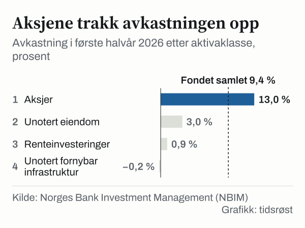

Statens pensjonsfond utland, oljefondet, var verdt 22 683 milliarder kroner per 30. juni 2026, viser halvårsrapporten som Norges Bank Investment Management (NBIM) la fram 12. august. Ved utgangen av 2010 var fondet verdt 3 077 milliarder kroner. På 15 år har formuen dermed blitt drøyt sju ganger så stor. Avkastning i finansmarkedene står for 15 210 milliarder kroner av verdien.

## Hva fondet består av

Tre faktorer avgjør hvor stort fondet er: gevinst eller tap i finansmarkedene, netto innskudd eller uttak fra staten, og svingninger i kronekursen. Per 30. juni 2026 fordelte verdien seg slik:

| Kilde til fondets verdi | Milliarder kroner |
|---|---|
| Avkastning på investeringene | 15 210 |
| Netto tilførsel fra staten | 5 509 |
| Endringer i kronekursen | 1 965 |
| **Samlet verdi** | **22 683** |

*Tallene summerer ikke nøyaktig på grunn av avrunding. Kilde: NBIM.*

Nesten tre fjerdedeler av formuen er plassert i aksjer. Per 30. juni 2026 var 72,1 prosent investert i aksjer, 25,8 prosent i rentepapirer, 1,6 prosent i unotert eiendom og 0,5 prosent i unotert infrastruktur for fornybar energi.

*Fondets fordeling på aktivaklasser per 30. juni 2026. Andelen unotert fornybar infrastruktur er under én rute. Kilde: NBIM.*

Aksjeporteføljen er spredt på eierposter i rundt 7 100 selskaper verden over. I gjennomsnitt eier fondet 1,5 prosent av alle børsnoterte selskaper. Fondet har handlet aksjer og rentepapirer siden 1998. De første kjøpene i unotert eiendom kom i 2011, mens investeringer i unotert fornybar infrastruktur ble åpnet i 2021.

## Første halvår 2026

I første halvår 2026 ga fondet en avkastning på 9,4 prosent, eller 1 753 milliarder kroner. Ifølge NBIM er det den høyeste kroneavkastningen i et halvår, og 0,22 prosentpoeng bedre enn fondets referanseindeks. NBIM oppgir at resultatet skyldes god avkastning i aksjemarkedet, særlig i asiatiske teknologiaksjer.

*Avkastning i første halvår 2026 etter aktivaklasse. Den stiplede linjen viser fondet samlet. Kilde: NBIM.*

Fondsverdien økte likevel med et lavere beløp, 1 416 milliarder kroner. En sterkere krone mot flere av hovedvalutaene trakk verdien målt i norske kroner ned med 427 milliarder kroner. Netto tilførsel fra staten var 89 milliarder kroner etter fradrag for forvaltningskostnader.

## Fondet over tid

Fondet har økt i verdi hvert kalenderår siden 2010 med ett unntak: I 2018 gikk verdien ned fra 8 488 til 8 256 milliarder kroner. Ved utgangen av 2014 var fondet verdt 6 431 milliarder kroner, og ved utgangen av 2019 10 088 milliarder. Mellom 2022 og 2024 økte verdien fra 12 429 til 19 742 milliarder kroner, og den var 21 268 milliarder ved utgangen av 2025.

![Linjediagram over Fondet har falt i verdi bare ett år siden 2010: Fondets verdi: 3 077 milliarder kroner i 2010, 3 312 milliarder kroner i 2011, 3 816 milliarder kroner i 2012, 5 038 milliarder kroner i 2013, 6 431 milliarder kroner i 2014, 7 475 milliarder kroner i 2015, 7 510 milliarder kroner i 2016, 8 488 milliarder kroner i 2017, 8 256 milliarder kroner i 2018, 10 088 milliarder kroner i 2019, 10 914 milliarder kroner i 2020, 12 340 milliarder kroner i 2021, 12 429 milliarder kroner i 2022, 15 757 milliarder kroner i 2023, 19 742 milliarder kroner i 2024, 21 268 milliarder kroner i 2025.](./graf-1.svg)
*Fondets verdi ved utgangen av hvert år, 2010–2025, milliarder kroner. Kilde: NBIM, årsrapporter.*

## Hvor mye som brukes

Ingen penger kan hentes ut av oljefondet uten vedtak i Stortinget. Siden 2002 har uttaket blitt styrt av handlingsregelen, som slår fast at pengebruken over statsbudsjettet over tid skal følge forventet realavkastning av fondet.

I forslaget til statsbudsjett for 2027, lagt fram 7. oktober 2026, foreslår regjeringen å bruke 608,4 milliarder kroner fra fondet. Finansdepartementet har beregningsteknisk anslått fondsverdien ved inngangen til 2027 til 22 400 milliarder kroner, slik at bruken tilsvarer 2,7 prosent av fondet. Målt som andel av trend-BNP for Fastlands-Norge utgjør bruken av fondsmidler 12,6 prosent.

## Hva tallene ikke viser

Verdien er målt i norske kroner. Når kronen styrker seg, faller verdien målt i kroner, selv om investeringene er like mye verdt i utenlandsk valuta.

## Kilder

- [NBIM: Halvårsrapport 2026](https://www.nbim.no/no/publikasjoner/rapporter/2026/halvarsrapport-2026/)
- [NBIM: Pressemelding «Rekordhøy kroneavkastning i første halvår» (12. august 2026)](https://www.nbim.no/no/nyheter-og-innsikt/presserom/pressemeldinger/2026/rekordhoy-kroneavkastning-i-forste-halvar/)
- [NBIM: Oljefondets verdi](https://www.nbim.no/no/investeringene/fondets-verdi/)
- [Regjeringen: Nøkkeltall i nasjonalbudsjettet 2027](https://www.regjeringen.no/no/aktuelt/nokkeltall-i-nasjonalbudsjettet-2027/id3174610/)
- [Regjeringen: Handlingsregelen](https://www.regjeringen.no/no/tema/okonomi-og-budsjett/statsbudsjett/ord-og-begreper-i-statsbudsjettet/handlingsregelen/id2860044/)
- [Regjeringen: Hvor mye av olje- og gassinntektene bruker vi?](https://www.regjeringen.no/no/tema/okonomi-og-budsjett/norsk_okonomi/hvor-mye-av-olje--og-gassinntektene-bruker-vi/id450461/)
- [NBIM: Årsrapport 2019 (tabell 7, fondets markedsverdi 2007–2019)](https://www.nbim.no/contentassets/3d447c795db84a18b54df8dd87d3b60e/spu_arsrapport_2019_no_web.pdf)
- [NBIM: Årsrapport 2020](https://www.nbim.no/en/news-and-insights/reports/2020/annual-report-2020/)
- [NBIM: Årsrapport 2025](https://www.nbim.no/contentassets/6db259ec684645ebbf171cacbe7cc7de/spu_arsrapport-2025.pdf)
- [NBIM: Investeringene](https://www.nbim.no/en/investments/)
