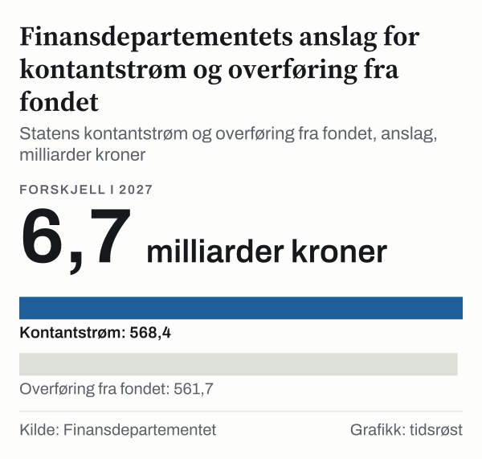
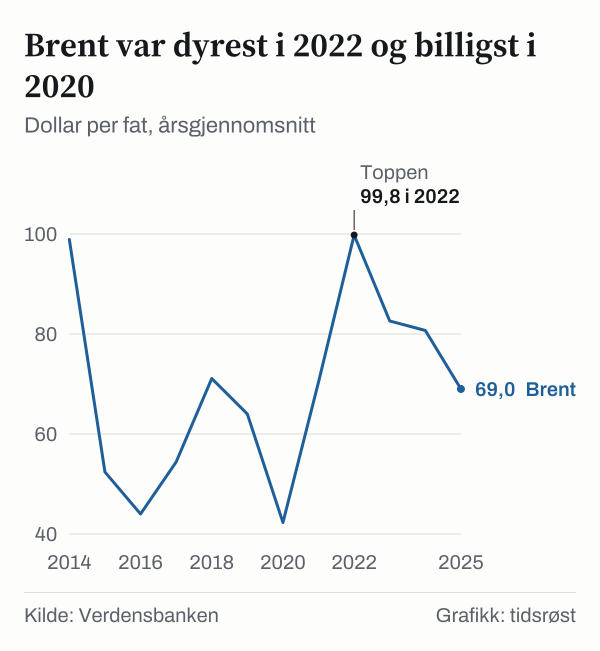

568 milliarder kroner mot 562 milliarder kroner. Det er to tall i Finansdepartementets budsjett for året 2027. Departementet la fram anslagene 7. oktober 2026. Statens netto kontantstrøm fra olje og gass anslås til 568,4 milliarder kroner i 2027, og overføringen fra Statens pensjonsfond utland til budsjettet til 561,7 milliarder kroner. Forskjellen mellom de to er 6,7 milliarder kroner.

I 2025 var tallene annerledes. Kontantstrømmen var 664,0 milliarder kroner. Overføringen fra fondet var 480,2 milliarder kroner, og 183,8 milliarder kroner ble satt av til fondet.

*Statens kontantstrøm og overføring fra fondet, anslag. Kilde: Finansdepartementet.*

Her setter vi tallene for oljeprisen, statens kontantstrøm og fondet ved siden av hverandre. Serien starter i 2014 og går fram til Finansdepartementets anslag. Oljeprisen og kontantstrømmen gikk i samme retning i de fleste årene, men ikke i samme omfang. Hva som ligger mellom dem, viser ikke tallene alene.

## 2014–2019: kurvene går stort sett sammen

Brent kostet 98,9 dollar per fat i 2014. Det er Verdensbankens årsgjennomsnitt. I 2015 var prisen 52,4 dollar, og det er 47,0 prosent lavere enn året før. I 2016 var prisen 44,0 dollar, og det er 16,0 prosent lavere enn i 2015.

Statens netto kontantstrøm fra petroleumsvirksomheten, regnet i faste kroner med prisnivået i 2027, var 449,1 milliarder kroner i 2014. Den var 314,1 milliarder kroner i 2015, og det er 30,1 prosent lavere enn året før. Den var 177,3 milliarder kroner i 2016, og det er 43,5 prosent lavere enn i 2015. Av disse to årene falt prisen mest i 2015, og kontantstrømmen mest i 2016.

*Dollar per fat, årsgjennomsnitt. Kilde: Verdensbanken.*

Kontantstrømmen er statens inntekter fra petroleumsvirksomheten minus utgiftene til den, slik Finansdepartementet viser den i budsjettet. Det er ikke det samme som prisen på olje. Likevel gikk de to i samme retning de neste årene. Prisen var 54,4 dollar i 2017, og det er 23,6 prosent høyere enn året før. Den var 71,1 dollar i 2018, og det er 30,7 prosent høyere enn i 2017. Kontantstrømmen var 233,6 milliarder kroner i 2017, og det er 31,7 prosent høyere enn året før. Den var 340,9 milliarder kroner i 2018, og det er 46,0 prosent høyere enn i 2017.

Året 2019 gikk ikke i takt. Prisen falt 10,0 prosent til 64,0 dollar, mens kontantstrømmen økte 0,6 prosent til 342,8 milliarder kroner. Det er det eneste året i 2014–2025 der de to gikk hver sin vei. Tallene sier ikke hvorfor.

## 2020–2025: bunnen, toppen og nedtrappingen

Oljeprisen var lavest i 2020, med 42,3 dollar per fat for Brent. Prisen var 33,9 prosent lavere enn året før. Kontantstrømmen falt 58,9 prosent til 140,8 milliarder kroner. Året etter var prisen 70,4 dollar, og det er 66,4 prosent høyere. Kontantstrømmen var 362,0 milliarder kroner, og det er 157,1 prosent høyere.

Toppen kom i 2022. Prisen var da 99,8 dollar, og det er 41,8 prosent høyere enn året før og det høyeste årsgjennomsnittet i serien. Kontantstrømmen var 1 498,1 milliarder kroner, og det er 313,9 prosent høyere. I 2020–2022 ble prisen 2,4 ganger så høy, mens kontantstrømmen ble 10,6 ganger så stor.

*Netto kontantstrøm, faste kroner. Kilde: Finansdepartementet og Statistisk sentralbyrå (via norskpetroleum.no).*

Brent var 82,6 dollar i 2023, og prisen var 17,2 prosent lavere enn året før. Den var 80,7 dollar i 2024, og det er 2,3 prosent lavere enn i 2023. Den var 69,0 dollar i 2025, og det er 14,5 prosent lavere enn i 2024.

Kontantstrømmen var 1 095,0 milliarder kroner i 2023, og det er 26,9 prosent lavere enn året før. Den var 763,6 milliarder kroner i 2024, og det er 30,3 prosent lavere enn i 2023. Den var 703,1 milliarder kroner i 2025, og det er 7,9 prosent lavere enn i 2024.

Sammensetningen i 2025 var slik: skatter på 395,7 milliarder kroner, netto kontantstrøm fra statens direkte økonomiske engasjement (SDØE) på 260,9 milliarder kroner og utbytte på 36,7 milliarder kroner. Skattene utgjorde 56,3 prosent, SDØE 37,1 prosent og utbyttet 5,2 prosent. Resten er mindre poster.

## Fra kontantstrøm til fond: regnestykket for året 2025

Finansdepartementet viser regnestykket i en tabell over nøkkeltall i nasjonalbudsjettet. I 2025 var statens inntekter fra petroleumsvirksomheten 692,7 milliarder kroner og utgiftene 28,7 milliarder kroner. Forskjellen er kontantstrømmen på 664,0 milliarder kroner.

Budsjettet utenom petroleum hadde et underskudd. Det kalles det oljekorrigerte underskuddet, og det dekkes av en overføring fra Statens pensjonsfond utland. Overføringen var 480,2 milliarder kroner i 2025. Kontantstrømmen minus overføringen er 183,8 milliarder kroner, og det er beløpet departementet fører som netto avsetning til fondet.

Samme kontantstrøm vises som 664,0 milliarder kroner i budsjettets tabell og som 703,1 milliarder kroner i serien over. Tallene er ikke direkte sammenlignbare: serien fra norskpetroleum.no er oppgitt i faste kroner med prisnivået i 2027, og budsjettets tabell oppgir ikke prisnivå for denne raden.

## Anslagene for de to neste årene

Anslagene i dette avsnittet er Finansdepartementets. Prosentene og forskjellene er våre egne utregninger fra dem. De ble lagt fram 7. oktober 2026. Departementet la dem fram sammen med nasjonalbudsjettet. Vi har ikke gjort egne anslag.

Anslaget for året 2026 er petroleumsinntekter på 706,1 milliarder kroner, utgifter på 35,5 milliarder kroner og en kontantstrøm på 670,6 milliarder kroner. Overføringen fra fondet anslås til 454,8 milliarder kroner. For året 2027 er anslagene 603,4 milliarder kroner i inntekter, 35,0 milliarder kroner i utgifter, 568,4 milliarder kroner i kontantstrøm og 561,7 milliarder kroner i overføring.

Inntektene er 14,5 prosent lavere i 2027 enn i 2026. Det tilsvarer 102,7 milliarder kroner lavere inntekter. Kontantstrømmen er 15,2 prosent lavere, og det er 102,2 milliarder kroner lavere. Overføringen fra fondet er 23,5 prosent høyere, og det er 106,9 milliarder kroner høyere. Hvis anslagene holder, er forskjellen mellom kontantstrømmen og overføringen 6,7 milliarder kroner i 2027. For året 2026 er den tilsvarende forskjellen 215,8 milliarder kroner.

*Finansdepartementets anslag for året 2027. Kilde: Finansdepartementet.*

Departementet oppgir det strukturelle, oljekorrigerte underskuddet til 608,4 milliarder kroner i 2027. Finansdepartementet anslår fondets verdi til 22 400 milliarder kroner ved begynnelsen av året 2027, og det strukturelle underskuddet er 2,7 prosent av den verdien. Anslaget for året 2026 er et strukturelt underskudd på 583,4 milliarder kroner mot en fondsverdi på 21 258 milliarder kroner ved begynnelsen av året, og det gir også 2,7 prosent. Det strukturelle underskuddet er 101,0 milliarder kroner høyere i 2027 enn i 2025.

## Fondet i Finansdepartementets tall

Fondet er det siste leddet i departementets regnestykke. Finansdepartementet oppgir fondets markedsverdi ved begynnelsen av året. Den var 19 735 milliarder kroner ved begynnelsen av året 2025. Departementet anslår 22 400 milliarder kroner ved begynnelsen av året 2027, og det er 2 665 milliarder kroner mer.

Det strukturelle, oljekorrigerte underskuddet var 507,4 milliarder kroner i 2025, regnet i løpende kroner. Det strukturelle underskuddet er 2,6 prosent av fondets verdi ved begynnelsen av året 2025. Andelen for året 2027 er 2,7 prosent, regnet av Finansdepartementets anslag.

Samme tabell viser renteinntekter og utbytte i fondet, uten valutagevinster og valutatap. Beløpet var 444,4 milliarder kroner i 2025, og det er 2,4 ganger så mye som netto avsetning til fondet på 183,8 milliarder kroner. Finansdepartementets anslag for året 2027 er renteinntekter og utbytte på 493,7 milliarder kroner. Den anslåtte netto avsetningen til fondet samme år er 6,7 milliarder kroner.

Tabellen viser ikke fondets samlede avkastning, og vi sier ikke noe om hvordan avkastningen har utviklet seg. Vi viser bare hva Finansdepartementet selv oppgir om verdi, uttak og løpende inntekter i fondet.

## To måter å lese kurvene på

Den første lesningen er at prisen og kontantstrømmen gikk i samme retning i de fleste årene. I ti av elleve år gikk de i samme retning. De store svingningene i 2020, i 2021 og i 2022 kom samtidig i begge seriene.

Den andre lesningen er at kontantstrømmen svinger mer enn prisen. Det gjelder i åtte av de elleve årene, og forskjellen er størst i 2022.

Begge lesningene bygger på to serier som ikke er målt likt. Brent er i dollar og løpende priser. Kontantstrømmen er i kroner og faste priser med prisnivået i 2027. Norskpetroleum.no beskriver serien som realisert netto kontantstrøm, med betalte skatter justert for refusjon av letekostnader. Et prosenttall for prisen og et for kontantstrømmen er derfor ikke direkte sammenlignbare. Forholdstallene 2,4 ganger og 10,6 ganger skal leses som to beskrivelser av samme periode, ikke som en regel for sammenhengen mellom dem.

## Grensene for sammenligningen

Tallene i denne analysen kommer fra tre kilder. Finansdepartementet beskriver sammenhengen mellom kontantstrøm, overføring og avsetning. For prisen og kontantstrømmen viser vi bare at de to seriene beveget seg samtidig.

Tallene viser ikke hvorfor prisen og kontantstrømmen gikk hver sin vei i 2019. Prisen er et årsgjennomsnitt, og et årsgjennomsnitt skjuler svingninger innenfor året.

Renteinntekter og utbytte i fondet er oppgitt uten valutagevinster og valutatap. De er derfor ikke det samme som fondets avkastning, og de forklarer ikke hvordan verdien endret seg fra år til år.

Anslagene er departementets og kan endres. Vi har ikke vurdert dem, og vi sier ikke noe om hva som er rimelig å vente av olje- og gasspriser eller av fondets avkastning. Det ligger utenfor det tallene her kan belyse.

## Slik regnet vi

Oljeprisen i analysen er Verdensbankens årsgjennomsnitt i nominelle dollar fra Pink Sheet. Statens netto kontantstrøm er fra norskpetroleum.no, basert på tall fra Finansdepartementet og Statistisk sentralbyrå, regnet om til faste kroner med prisnivået i 2027. Tallene for budsjettet, anslagene, overføringene og fondets verdi og løpende inntekter er fra Finansdepartementets nøkkeltabell for nasjonalbudsjettet.

Prosentvise endringer er regnet fra året før til året. Forholdstallene er regnet ved å dele verdien i 2022 på verdien i 2020. Andelene av kontantstrømmen i 2025 er hver post delt på summen. Forskjellen mellom kontantstrøm og overføring er overføringen trukket fra kontantstrømmen. Bruken av fondet i prosent er det strukturelle underskuddet delt på fondets verdi ved begynnelsen av året. Forholdstall for renteinntekter og utbytte er beløpet delt på netto avsetning. Alle tall er hentet 23. oktober 2026.

## Kilder

- [Verdensbanken: Commodity price data (Pink Sheet), årlige priser](https://www.worldbank.org/en/research/commodity-markets)
- [norskpetroleum.no: Statens inntekter fra petroleumsvirksomheten](https://www.norskpetroleum.no/en/economy/governments-revenues/)
- [Finansdepartementet: Nøkkeltall i nasjonalbudsjettet og statsbudsjettet](https://www.regjeringen.no/en/whats-new/a-responsible-budget-that-keeps-norway-secure-in-uncertain-times/id3174614/)
- [Finansdepartementet: Oljekorrigert budsjettunderskudd](https://www.regjeringen.no/no/tema/okonomi-og-budsjett/statsbudsjett/ord-og-begreper-i-statsbudsjettet/oljekorrigert-budsjett/id2860069/)
