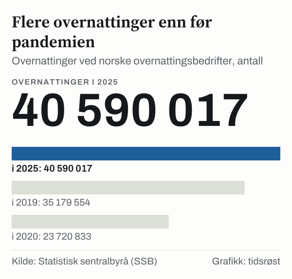

Det ble registrert 40,6 millioner overnattinger ved norske hoteller, campingplasser, hyttegrender og vandrerhjem i 2025, viser overnattingsstatistikken fra Statistisk sentralbyrå (SSB). Det er 5,2 prosent flere enn i 2024, da tallet var 38,6 millioner, og ifølge SSB første gang tallet passerer 40 millioner. Det meste av økningen kom fra utenlandske gjester: De sto for 14,2 millioner overnattinger, 14,0 prosent flere enn året før.

## Hvem som overnattet

Norske gjester sto for 26,4 millioner overnattinger i 2025, 65,1 prosent av totalen og 1,0 prosent flere enn i 2024. Utenlandske gjester økte fra 12,4 millioner i 2024 til 14,2 millioner i 2025. Av økningen på rundt 2,0 millioner overnattinger kom om lag 1,7 millioner fra utenlandske gjester.

*Overnattinger etter gjestenes bosted, 2016–2025, summert fra månedstall. Kilde: SSB, tabell 14162.*

## Hvor gjestene bodde

Hotellene sto for 69,4 prosent av overnattingene i 2025, campingplassene for 20,7 prosent og hyttegrender og vandrerhjem for 9,9 prosent. Hotellovernattingene økte med 5,3 prosent fra 2024, campingovernattingene med 5,7 prosent og overnattingene i hyttegrender og vandrerhjem med 3,2 prosent.

*Overnattinger etter type overnattingsbedrift i 2025. Kilde: SSB, tabell 14162.*

| Kategori | 2023 (mill.) | 2024 (mill.) | 2025 (mill.) | Endring 2024–2025 |
|---|---:|---:|---:|---:|
| Hoteller og lignende | 25,3 | 26,7 | 28,2 | +5,3 % |
| Campingplasser | 7,9 | 8,0 | 8,4 | +5,7 % |
| Hyttegrender og vandrerhjem | 3,8 | 3,9 | 4,0 | +3,2 % |
| **Overnattinger i alt** | **37,0** | **38,6** | **40,6** | **+5,2 %** |
| – Herav norske gjester | 25,9 | 26,2 | 26,4 | +1,0 % |
| – Herav utenlandske gjester | 11,1 | 12,4 | 14,2 | +14,0 % |

*Kilde: SSB, tabell 14162. Tallene er summert fra månedstall og avrundet.*

## Over tid

I 2019, før pandemien, var det 35,2 millioner overnattinger. I 2020 falt tallet til 23,7 millioner, og antallet utenlandske gjestedøgn var 3,3 millioner, mot 10,7 millioner året før. Siden har tallet økt hvert år, til 36,1 millioner i 2022, 37,0 millioner i 2023, 38,6 millioner i 2024 og 40,6 millioner i 2025.

*Overnattinger i alt ved hoteller, campingplasser, hyttegrender og vandrerhjem. Kilde: SSB, tabell 14162.*

I de åtte første månedene av 2026 ble det registrert 31,0 millioner overnattinger, 2,3 prosent flere enn i samme periode i 2025 (30,3 millioner).

## Hva tallene ikke viser

Statistikken teller overnattinger, ikke personer: En gjest som bor tre netter, gir tre overnattinger. Tallene gjelder hoteller, campingplasser, hyttegrender og vandrerhjem; andre former for utleie inngår ikke i denne tabellen.

## Kilder

- [SSB: Rekordmange overnattingar i 2025](https://www.ssb.no/transport-og-reiseliv/reiseliv/statistikk/overnattingar/artikler/rekordmange-overnattingar-i-2025)
- [SSB Statistikkbanken: Tabell 14162 – Overnattingar etter region, innkvarteringstype og bustadland](https://www.ssb.no/statbank/table/14162)
