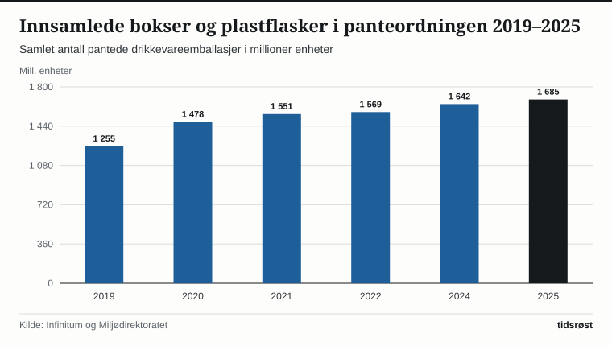
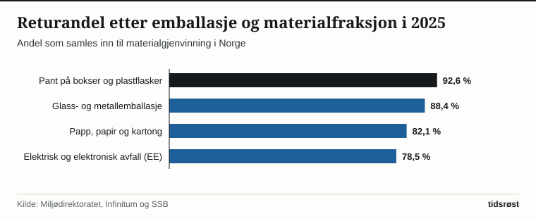

Den norske panteordningen er et internasjonalt forbilde innen sirkulær økonomi, og delegasjoner fra en rekke land besøker hvert år Norge for å kopiere modellen. I løpet av 2025 pantet innbyggerne i Norge 1 685 millioner aluminiumsbokser og plastflasker gjennom returselskapet Infinitum, viser tall rapportert til Miljødirektoratet.

Det tilsvarer i gjennomsnitt rundt 300 pantede flasker og bokser per innbygger i året, og gir en samlet returandel på 92,6 prosent. All innsamlet aluminium og klar plast fra panteautomatene går direkte til materialgjenvinning og blir til nye bokser og flasker.

## Miljøavgift som belønner samarbeid i dagligvarebransjen

Hemmeligheten bak den høye returandelen ligger i utformingen av den norske miljøavgiften på drikkevareemballasje. Staten legger i utgangspunktet en særavgift på hver eneste flaske og boks som selges, men avgiften reduseres trinnvis jo høyere returandel bransjen oppnår. Dersom 95 prosent eller mer av emballasjen samles inn, slipper produsentene og butikkene miljøavgiften helt.

*Innsamlede bokser og plastflasker i panteordningen (millioner enheter), 2019–2025. Kilde: Infinitum og Miljødirektoratet.*

Denne mekanismen har gjort det lønnsomt for drikkevareprodusentene og dagligvarekjedene å bygge ut et finmasket nett av over 3 800 panteautomater og mer enn 11 000 manuelle returpunkter over hele landet.

## Høy gjenvinning av glass, metall, papir og elektronikk

Også utenfor panteautomatene har Norge velutbygde produsentansvarsordninger for emballasje og elektronisk utstyr:

| Avfalls- og emballasjefraksjon | Retur- / gjenvinningsandel | Hva skjer med materialet? |
|---|---:|---|
| Pantebart metall og plast (Infinitum) | 92,6 % | Smeltes og granuleres til nye bokser og flasker |
| Glassemballasje og metall (Sirkel) | 88,4 % | Ny glassemballasje, skumglass til byggebransjen og nytt metall |
| Papp, papir og drikkekartong | 82,1 % | Nye papirprodukter, bølgepapp og tørkepapir |
| Elektrisk og elektronisk avfall (EE) | 78,5 % | Miljøsanering og utvinning av kobber, aluminium og edle metaller |

*Kilde: Miljødirektoratet, Infinitum, Sirkel og SSB (tabell 10513).*

Gjennom forhandlerplikten har alle norske forbrukere dessuten rett til å levere kasserte elektriske produkter – fra lyspærer og mobiltelefoner til vaskemaskiner – helt gratis tilbake til butikker som selger tilsvarende utstyr.

*Innsamlings- og gjenvinningsgrad for utvalgte materialfraksjoner i 2025. Kilde: Miljødirektoratet og SSB.*

## Nye krav til matavfall og tekstiler i alle kommuner

Ifølge Statistisk sentralbyrå (SSB) oppsto det rundt 2,3 millioner tonn husholdningsavfall i Norge i 2025. Etter at skjerpede regler i avfallsforskriften trådte i kraft, har kommunene og de interkommunale avfallsselskapene bygget ut separat innsamling eller sentral ettersortering av både matavfall og plastavfall over hele landet, samt nye innsamlingsordninger for tekstilavfall fra 2025.

Det utsorterte matavfallet fra husholdningene og storkjøkkenene benyttes til produksjon av klimanøytral biogass til bybusser og lastebiler, samtidig som næringsrik biogjødsel tilbakeføres til norsk landbruksjord.

## Kilder

- [SSB: Avfall fra husholdninger – mengder og gjenvinning](https://www.ssb.no/natur-og-miljo/avfall/statistikk/avfall-fra-husholdninger)
- [SSB Statistikkbanken: Tabell 10513 – Husholdningsavfall etter behandlingsmåte og materialtype](https://www.ssb.no/statbank/table/10513)
- [Miljødirektoratet: Emballasje, produsentansvar og avfallsstatistikk](https://www.miljodirektoratet.no/ansvarsomrader/avfall/)
- [Infinitum: Årsrapporter og nøkkeltall for panteordningen i Norge](https://infinitum.no/om-oss/arsrapporter/)
