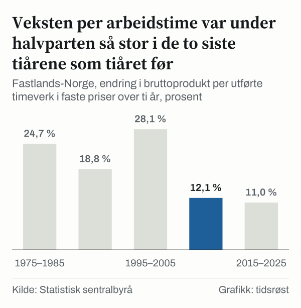
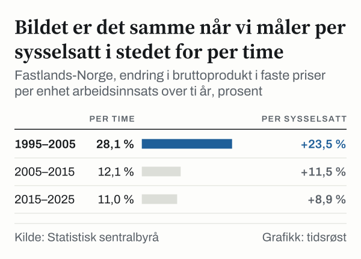

11,0 prosent. Så mye mer verdi skapte hver arbeidstime i Fastlands-Norge i 2025 enn ti år tidligere, regnet i faste priser. I tiåret 1995–2005 var tallet 28,1 prosent.

Produktivitet er et stort ord for en enkel ting: hvor mye som blir produsert for hver time noen jobber. Når tallet øker, kan økonomien vokse uten at folk må jobbe flere timer. Det er den delen av veksten som ikke handler om flere hender eller lengre arbeidsdager.

Tallet er fulgt i perioden 1970–2025, med ett spørsmål: når endret veksten seg? I Statistisk sentralbyrås nasjonalregnskap (SSB) ligger svaret like etter året 2005. Før det kom en lang rekke tiår med solid økning. Etterpå har økningen i hvert av de to tiårene vært under halvparten så stor.

Det gjelder hele økonomien utenom olje, gass og utenriks sjøfart, og det gjelder både per time, per sysselsatt og i flere næringer. Teksten viser hvordan vi har kommet fram til det, og sier like tydelig hva tallene ikke kan forklare.

## Hva tallet måler, og hva det holder utenfor

Utgangspunktet er bruttoprodukt i basisverdi, altså verdien av det næringene produserer minus det de bruker av varer og tjenester underveis. Tallet er målt i faste priser, der alle år er regnet i prisene fra året 2023. Da forsvinner prisstigningen fra sammenligningen, og det som er igjen, er volum.

Dette volumet deler vi på utførte timeverk for lønnstakere og selvstendige. I 2025 utgjorde det 4120,9 millioner timeverk. Vi bruker timer og ikke antall personer, fordi to personer i ulike stillinger kan jobbe svært ulikt antall timer i løpet av et år.

Fastlands-Norge er SSBs betegnelse for økonomien uten utvinning av råolje og naturgass, rørtransport og utenriks sjøfart. Avgrensingen gjør tallene lettere å sammenligne over tid.

Tabellen hos SSB oppgir bare årlig prosentendring i produktivitet. Nivået har vi derfor regnet ut selv, ved å dele bruttoprodukt på timeverk. Slik får vi et tall i kroner per time som kan følges over hele perioden. Det er ikke SSBs egen publiserte størrelse, men en beregning som bygger på to av SSBs tabeller.

## 1970–1995: nivået stiger, takten varierer

Første stopp er året 1970. Da skapte hver arbeidstime i Fastlands-Norge 307 kroner i faste priser. Fem år senere var tallet 376 kroner, og i 1985 var det 469 kroner.

*Fastlands-Norge, bruttoprodukt per utførte timeverk, kroner per time i faste priser, hvert femte år. Kilde: Statistisk sentralbyrå.*

Nivået steg i alle de tre femårsperiodene fram til året 1985. I 1975–1985 økte verdien per time med 24,7 prosent. Det er et tall vi kan bruke som målestokk. Tiåret 1970–1980 ga 36,5 prosent regnet fra femårstallene, men det ligger utenfor de fem tiårene som sammenlignes. Tiåret ligger under tiåret 1995–2005, som vi kommer til.

Over hele serien er bildet klart. Nivået er 2,9 ganger så høyt i 2025 som i 1970. Verdiskapingen per time er dermed nesten tredoblet over femtifem år.

Økningen gikk ned i tiåret 1985–1995. Verdiskapingen per time økte med 18,8 prosent, mindre enn både tiåret før og tiåret etter. Nivået passerte 501 kroner i 1990 og kom til 557 kroner i 1995. Tallene sier ikke hva som lå bak. I tiåret etter ble økningen større igjen.

## 1995–2005: høyest økning av de fem tiårene som sammenlignes

Femårstallene gir 749 kroner i 2010. I 2020 er tallet 829 kroner. Tallene fra hvert femte år gir et grovere bilde enn de årlige, men viser samme retning.

Av de fem tiårene som sammenlignes her, er 1995–2005 det med høyest økning. Verdi per time økte med 28,1 prosent, og nivået gikk fra 557 til 714 kroner. Ingen av de fem tiårene som sammenlignes har høyere vekst.

Årene i tiåret ser slik ut. I 2000 økte verdien per time med 3,8 prosent, i 2001 med 3,0 prosent, i 2003 med 3,5 prosent, i 2004 med 3,1 prosent og i 2005 med 3,4 prosent. I fem av de seks årene 2000–2005 var årsveksten tre prosent eller mer. Unntaket var året 2002, da veksten var 1,8 prosent.

Regnes de to tiårene 1985–2005 under ett, ble økningen 52,3 prosent. Det er drøyt halvannen gang så mye verdi per time som i 1985. Nivået i år 2000 lå på 617 kroner.

## Tiårene 2005–2025: under halvparten så stor økning

Så endrer bildet seg. I 2005–2015 økte verdien per time med 12,1 prosent, og i 2015–2025 med 11,0 prosent. Begge tiårene ligger under halvparten av økningen i tiåret 1995–2005.

*Fastlands-Norge, endring i bruttoprodukt per utførte timeverk i faste priser over ti år, prosent. Kilde: Statistisk sentralbyrå.*

Veksten var 3,4 prosent i 2005, 1,9 prosent i 2006 og 1,3 prosent i 2007. Årsveksten var −0,8 prosent i 2008 og 0,4 prosent i 2009.

I 2006–2025 har verdien per time økt i atten av tjue år. I årene 2006–2025 har ingen enkeltår nådd tre prosent. Den høyeste årsveksten, 2,3 prosent, kom tre ganger: i 2013, i 2021 og i 2022. Årsveksten var −0,8 prosent i 2008 og −0,8 prosent i 2020, pandemiåret.

Ved utgangen av perioden lå nivået på 888 kroner per time i 2025, mot 714 kroner i 2005. Økningen over de siste tjue årene, 24,4 prosent, er under halvparten av økningen over de tjue årene 1985–2005.

## Næring for næring: samme tall, ulike historier

Totaltallet er et samlet resultat for mange næringer. Det samme tallet er regnet for sju næringer i de to tiårene 2005–2025, og seks av dem vises i diagrammet.

*Endring i bruttoprodukt per utførte timeverk i faste priser, prosent. Kilde: Statistisk sentralbyrå.*

Av de sju næringene hadde informasjon og kommunikasjon og varehandel høyest vekst i begge tiårene, i den ene eller den andre rekkefølgen. Verdi per time i varehandel økte med 33,2 prosent i 2005–2015 og 26,1 prosent i 2015–2025. Informasjon og kommunikasjon hadde enda høyere vekst i det første tiåret, 39,0 prosent, men 16,7 prosent i det andre. Varehandel, informasjon og kommunikasjon og industri hadde alle lavere vekst i det siste tiåret enn i det første. Veksten i industrien var 14,6 prosent i det første tiåret og 5,2 prosent i det andre.

Bygg og anlegg er den eneste av de sju næringene med nedgang i begge tiårene. Verdien per time falt med 8,0 prosent i det første tiåret og med 4,9 prosent i det andre. Transport utenom utenriks sjøfart økte med 20,6 prosent i det første tiåret og falt med 14,4 prosent i det andre.

Faglig tjenesteyting falt med 2,6 prosent i det første tiåret. I det andre økte den med 14,5 prosent. Overnatting og servering økte med 2,1 prosent og 6,9 prosent. De to næringene hadde høyere vekst i det siste tiåret enn i det første.

Nivåene er ulike også. I 2025 var verdien per time 1082 kroner i informasjon og kommunikasjon, 875 kroner i industrien og 757 kroner i varehandel. Av de tre næringene lå informasjon og kommunikasjon høyest og varehandel lavest. Bygg og anlegg lå på 621 kroner. Faglig tjenesteyting lå på 870 kroner, transport på 638 kroner og overnatting og servering på 508 kroner. Nivåene sier hvor mye verdi hver time gir i næringen, og de er ikke direkte sammenlignbare mellom næringer med ulikt innhold, men de gir en ramme for å lese vekstratene.

Hva som ligger bak forskjellene, er ikke undersøkt. Næringene hadde svært ulik utvikling i de to tiårene.

## En annen måte å regne på: per sysselsatt

Timer er ikke det eneste mulige mål. Bruttoproduktet kan også deles på antall sysselsatte personer. Da ser tallene slik ut.

*Fastlands-Norge, endring i bruttoprodukt i faste priser per enhet arbeidsinnsats over ti år, prosent. Kilde: Statistisk sentralbyrå.*

Mønsteret er det samme: sterkest vekst i 1995–2005, og klart svakere i de to neste tiårene. Per sysselsatt var økningen 23,5 prosent i det første tiåret, 11,5 prosent i det andre og 8,9 prosent i det siste.

Per sysselsatt var bruttoproduktet 818,6 tusen kroner i 1995. Tallet var 1011,3 tusen i 2005. I 2015 var det 1127,7 tusen. I 2025 var det 1228,4 tusen kroner.

Forskjellen mellom de to målene har en enkel kilde. Hver sysselsatt utførte i gjennomsnitt 1416,5 timeverk i 2005. I 2025 var tallet 1383,1 timeverk. Antall timer per sysselsatt gikk dermed ned med 2,4 prosent, og veksten per time ligger over veksten per sysselsatt i hvert av de tre tiårene.

Det er også verdt å se på hvor sterkt tiåret 1995–2005 står. Tre tiår ligger i serien før året 2005: 24,7 prosent, 18,8 prosent og 28,1 prosent. De to siste tiårene ligger under alle tre.

## Det tallene ikke kan avgjøre

Analysen sier når kurven endret takt. Den sier ikke hvorfor, og det er ikke forsøkt forklart. Et årstall i en tabell er en måling, ikke en årsak.

SSB oppgir i en merknad til tabellen om lønn, sysselsetting og produktivitet at tallene etter basisåret er «foreløpige». Det betyr at nivået for året 2025 og tiårsendringen 2015–2025 bygger på foreløpige tall. Resten gjelder slik tabellene så ut 23. oktober 2026, og de er ikke kontrollert mot andre kilder enn SSBs egne tabeller.

Inndelingen betyr også noe. Her er hele tiår sammenlignet med året 2025 som endepunkt, og nivået er i tillegg vist for hvert femte år. En annen inndeling ville gitt andre tiårstall, men hovedlinjen ligger fast. Til slutt måler tallene verdi i faste priser, ikke i kroner slik de var verdt det enkelte år.

Små tall har også grenser for hvor presist de kan leses. Årsveksten i 2007 var 1,3 prosent, og i 2006 var den 1,9 prosent. Forskjellen er liten, og den tåler ikke å tolkes sterkt hver for seg. Tallene er målt med én desimal og avrundet. Verdi i faste priser sier heller ikke noe om hva den enkelte tjener eller hvordan verdiene fordeles. Analysen bruker bare tall fra SSB og setter ikke egne tall på noe som ikke er målt ennå.

## Slik regnet vi

Bruttoprodukt i basisverdi i faste priser er hentet fra SSBs tabell over produksjon og inntekt etter næring. Utførte timeverk og sysselsatte personer er hentet fra tabellen over lønn, sysselsetting og produktivitet etter næring. Begge gjelder Fastlands-Norge og utvalgte næringer, og tallene ble hentet 23. oktober 2026.

Nivået per time er bruttoprodukt delt på timeverk. Tiårsendringene er prosentvis endring mellom nivået i to år. Den årlige veksten er SSBs egen prosentendring i tabellen over produktivitet. Per sysselsatt er bruttoproduktet delt på antall sysselsatte personer, lønnstakere og selvstendige, og timeverk per sysselsatt er timeverk delt på sysselsatte. Næringene er SSBs egne grupper i tabellen.

## Kilder

- [SSB: Lønn, sysselsetting og produktivitet, etter næring](https://www.ssb.no/statbank/table/09174)
- [SSB: Produksjon og inntekt, etter næring](https://www.ssb.no/statbank/table/09170)
- [SSB: Nasjonalregnskap](https://www.ssb.no/nasjonalregnskap-og-konjunkturer/nasjonalregnskap/statistikk/nasjonalregnskap)
